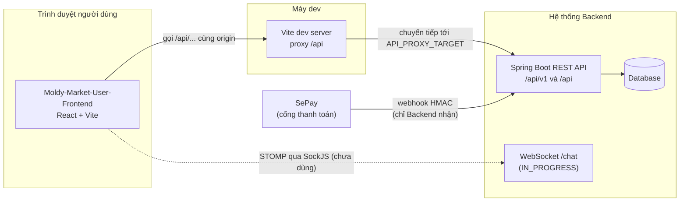

# 01 - Project Overview (Tổng quan dự án)

> **Trạng thái:** BẢN NHÁP v0.1
> **Cập nhật:** 2026-11-08
> **Áp dụng cho:** `Moldy-Market-User-Frontend`
> **Mục đích:** Giới thiệu Moldy Market là gì, ai dùng, Frontend này chịu trách nhiệm phần nào, Backend đã có gì, và mọi tài liệu khác nên được đọc theo thứ tự nào.

Quy ước nhãn dùng xuyên suốt bộ tài liệu:

| Nhãn | Ý nghĩa |
|---|---|
| `[ĐÃ XÁC MINH BACKEND]` | Thông tin có trong doc 14, rút từ việc đọc source code Backend. |
| `[ĐÃ CẤU HÌNH]` | Đã thực sự có trong repo Frontend (công cụ, cấu hình, thư mục). |
| `[ĐỀ XUẤT]` | Kiến trúc Frontend dự kiến, **chưa có code**. Có thể thay đổi sau khi team review. |

> Hiện tại repo chỉ có phần nền (công cụ, cấu hình, cấu trúc thư mục, design tokens, i18n). **Chưa có trang, router, service, hook hay store nào.** Mọi thứ thuộc lớp ứng dụng trong bộ tài liệu này là `[ĐỀ XUẤT]`.

---

## 1. Moldy Market là gì

Moldy Market là một sàn thương mại điện tử **C2C (consumer to consumer) chuyên đồ cũ**: người dùng bình thường đăng bán đồ đã qua sử dụng, và người khác mua lại. Ngoài người bán cá nhân, hệ thống còn có **gian hàng (store)** để một người bán nhiều sản phẩm, có thể thêm nhân viên (staff) cùng quản lý.

Đây là **đồ án tốt nghiệp** của một nhóm sinh viên. Backend (Spring Boot) và Frontend (React) được làm song song bởi các thành viên khác nhau, nên việc ghi lại chính xác "Backend hiện có gì" (doc 14) quan trọng không kém việc viết code.

### 1.1 Vấn đề sản phẩm muốn giải quyết

Đồ cũ khó mua bán vì thiếu tin cậy: không biết giá có hợp lý không, tình trạng thật ra sao, người bán có đáng tin không, thanh toán xong có nhận được hàng không. Theo các tài liệu thiết kế của team, hệ thống hướng tới giải quyết bằng các cơ chế sau. **Chỉ phần ghi `IMPLEMENTED` ở mục 4 là đã có code Backend trên `main`**; các cơ chế còn lại là ý định thiết kế:

- Định giá hỗ trợ (auto pricing, appraiser/thẩm định viên, giá tham chiếu): phần Backend nằm ở branch chưa merge.
- Thanh toán an toàn qua escrow (giữ tiền, giải ngân sau): phần Backend nằm ở branch chưa merge, và chưa nối với order thật (doc 14, B7).
- Thương lượng giá (offer): chưa có code ở bất kỳ branch nào (`NOT_FOUND`).
- Đánh giá, theo dõi gian hàng, wishlist: chưa có code (`NOT_FOUND`).

Frontend **không được** trình bày một cơ chế như thể nó đã hoạt động khi Backend chưa có.

---

## 2. Người dùng và vai trò

Backend định nghĩa 5 tên role `[ĐÃ XÁC MINH BACKEND]`: `USER`, `APPRAISER`, `STAFF`, `ADMIN`, `OWNER`. Việc gán role **gắn theo từng gian hàng** (`UserRole(user_id, role_id, store_id)`).

Bảng dưới là cách **Frontend này** nhìn các nhóm người dùng. Cột "Role Backend" là điều đã xác minh; cột "Ghi chú" là cách dùng trong giao diện.

| Nhóm người dùng | Role Backend | Làm được gì trong User Frontend | Ghi chú |
|---|---|---|---|
| Khách (chưa đăng nhập) | không có | Xem trang chủ, tìm kiếm, xem sản phẩm, danh mục, trang gian hàng | Các endpoint đọc công khai: category, product, store theo id `[ĐÃ XÁC MINH BACKEND]`. |
| Người dùng thường | `USER` | Hồ sơ, đổi mật khẩu, đăng tin cá nhân, mở gian hàng; mua hàng, giỏ hàng, chat, notification khi Backend merge | Một user vừa mua vừa bán được, không có role riêng "buyer" hay "seller". |
| Chủ gian hàng | `OWNER` (gắn `store_id`) | Store Dashboard: hồ sơ gian hàng, sản phẩm, staff | Mỗi user chỉ có một gian hàng (`STORE_002`). |
| Nhân viên gian hàng | `STAFF` (gắn `store_id`) | Phần của Store Dashboard theo quyền được chủ ủy quyền | Frontend chưa đọc được permission của chính mình (Q1). |
| Thẩm định viên | `APPRAISER` | Hàng đợi thẩm định giá | Toàn bộ là `IN_PROGRESS` (branch pricing). |
| Quản trị viên | `ADMIN` | **Không dùng User Frontend.** Dùng Admin Frontend (repo riêng). | Xem `Moldy-Market-Admin-Frontend`. |

> Ghi chú: Frontend không phải ranh giới bảo mật. Ẩn một nút chỉ để giao diện gọn; việc cho phép hay từ chối thật sự là của Backend (trả `403`).

---

## 3. Phạm vi của repo này

### 3.1 Hai ứng dụng Frontend độc lập

Dự án có **hai repo Frontend tách biệt, không chia sẻ code**:

| Repo | Đối tượng | Nội dung chính |
|---|---|---|
| `Moldy-Market-User-Frontend` (repo này) | Khách, người mua, người bán, chủ và staff gian hàng, thẩm định viên | Duyệt và tìm sản phẩm, đăng tin, quản lý gian hàng, (sau này) giỏ hàng, thanh toán, chat |
| `Moldy-Market-Admin-Frontend` | Quản trị viên | Quản lý user, gian hàng, kiểm duyệt sản phẩm, danh mục |

Lý do tách riêng `[ĐỀ XUẤT]`: hai ứng dụng có người dùng, bố cục, rủi ro bảo mật và nhịp phát hành khác nhau. Tách repo giúp bundle của người dùng không chứa mã quản trị, và mỗi bên deploy độc lập. Đổi lại, các phần chung (design tokens, quy ước) bị lặp ở hai nơi; hai repo phải được đối chiếu định kỳ (nằm trong roadmap, doc 13).

### 3.2 Việc Frontend làm và không làm

| Frontend LÀM | Frontend KHÔNG làm |
|---|---|
| Hiển thị dữ liệu Backend trả về | Tự tính giá, tổng tiền, phí để quyết định số tiền thanh toán (Backend tính, doc 14 mục 5.7) |
| Kiểm tra form để người dùng sửa lỗi sớm (validation phía client) | Coi validation phía client là bảo mật (Backend vẫn kiểm tra lại) |
| Ẩn/hiện menu theo role để giao diện gọn | Quyết định ai được làm gì (`403` của Backend là quyết định cuối) |
| Hiển thị QR thanh toán từ `qrBankUrl` do Backend trả | Tự dựng QR, hoặc tự tuyên bố "thanh toán thành công" (chỉ tin `paymentStatus === "SUCCESSFUL"`) |
| Ánh xạ mã lỗi (`code`) sang câu thông báo i18n | Hiển thị nguyên văn `message` tiếng Anh của Backend |
| Polling trạng thái thanh toán (Backend chưa có kênh push) | Tự suy luận trạng thái order từ đồng hồ đếm ngược |

---

## 4. Các module và tình trạng Backend

Bảng tóm tắt từ doc 14 (xem doc 14 mục 4 để có endpoint chi tiết). `FE` là trạng thái phía Frontend; hiện tại mọi tính năng đều `NOT_STARTED`.

| Module | Trạng thái Backend | Ghi chú cho User Frontend | FE |
|---|---|---|---|
| Xác thực (đăng ký, đăng nhập, refresh, logout) | `IMPLEMENTED` | Lưu ý B10: user mới đăng ký chưa đăng nhập được (Q14) | `NOT_STARTED` |
| Hồ sơ cá nhân, đổi mật khẩu | `IMPLEMENTED` | | `NOT_STARTED` |
| Gian hàng (tạo, xem, sửa, trang công khai) | `IMPLEMENTED` | Mỗi user một gian hàng | `NOT_STARTED` |
| Staff của gian hàng | `IMPLEMENTED` (thêm trực tiếp bằng email), mời staff `PLANNED` | Cần quyền `STORE_STAFF_MANAGE` | `NOT_STARTED` |
| Danh mục (category) | `IMPLEMENTED` | Đọc công khai | `NOT_STARTED` |
| Sản phẩm (tạo, sửa, xóa, đổi trạng thái, tìm kiếm, gợi ý) | `IMPLEMENTED` | Update cần `version`; ảnh chỉ nhận URL https (Q5) | `NOT_STARTED` |
| Chiến lược định giá của sản phẩm | `PARTIALLY_IMPLEMENTED` | Chỉ `SELLER_SET` chắc chắn dùng được; `PROD_003` cho chiến lược chưa hỗ trợ | `NOT_STARTED` |
| Notification | `IN_PROGRESS` | Phân trang cursor, không có kênh push | `NOT_STARTED` |
| Chat (REST và WebSocket) | `IN_PROGRESS` | Chỉ giữa hai user, không gắn offer/order/product (Q6) | `NOT_STARTED` |
| Cart | `IN_PROGRESS` | `listingId` có phải `Product.id` hay không còn hỏi (Q7) | `NOT_STARTED` |
| Checkout, order (người mua), payment, SePay | `IN_PROGRESS` | B11, B12, B13, B14; tự bỏ `quantity` theo quyết định team | `NOT_STARTED` |
| Voucher, pricing, appraiser | `IN_PROGRESS` | Voucher chưa được áp dụng ở checkout | `NOT_STARTED` |
| Wallet, escrow, withdrawal | `IN_PROGRESS` | Trông như thao tác nội bộ; B2, Q4 | `NOT_STARTED` |
| Order phía người bán, offer, refund, dispute, wishlist, follow, review, thống kê, upload ảnh | `NOT_FOUND` / `REQUIRES_BUSINESS_CLARIFICATION` | Chỉ có skeleton `TODO`, không viết code API | `NOT_STARTED` |

Quy tắc phát triển rút từ doc 14 mục 1.2: chỉ dòng `IMPLEMENTED` mới được viết service gọi API thật; `IN_PROGRESS` chờ branch merge và doc 14 cập nhật; `PLANNED`/`NOT_FOUND` chỉ làm skeleton.

---

## 5. Công nghệ sử dụng `[ĐÃ CẤU HÌNH]`

Ngôn ngữ: **JavaScript** (không TypeScript), dùng JSDoc cho kiểu dữ liệu khi cần. Phiên bản lấy từ `package.json` (dạng `^` nên có thể nhích lên).

| Mảng | Công nghệ | Phiên bản | Vai trò |
|---|---|---|---|
| Runtime | Node.js | `>=22.12.0` (`.nvmrc` = 22) | Chạy công cụ build |
| Build | Vite, `@vitejs/plugin-react` | ^8.3.5, ^6.1.2 | Dev server, build, proxy `/api` |
| UI | React, react-dom | ^19.3.1 | Thư viện giao diện |
| Style | Tailwind CSS (qua `@tailwindcss/vite`) | ^4.3.4 | Utility CSS, cấu hình trong CSS, không có `tailwind.config.js` |
| Component | shadcn/ui (`radix-nova`), radix-ui, class-variance-authority, tw-animate-css, lucide-react | shadcn ^4.23.0 | Component nền, icon |
| Tiện ích class | clsx, tailwind-merge (hàm `cn` ở `src/lib/utils.js`) | | Gộp class Tailwind |
| Routing | react-router | ^7.18.5 | Điều hướng |
| HTTP | axios | ^1.21.0 | Gọi REST |
| Server state | @tanstack/react-query | ^5.105.3 | Cache và đồng bộ dữ liệu từ API |
| Client state | zustand | ^5.0.16 | Trạng thái giao diện cục bộ |
| Form | react-hook-form, zod, @hookform/resolvers | ^7.91.0, ^4.6.7, ^7.0.1 | Form và validation |
| i18n | i18next, react-i18next | ^26.7.1, ^17.1.11 | Đa ngôn ngữ (`vi`, `en`) |
| Chất lượng | ESLint (flat config), Prettier | ^10.13.0, ^3.9.10 | Lint, format |
| Font | @fontsource/be-vietnam-pro, @fontsource-variable/playfair-display | | Tự host font |

**Chưa cấu hình** (sẽ làm, xem doc 13): Vitest + React Testing Library, GitHub Actions CI, mẫu Pull Request, luật bảo vệ nhánh `main`, metadata `index.html`. Playwright E2E mới chỉ là kế hoạch. Husky và lint-staged không dùng.

Ghi chú: `npm audit` báo một cảnh báo mức moderate về `minimatch` thuộc chuỗi ESLint (devDependencies), chưa có bản vá từ upstream.

---

## 6. Ranh giới hệ thống

Điểm cần nhớ:

- Khi dev, trình duyệt gọi `/api/...` trên **cùng origin** với Vite; Vite chuyển tiếp tới Backend (`API_PROXY_TARGET`, mặc định `http://localhost:8080`). Lý do: Backend **chưa có CORS cho REST** (B1). `[ĐÃ CẤU HÌNH]`
- Khi production, hoặc phục vụ cùng origin với API, hoặc Backend phải thêm CORS (doc 12).
- Frontend **không bao giờ gọi** webhook SePay. Chỉ SePay gọi Backend.
- Không có kênh push cho notification và thanh toán; Frontend phải polling những chỗ cần.

---

## 7. Tình trạng hiện tại của repo

| Hạng mục | Trạng thái |
|---|---|
| Công cụ (Vite, React, Tailwind, shadcn, ESLint, Prettier) | `FOUNDATION_ONLY` `[ĐÃ CẤU HÌNH]` |
| Proxy `/api`, alias `@`, biến môi trường | `[ĐÃ CẤU HÌNH]`, đã thử gọi `/api/v1/categories` qua proxy |
| Design tokens và font | `[ĐÃ CẤU HÌNH]` (xem doc 03) |
| i18n (`vi`, `en`, namespace `common`) | `[ĐÃ CẤU HÌNH]` |
| Cấu trúc thư mục | `[ĐÃ CẤU HÌNH]` theo nghĩa thư mục tồn tại (nhiều thư mục chỉ có `.gitkeep`) |
| Component shadcn | Chỉ có `button` |
| Router, providers, layout, Axios instance, service, hook, store, schema | Chưa có, `[ĐỀ XUẤT]` |
| Trang | Chỉ có trang thử `App.jsx` (kiểm tra i18n và nút) |
| Test, CI | Chưa cấu hình |

---

## 8. Hướng dẫn đọc bộ tài liệu

| Bạn muốn... | Đọc |
|---|---|
| Hiểu kiến trúc, thư mục, quy tắc phụ thuộc | 02 |
| Xem màu, font, component UI, responsive | 03 |
| Biết có những route/trang nào | 04, 05 |
| Biết cách tổ chức component | 06 |
| Biết Backend thật sự có gì để gọi | 14 (và 07 cho cách gọi) |
| Làm đăng nhập, phân quyền | 08 |
| Biết state nằm ở đâu | 09 |
| Xem luồng nghiệp vụ end-to-end | 10 |
| Quy tắc đặt tên và code | 11 |
| Cài đặt, biến môi trường, build | 12 |
| Biết thứ tự việc cần làm | 13 |
| Đóng góp code, mở PR | 15 |

**Nguyên tắc vàng:** nếu một thông tin không có trong doc 14, hãy coi là *chưa biết*; hỏi team Backend và cập nhật doc 14, đừng tự bịa endpoint, DTO hay quy tắc nghiệp vụ.

---

## 9. Thuật ngữ

| Thuật ngữ | Nghĩa trong dự án |
|---|---|
| Store (gian hàng) | Cửa hàng của một user, có thể có staff. **Không** phải "store" của Zustand (vì vậy thư mục Zustand tên `state/`). |
| Listing / product | Một tin đăng bán một món đồ. Backend gọi là `Product`, riêng cart gọi `listingId` (Q7). |
| Tin cá nhân | Product có `storeId = null` (người bán không qua gian hàng). |
| Staff | Nhân viên của gian hàng, quyền do chủ ủy quyền. |
| Appraiser | Thẩm định viên định giá sản phẩm. |
| Escrow | Cơ chế giữ tiền tạm thời đến khi giao dịch hoàn tất. |
| Checkout group | Một lần thanh toán có thể gồm nhiều order (tách theo người bán và gian hàng). |
| Envelope | Khung `ApiResponse { success, code, message, data, timestamp }` bọc mọi REST response. |

---

## Tài liệu liên quan

- 02 - Frontend Architecture
- 03 - Design System
- 07 - API Integration
- 13 - Development Roadmap
- 14 - Backend Integration Matrix (nguồn sự thật về Backend)
