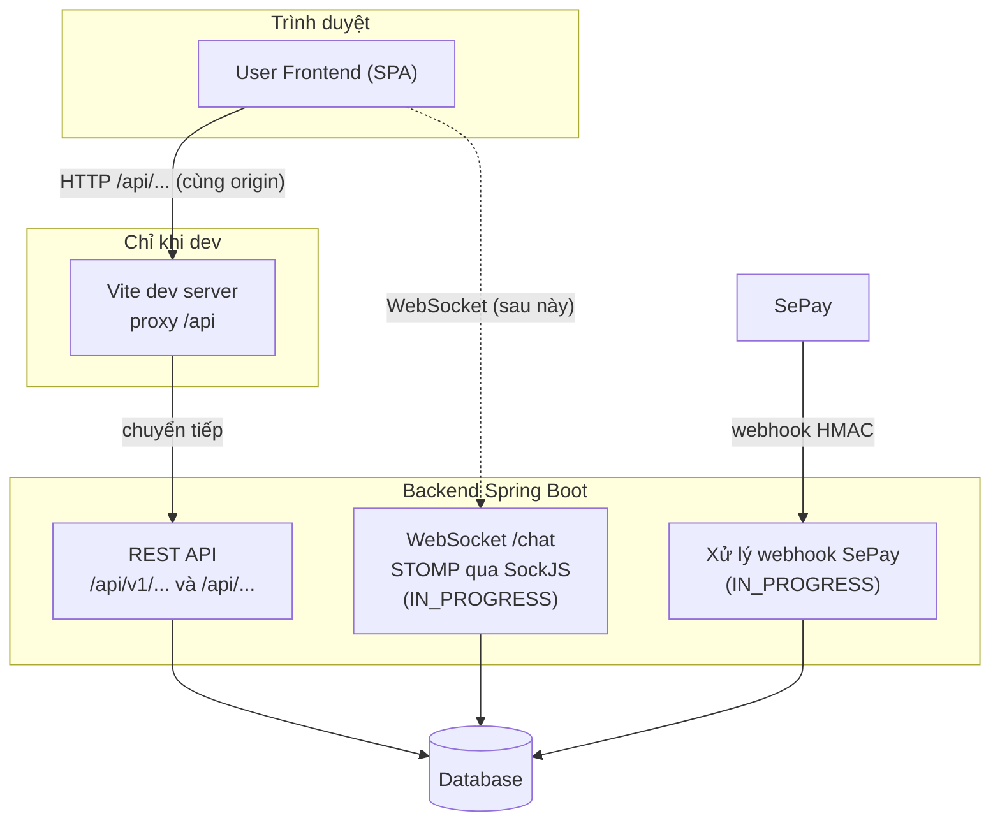
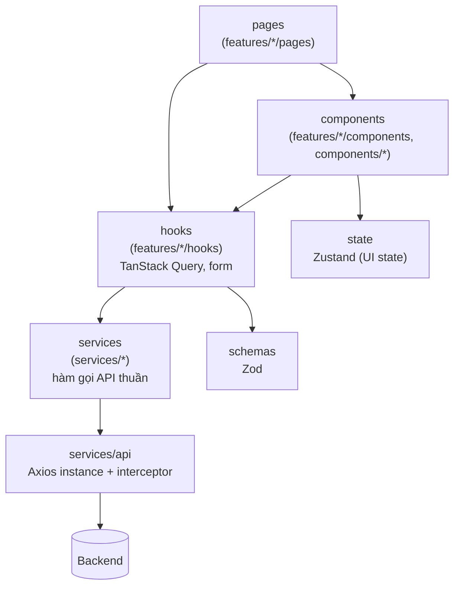
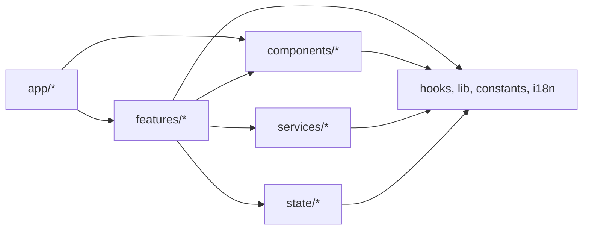
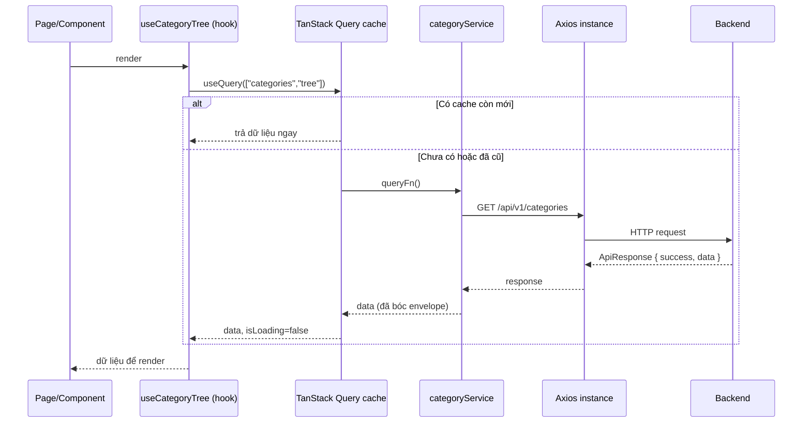

# 02 - Frontend Architecture (Kiến trúc Frontend)

> **Trạng thái:** BẢN NHÁP v0.1
> **Cập nhật:** 2026-11-08
> **Áp dụng cho:** `Moldy-Market-User-Frontend`
> **Mục đích:** Mô tả kiến trúc tổng thể, cấu trúc thư mục, cách chia lớp, quy tắc phụ thuộc giữa các lớp và lý do của từng quyết định lớn.

Nhãn: `[ĐÃ XÁC MINH BACKEND]`, `[ĐÃ CẤU HÌNH]`, `[ĐỀ XUẤT]` (xem doc 01). **Phần lớn tài liệu này là `[ĐỀ XUẤT]`** vì repo chưa có code ứng dụng. Các ví dụ code là *ví dụ minh họa, chưa có trong repo*.

---

## 1. Nguyên tắc kiến trúc

1. **Tổ chức theo tính năng (feature-based), không theo loại file.** Mọi thứ của "đăng sản phẩm" nằm gần nhau, thay vì rải ở `components/`, `hooks/`, `pages/` toàn cục.
2. **Tách lớp rõ ràng:** giao diện, logic dữ liệu, gọi API là ba việc khác nhau, nằm ở ba chỗ khác nhau.
3. **Ba loại state, ba công cụ:** dữ liệu từ server (TanStack Query), trạng thái giao diện cục bộ (Zustand), dữ liệu form (React Hook Form + Zod). Không trộn.
4. **Backend là nguồn sự thật.** Frontend không tự tính giá, không tự suy luận trạng thái thanh toán, không coi việc ẩn nút là bảo mật.
5. **Chỉ code những gì Backend đã có.** Dòng `IN_PROGRESS`/`NOT_FOUND` chỉ có skeleton (doc 14 mục 1.2).
6. **Đơn giản trước.** Không thêm thư viện hay lớp trừu tượng khi chưa có nhu cầu thật.

---

## 2. Kiến trúc hệ thống tổng thể



Giải thích:

- Frontend là **SPA** (single page application) chạy hoàn toàn trên trình duyệt; không có server-side rendering (`rsc: false`, không dùng Next.js). `[ĐÃ CẤU HÌNH]`
- Chỉ có **một** điểm vào Backend: REST dưới `/api`, cộng WebSocket `/chat` ở các branch chưa merge.
- Notification và trạng thái thanh toán **không có kênh push**, Frontend polling (doc 14 mục 4.3, 5.8).

---

## 3. Cấu trúc thư mục

Các thư mục dưới đây đã được tạo thủ công (nhiều thư mục chỉ chứa `.gitkeep`) `[ĐÃ CẤU HÌNH]`. **File bên trong, ngoài những file đã nêu ở doc 01 mục 7, là `[ĐỀ XUẤT]`.**

```text
src/
  app/
    providers/        # QueryClientProvider, RouterProvider bọc ngoài, ...
    router/           # định nghĩa route, route guard
    layouts/          # MainLayout, AuthLayout, StoreDashboardLayout
  components/
    ui/               # shadcn (sinh bởi CLI, KHÔNG sửa tay)
    common/           # component dùng chung nhiều feature (Logo, PageHeader, EmptyState...)
    feedback/         # loading, lỗi, rỗng, toast
    navigation/       # header, footer, menu, breadcrumb
  features/
    auth/{components,hooks,pages,schemas}
    marketplace/{components,hooks,pages}
    products/{components,hooks,pages,schemas}
    stores/{components,hooks,pages,schemas}
    profile/{components,hooks,pages,schemas}
  hooks/              # hook dùng chung (không thuộc feature nào)
  lib/                # utils.js (hàm cn), helper chung
  state/              # Zustand: client state (sidebar, tùy chọn UI, ngôn ngữ)
  constants/          # hằng số
  i18n/               # index.js, locales/{vi,en}/common.json
  services/
    api/              # Axios instance, interceptor, helper chuẩn hóa lỗi/phân trang
    auth/  users/  stores/  categories/  products/
```

Những điểm cần nhớ:

- **`state/` thay vì `stores/`:** "store" trong dự án là *gian hàng*. Đặt thư mục Zustand tên `stores/` gây nhầm với `features/stores/` và `services/stores/`. Vì vậy đổi thành `state/`. `[ĐÃ CẤU HÌNH]`
- **`lib/` thay vì `utils/`:** shadcn đã tạo `lib/utils.js`; không tạo thêm `utils/` song song.
- **Không có `pages/` toàn cục:** component trang nằm trong `features/<tên>/pages/`. Router (`app/router/`) chỉ ghép trang vào route.
- **Thư mục `.gitkeep`:** chỉ là chỗ giữ chỗ; xóa file này khi thư mục có file thật.
- **Module chưa merge ở Backend** (notification, chat, cart, order, payment, pricing, voucher, escrow...) **chưa có** thư mục. Chúng được tạo khi Backend merge vào `main` và doc 14 cập nhật.

### 3.1 Vì sao `marketplace` tách khỏi `products`

`marketplace` là phần *duyệt và khám phá* (trang chủ, danh sách, tìm kiếm, danh mục); `products` là phần *làm việc với một sản phẩm* (chi tiết, đăng, sửa). Chúng dùng chung API product nhưng khác mục đích và người dùng (khách vs. người bán). Tách ra giúp mỗi feature nhỏ và dễ đọc.

---

## 4. Các lớp và trách nhiệm `[ĐỀ XUẤT]`



| Lớp | Thư mục | Làm | Không làm |
|---|---|---|---|
| Page | `features/*/pages` | Ghép component, đọc tham số URL, quyết định bố cục trang | Gọi Axios trực tiếp, chứa logic nghiệp vụ dài |
| Component | `features/*/components`, `components/*` | Hiển thị, nhận dữ liệu qua props, phát sự kiện | Gọi API trực tiếp (trừ khi qua hook của feature) |
| Hook | `features/*/hooks` | Bọc service bằng `useQuery`/`useMutation`, quản lý query key, invalidate cache | Biết chi tiết HTTP (URL, header) |
| Service | `services/*` | Hàm async thuần: gọi Axios, bóc phong bì `ApiResponse`, trả `data` | Dùng hook, dùng React, giữ state |
| API client | `services/api` | Axios instance, gắn token, xử lý 401/refresh, chuẩn hóa lỗi | Biết endpoint cụ thể của một module |
| State | `state/*` | Trạng thái giao diện thuần client | Lưu dữ liệu trả về từ API |
| Schema | `features/*/schemas` | Zod cho form của feature | Gọi API |

### 4.1 Ví dụ minh họa (chưa có trong repo)

Lớp service, dùng endpoint đã xác minh `GET /api/v1/categories`:

```js
// services/categories/categoryService.js  (ví dụ minh họa)
import { apiClient } from '@/services/api/client'

export async function getCategoryTree() {
  const res = await apiClient.get('/api/v1/categories')
  return res.data.data // bóc phong bì ApiResponse
}
```

Lớp hook của feature:

```js
// features/marketplace/hooks/useCategoryTree.js  (ví dụ minh họa)
import { useQuery } from '@tanstack/react-query'
import { getCategoryTree } from '@/services/categories/categoryService'

export function useCategoryTree() {
  return useQuery({ queryKey: ['categories', 'tree'], queryFn: getCategoryTree })
}
```

Lưu ý quan trọng: một số endpoint **không có body** (DELETE category/product...). Hàm bóc `res.data.data` phải chịu được trường hợp không có `data` (doc 14 mục 2.1). Chi tiết ở doc 07.

---

## 5. Quy tắc phụ thuộc (import rules) `[ĐỀ XUẤT]`

Mục tiêu: tránh vòng lặp và giữ mỗi feature độc lập.



Quy tắc bằng lời:

1. `components/ui` (shadcn) **không import** bất kỳ thứ gì ngoài `lib/utils` và thư viện.
2. `components/common|feedback|navigation` **không import từ `features/*`**. Chúng phải dùng được ở mọi feature.
3. `services/*` **không import** React, hook, `features/*`, `state/*`.
4. `features/A` **không import trực tiếp từ `features/B`**. Nếu cần chia sẻ, đưa phần chung lên `components/common`, `hooks/` hoặc `lib/`. Ngoại lệ có chủ đích (ví dụ trang chủ dùng card sản phẩm của `products`) phải ghi rõ trong PR; cách an toàn là đưa card đó vào `components/common`.
5. `app/*` là nơi duy nhất ghép các feature với nhau (router, layout).
6. Import dùng alias `@/...`, không dùng đường dẫn tương đối nhiều cấp (`../../..`).

Những quy tắc này nên được ESLint cưỡng chế sau này (`no-restricted-imports`); hiện chưa cấu hình.

---

## 6. Routing `[ĐỀ XUẤT]`

- Dùng **React Router v7** ở chế độ data router: `createBrowserRouter` + `RouterProvider` import từ `react-router/dom`.
- Ba layout: `MainLayout` (header, footer, trang công khai và trang cần đăng nhập), `AuthLayout` (đăng nhập, đăng ký), `StoreDashboardLayout` (sidebar quản lý gian hàng).
- Route guard là một component bao route (kiểm tra đã đăng nhập, có role phù hợp). Đây là **tiện ích giao diện**, không phải bảo mật.
- Danh sách route đầy đủ nằm ở doc 04; mô tả từng trang ở doc 05. Tài liệu này không lặp lại.

---

## 7. Quản lý state `[ĐỀ XUẤT]`

| Loại state | Công cụ | Ví dụ | Nơi |
|---|---|---|---|
| Server state (dữ liệu từ API) | TanStack Query | danh sách sản phẩm, hồ sơ, gian hàng | `features/*/hooks` |
| Client state (UI thuần) | Zustand | mở/đóng sidebar, ngôn ngữ đã chọn | `state/` |
| Form state | React Hook Form + Zod | form đăng sản phẩm | `features/*/components`, `schemas` |
| URL state | React Router (search params) | bộ lọc, trang, từ khóa tìm kiếm | page |

Quy tắc: **không chép dữ liệu API vào Zustand.** Nếu cần dữ liệu server ở nhiều nơi, mọi nơi cùng gọi một hook query (cùng query key); TanStack Query tự dùng cache. Bộ lọc tìm kiếm nên nằm trên URL để chia sẻ link và quay lại bằng nút Back. Chi tiết ở doc 09.

Trạng thái đăng nhập (access token, thông tin user hiện tại) là trường hợp đặc biệt; nơi lưu token **chưa chốt** (Q2, doc 08).

---

## 8. Luồng dữ liệu tiêu biểu

Đọc dữ liệu (ví dụ danh sách danh mục):



Ghi dữ liệu (ví dụ cập nhật hồ sơ): form (React Hook Form + Zod) kiểm tra hợp lệ, `useMutation` gọi service, khi thành công thì `invalidateQueries` để đọc lại dữ liệu mới, khi lỗi thì ánh xạ `code` thành thông báo i18n.

---

## 9. Xử lý lỗi và biên giới Backend `[ĐỀ XUẤT]`

- Lỗi Backend có dạng `ApiResponse` với `success = false` và `code` (ví dụ `AUTH_001`, `COMMON_010`). Lớp `services/api` chuẩn hóa thành một đối tượng lỗi thống nhất; component không đọc thẳng response thô.
- Frontend ánh xạ `code` sang key i18n; không hiển thị nguyên `message` tiếng Anh.
- Cần xử lý riêng: `401` (refresh token một lần, xếp hàng các request chờ, không lặp vô hạn), `403` (không đủ quyền), `COMMON_010` (dữ liệu bị sửa, tải lại), `COMMON_009` (rate limit), và `ORDER_003` của `orders/me` (là trạng thái rỗng, không phải lỗi).
- Chi tiết và ví dụ ở doc 07 và 08.

---

## 10. Quyết định kiến trúc và lý do

| # | Quyết định | Lý do | Đánh đổi / lưu ý |
|---|---|---|---|
| D1 | **Hai repo Frontend tách rời** (User, Admin) | Người dùng, rủi ro, nhịp phát hành khác nhau; bundle người dùng không chứa mã admin | Lặp design tokens và quy ước; phải đối chiếu định kỳ. Có thể gom thành package chung sau, chưa làm. |
| D2 | **JavaScript + JSDoc**, không TypeScript | Giảm chi phí học và cấu hình cho một đồ án có thời hạn; team đã quen JS | Mất kiểm tra kiểu lúc build; bù bằng schema Zod, JSDoc, ESLint, doc 14 làm hợp đồng kiểu. |
| D3 | **Vite** | Dev server nhanh, proxy sẵn có, cấu hình ngắn | Không có SSR (không cần cho dự án này). |
| D4 | **Tailwind CSS v4** (cấu hình trong CSS) | Token nằm trong `index.css`, ít file cấu hình; tích hợp tốt với shadcn | v4 khác v3: không có `tailwind.config.js`; tài liệu cũ trên mạng có thể sai. |
| D5 | **shadcn/ui** (sao chép mã vào repo) | Sở hữu mã component, tùy biến tự do, dựa trên Radix (a11y tốt) | Mã sinh ra không sửa tay; Prettier và ESLint nới lỏng riêng cho `components/ui`. |
| D6 | **React Router v7 data router** | Chuẩn hiện tại của React Router; hỗ trợ layout lồng nhau, loader/action nếu cần | Chỉ dùng phần cần thiết (định tuyến, layout); data fetching vẫn dùng TanStack Query. |
| D7 | **TanStack Query** cho server state | Cache, dedupe, retry, invalidate sẵn có; tránh tự viết `useEffect` + `useState` để fetch | Cần kỷ luật query key. |
| D8 | **Zustand** cho client state | API nhỏ, không cần provider bao ngoài, đủ cho state giao diện | Chỉ dùng cho UI state, không dùng thay TanStack Query. |
| D9 | **React Hook Form + Zod** | Form hiệu năng tốt; một schema vừa validate vừa suy ra kiểu | Ràng buộc Zod phải khớp ràng buộc Backend (doc 14), nhưng Backend vẫn là chốt chặn. |
| D10 | **i18next**, mặc định `vi`, có `en` | Dự án hướng người dùng Việt; chuẩn bị mở rộng | Không dịch enum hay mã lỗi Backend; chỉ ánh xạ sang key ở phía Frontend. |
| D11 | **Feature-based + lớp `services` tách riêng** | Dễ tìm, dễ review, gọi API thuần dễ test, mỗi service ứng một module Backend | Dễ lặp hook ở các feature, cần quy tắc phụ thuộc (mục 5). |
| D12 | **Thư mục `state/`, không `stores/`** | Tránh nhầm với gian hàng (store) | Khác tên mặc định trong tài liệu Zustand. |
| D13 | **Axios `baseURL` không gắn cứng `/api/v1`** | Backend có hai prefix `/api/v1/...` và `/api/...` (doc 14 mục 2.3) | Mỗi service viết đường dẫn đầy đủ. |
| D14 | **Dev dùng Vite proxy** | Backend chưa có CORS cho REST (B1) | Production cần cùng origin hoặc Backend thêm CORS (doc 12). |
| D15 | **Chỉ service cho endpoint `IMPLEMENTED`** | Tránh code theo contract chưa ổn định (nhiều DTO còn đổi) | Cần cập nhật doc 14 mỗi khi Backend merge. |
| D16 | **Dark mode ngoài phạm vi hiện tại** | Giữ phạm vi nhỏ; tokens `.dark` có sẵn từ shadcn nhưng không được thiết kế | Không dùng class `dark` trong code mới cho đến khi có quyết định. |

---

## 11. Điểm mở và rủi ro kiến trúc

| Điểm mở | Tham chiếu | Ảnh hưởng |
|---|---|---|
| Nơi lưu token (bộ nhớ, `localStorage`, cookie httpOnly) | Q2, doc 08 | Thiết kế interceptor và bootstrap phiên. **CHƯA CHỐT.** |
| Lấy permission code của user | Q1 | Menu Store Dashboard chỉ dựa được vào role, `403` là quyết định thật. |
| Upload ảnh sản phẩm | Q5 | Form đăng sản phẩm chỉ nhận URL https. |
| Nhiều dạng phân trang | doc 14 mục 2.2 | Cần adapter riêng cho từng dạng, không viết một paginator chung. |
| Backend chưa có CORS cho REST | B1 | Deploy production. |
| Luồng kích hoạt tài khoản chưa có | B10, Q14 | Đăng ký rồi đăng nhập chưa chạy end-to-end. |
| Trạng thái order không được cập nhật sau thanh toán | B12 | Trang thanh toán chỉ tin `paymentStatus`. |

---

## Tài liệu liên quan

- 01 - Project Overview
- 03 - Design System
- 04 - Routing and Pages
- 06 - Component Architecture
- 07 - API Integration
- 08 - Authentication and Authorization
- 09 - State Management
- 11 - Coding Conventions
- 14 - Backend Integration Matrix
