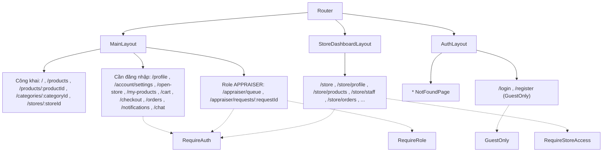
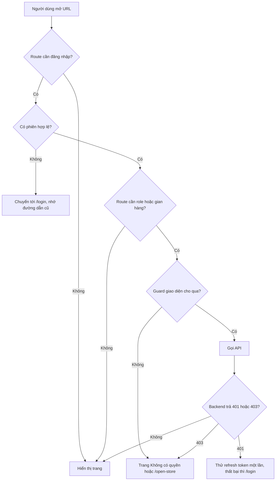

# 04 - Routing và danh sách trang (User Frontend)

> **Trạng thái tài liệu:** v0.3 (cập nhật 2026-11-27: bổ sung `/offers`, `/store/offers`, `/forgot-password`, các route `/appraiser/*` & `/appraisals/*` và khung mua hàng 3 tầng / Chat Offer Cards)
> **Cập nhật:** 2026-11-27
> **Áp dụng cho:** `Moldy-Market-User-Frontend`
> **Mục đích:** Là nguồn duy nhất liệt kê mọi route của User Frontend: đường dẫn, trang, layout, quyền truy cập, phụ thuộc Backend và trạng thái. Các doc khác (05, 10, 13) chỉ trỏ về đây, không lặp lại bảng route.

Quy ước nhãn dùng trong tài liệu này:

- `[ĐÃ XÁC MINH BACKEND]`: thông tin lấy từ doc 14 (đã đọc code Backend).
- `[ĐÃ TRIỂN KHAI]`: đã có code thực tế trong `src/`.
- `[ĐỀ XUẤT]`: kiến trúc dự kiến, **chưa có code**.

Router đã được triển khai tại `src/app/router/routes.js` với `MainLayout`, `AuthLayout`, `RequireAuth`, `GuestOnly` (cho `/login`), `RouteErrorPage`, `RouteLoading` và tải lười (`lazy`) toàn bộ trang.

---

## 1. Công nghệ routing `[ĐÃ TRIỂN KHAI]`

| Mục | Giá trị |
|---|---|
| Thư viện | `react-router` ^7.18.5 |
| Cách khai báo | `createBrowserRouter` + `RouterProvider` (import `RouterProvider` từ `react-router/dom`) tại `src/App.jsx` & `src/app/router/routes.js` |
| Thư mục | `src/app/router/`, `src/app/layouts/`, `src/features/<module>/pages/` |
| Tải trang | Mỗi trang tải lười (`lazy`), trả `{ Component: module.XxxPage }` |
| Trạng thái cần giữ khi chia sẻ link | Đặt trong **query string** (tìm kiếm, lọc, sắp xếp, trang). Xem mục 5 |

---

## 2. Layout

| Layout | Trạng thái | Dùng cho | Thành phần chính | Ghi chú |
|---|---|---|---|---|
| `MainLayout` | `[ĐÃ TRIỂN KHAI]` | Mọi trang công khai, trang cần đăng nhập và toàn bộ `/store/*` | Header (`Logo`, `LanguageSwitcher`, nav, badge tin nhắn chưa đọc, menu shop/nhân viên động, logout), `ChatRealtimeContext`, `Outlet`, Footer | Quản lý một kết nối STOMP/SockJS dùng chung theo phiên |
| `AuthLayout` | `[ĐÃ TRIỂN KHAI]` | `/login`, `/register`, `/verify-email`, `*` (`NotFoundPage`) | Khung gọn, căn giữa, `Logo`, `LanguageSwitcher` | `/login` bọc trong `GuestOnly` |
| `StoreDashboardLayout` | `[ĐÃ TRIỂN KHAI]` | Toàn bộ `/store/*` | Sidebar trái theo quyền chủ / nhân viên gian hàng | Bọc bên trong `MainLayout`, tự ẩn sidebar khi chưa mở gian hàng |

Trang người thẩm định (`/appraiser/*`) dự kiến dùng `MainLayout` (xem `HANDOFF-APPRAISER-FRONTEND.md`).

---

## 3. Bảng route

Ghi chú các cột:

- **Quyền truy cập:** `Công khai`, `Khách`, `Đã đăng nhập`, `Chủ/nhân viên gian hàng`.
- **Backend:** trạng thái theo doc 14 (`IMPLEMENTED`, `IMPLEMENTED_LOCAL`, `IN_PROGRESS`, `PLANNED`, `NOT_FOUND`).
- **FE:** trạng thái Frontend thực tế tại 2026-11-22 (`INTEGRATED`, `IMPLEMENTED_LOCAL`, `NOT_STARTED`).

### 3.1 Công khai (`MainLayout`)

| Path | Page | Quyền truy cập | Phụ thuộc Backend (doc 14) | Backend | FE |
|---|---|---|---|---|---|
| `/` | `HomePage` | Công khai | `GET /api/v1/categories`, `GET /api/v1/products/search` | `IMPLEMENTED` | `IMPLEMENTED_LOCAL` (danh mục `INTEGRATED`) |
| `/products` | `ProductListPage` | Công khai | `GET /api/v1/products/search` (kèm `facets`) | `IMPLEMENTED` | `IMPLEMENTED_LOCAL` |
| `/products/:productId` | `ProductDetailPage` | Công khai | `GET /api/v1/products/{id}`, `GET /api/v1/stores/{id}`, `POST /api/v1/carts/items`, `POST /api/v1/conversations` | `IMPLEMENTED` | `IMPLEMENTED_LOCAL` |
| `/categories/:categoryId` | `CategoryPage` | Công khai | `GET /api/v1/categories/{id}`, `GET /api/v1/products/search` với `categoryId` | `IMPLEMENTED` | `IMPLEMENTED_LOCAL` |
| `/stores/:storeId` | `StorePublicPage` | Công khai | `GET /api/v1/stores/{id}` (có `ownerId`), `GET /api/v1/products/search` với `storeId`, chat shop | `IMPLEMENTED` | `IMPLEMENTED_LOCAL` |

### 3.2 Xác thực và lỗi (`AuthLayout`)

| Path | Page | Quyền truy cập | Phụ thuộc Backend | Backend | FE |
|---|---|---|---|---|---|
| `/login` | `LoginPage` | Khách (`GuestOnly`) | `POST /api/v1/auth/login` (`X-Moldy-Auth: 1` + cookie), `GET /api/v1/users/me` | `IMPLEMENTED` | `IMPLEMENTED_LOCAL` |
| `/register` | `RegisterPage` | Công khai (AuthLayout) | `POST /api/v1/auth/register`, chuyển sang `/verify-email` | `IMPLEMENTED` | `INTEGRATED` local (OTP Gmail đã xác nhận) |
| `/verify-email` | `VerifyEmailPage` | Công khai (AuthLayout) | `POST /api/v1/auth/verify-email`, `POST /api/v1/auth/resend-verification` | `IMPLEMENTED` | `INTEGRATED` local |
| `*` | `NotFoundPage` | Công khai | Không có | Không áp dụng | `IMPLEMENTED_LOCAL` |

### 3.3 Cần đăng nhập (`MainLayout` + `RequireAuth`)

| Path | Page | Phụ thuộc Backend | Backend | FE |
|---|---|---|---|---|
| `/profile` | `ProfilePage` | `GET /api/v1/users/me` | `IMPLEMENTED` | `IMPLEMENTED_LOCAL` |
| `/profile/edit` | `ProfileEditPage` | `GET`, `PUT /api/v1/users/me` (quyền `PROFILE_MANAGE`) | `IMPLEMENTED` | `IMPLEMENTED_LOCAL` |
| `/account/settings` | `AccountSettingsPage` | `PUT /api/v1/users/me/password` | `IMPLEMENTED` | `IMPLEMENTED_LOCAL` |
| `/open-store` | `OpenStorePage` | `POST /api/v1/stores` (mỗi user một gian hàng, lỗi `STORE_002`) | `IMPLEMENTED` | `IMPLEMENTED_LOCAL` |
| `/my-products` | `MyProductsPage` | `GET /api/v1/products/me` | `IMPLEMENTED` | `IMPLEMENTED_LOCAL` |
| `/my-products/new` | Redirect → `/store/products/new` | Áp dụng luồng đăng bán qua gian hàng | — | `IMPLEMENTED_LOCAL` |
| `/my-products/:productId/edit` | `ProductEditPage` | `GET /api/v1/products/{id}`, `PUT /api/v1/products/{id}` (bắt buộc `version`), `DELETE`, `PATCH /{id}/status?status=` | `IMPLEMENTED` | `IMPLEMENTED_LOCAL` |
| `/cart` | `CartPage` | GET `/api/v1/carts`, POST `/items`, DELETE `/items/{listingId}` (Q7 doc 14) | Ba endpoint đã sửa và test Backend local | INTEGRATED local; Chu xác nhận thêm, xem, tải lại và xóa ngày 2026-11-18 |
| `/checkout` | `CheckoutPage` | Form + áp dụng mã voucher (`GET /api/vouchers/{code}`) và `POST /api/v1/checkout-groups` (hỗ trợ `voucherCode`); không tự retry POST; chuyển sang trang thanh toán | `IMPLEMENTED_LOCAL` (có voucher) | `IMPLEMENTED_LOCAL` |
| `/checkout/:checkoutGroupId` | `CheckoutPaymentPage` | GET /api/v1/checkout-groups/{id} cho reload và polling online 5 giây; hiển thị `discountAmount`/`voucherCode`; COD cập nhật thủ công | `IMPLEMENTED_LOCAL` | `IMPLEMENTED_LOCAL` |
| `/orders` | `OrderListPage` | `GET /api/v1/orders/me` (sắp xếp `createdAt DESC`); 404 ORDER_LIST_NOT_FOUND là danh sách rỗng | `IMPLEMENTED_LOCAL` | `IMPLEMENTED_LOCAL` |
| `/offers` | `SentOffersPage` | `GET /api/v1/offers/sent`, `PATCH /{id}/{accept,reject,cancel}`, `POST /{id}/counter`, `GET /{id}/history` (tab lọc, countdown live, mua ngay theo giá chốt, mở Chat) | `IMPLEMENTED` (`f3ca06a`) | `IMPLEMENTED` (`361ea90`) |
| `/orders/:orderId` | `OrderDetailPage` | Tìm ID trong danh sách `/orders/me`, hiển thị timeline mốc thời gian, giảm giá voucher, nút Hủy đơn (`POST /api/v1/orders/buyer/{id}/cancel`), và khiếu nại (`OrderDisputePanel`) | `IMPLEMENTED_LOCAL` | `IMPLEMENTED_LOCAL` |
| `/notifications` | `NotificationsPage` | `GET /api/v1/notifications?limit&token` (cursor), `PATCH /{id}/read`, `PATCH /{id}/unread`, `DELETE /{id}`; restore API chưa có UI | `IMPLEMENTED` (Backend `e0524c0`) | `IMPLEMENTED_LOCAL`, RequireAuth |
| `/chat` | `ChatPage` | GET conversations và STOMP /chat dùng chung từ MainLayout | IMPLEMENTED_LOCAL; badge unread ở menu/inbox | Có inbox và trạng thái kết nối/reconnect; manual UI chờ Chu |
| `/chat/:conversationId` | `ChatPage` (cùng trang, chọn cuộc hội thoại) | REST history, PATCH read {messageId}, STOMP send/messages/errors/chat-reads | IMPLEMENTED_LOCAL; visible/focused read prefix và peer read receipt | Có gửi/nhận TEXT, giữ draft khi lỗi, reload REST sau event/reconnect; manual UI chờ Chu |
| `/wishlist` | `WishlistPage` | `GET /api/v1/wishlists?page&size` (0-based Spring Page), `POST/DELETE /{productId}`, `GET /check/{productId}`, `GET /count` | `IMPLEMENTED` (Backend `e0524c0`) | `IMPLEMENTED_LOCAL` |
| `/disputes` | `DisputeListPage` | `GET /api/v1/disputes/me`, `GET /{orderId}`, `POST /api/v1/disputes`, `POST /{orderId}/cancel` | `IMPLEMENTED` (Backend `e0524c0`) | `IMPLEMENTED_LOCAL` |
| `/transactions` | `TransactionsPage` | `GET /api/v1/payments/my-payments`, `GET /api/v1/payments/{id}` | `IMPLEMENTED` (Backend `e0524c0`) | `IMPLEMENTED_LOCAL` |
| `/wallet` | `WalletPage` | `GET /api/v1/wallets/me`, `GET /api/v1/wallets/me/transactions`, `GET /api/v1/withdrawals/me`, `POST /api/v1/withdrawals`, `POST /api/v1/withdrawals/{id}/cancel` | `IMPLEMENTED_LOCAL` (B2 fixed) | `IMPLEMENTED_LOCAL`, RequireAuth |
| `/appraisals` | `MyAppraisalsPage` | `POST /api/pricing/appraiser/request`, `GET /api/pricing/requests/{requestId}`, `GET /api/pricing/{listingId}` (DTO chưa audit) | `IN_PROGRESS` | `NOT_STARTED` |

### 3.4 Người thẩm định (cần role `APPRAISER`, `MainLayout`) — Xem `HANDOFF-APPRAISER-FRONTEND.md`

> **Lưu ý 2026-11-23:** Backend đã thay thế hoàn toàn `/api/pricing/appraiser/*` cũ bằng bộ 6 controller `/api/v1/appraisal-{requests,applications,invitations,assignments,reports,reviews}/**` (cần HTTP/security audit trước khi nối). Các trang Appraiser bên dưới là UI preview; không gọi API hoặc hiển thị dữ liệu nghiệp vụ mẫu.
>
> Trong môi trường development, `/__preview/appraiser/*` mở các trang để click-through mà không cần phiên Backend. Route preview không được đưa vào production build; chỉ route preview hiển thị nhãn xem trước. Các route `/appraiser/*` vẫn yêu cầu đăng nhập và role `APPRAISER`.

| Path | Page | Phụ thuộc Backend | Backend | FE |
|---|---|---|---|---|
| `/appraiser/profile` | `AppraiserProfilePage` | `/api/v1/appraisers/me`, `/me/status`, registration/deactivate/reactivate | `AUDIT_PENDING` | `SKELETON` |
| `/appraiser/queue` | `AppraiserQueuePage` (Yêu cầu đang mở / Ứng tuyển) | `GET /api/v1/appraisal-requests/market/open`, `POST /api/v1/appraisal-requests/{requestId}/applications` | `AUDIT_PENDING` | `SKELETON` |
| `/appraiser/requests/:requestId` | `AppraiserRequestDetailPage` | `GET /api/v1/appraisal-requests/{requestId}` | `AUDIT_PENDING` | `SKELETON` |
| `/appraiser/applications` | `AppraiserApplicationsPage` | `GET /api/v1/appraisal-applications/my-applications`, `PATCH .../withdraw` | `AUDIT_PENDING` | `SKELETON` |
| `/appraiser/invitations` | `AppraiserInvitationsPage` | `GET /api/v1/appraisal-invitations/my-invitations`, `PATCH .../{accept,reject}` | `AUDIT_PENDING` | `SKELETON` |
| `/appraiser/assignments` | `AppraiserAssignmentsPage` | `GET /api/v1/appraisal-assignments/my-assignments` | `AUDIT_PENDING` | `SKELETON` |
| `/appraiser/assignments/:assignmentId` | `AppraiserAssignmentDetailPage` | `GET /api/v1/appraisal-assignments/{id}`, `PATCH .../start`, `POST /api/v1/appraisal-reports/assignments/{id}`, `GET .../history` | `AUDIT_PENDING` | `SKELETON` |
| `/appraiser/commissions` | `AppraiserCommissionsPage` | `GET /api/v1/appraiser/commissions/my` (RAW JSON) | `AUDIT_PENDING` | `SKELETON` |

Quyền thực tế do Backend quyết định. Frontend chỉ dùng tên role từ `GET /api/v1/users/me` để ẩn hiện menu (xem mục 4).

### 3.5 Quản lý Gian hàng (`MainLayout` + `RequireAuth` + `StoreDashboardLayout`, cần là chủ hoặc nhân viên gian hàng)

| Path | Page | Phụ thuộc Backend | Backend | FE |
|---|---|---|---|---|
| `/store` | `StoreOverviewPage` | Chủ gian hàng dùng `GET /api/v1/stores/my-store`. Nhân viên có `STORE_WORKSPACE_ACCESS` dùng `GET /api/v1/stores/{id}` với `storeId` từ hồ sơ phiên | `IMPLEMENTED` cho thông tin gian hàng | Có tổng quan chủ gian hàng và màn hình gian hàng liên kết cho nhân viên |
| `/store/profile` | `StoreProfilePage` | `GET`, `PUT /api/v1/stores/my-store` | `IMPLEMENTED` | Có form chỉnh sửa, chờ kiểm tra với Backend thật |
| `/store/products` | `StoreProductsPage` | Owner: `GET /api/v1/stores/my-store/products`; staff: `GET /api/v1/stores/{storeId}/products` theo membership `/staff/me` có PRODUCT_MANAGE_OWN | IMPLEMENTED_LOCAL, PostgreSQL/HTTP tests pass | Danh sách quản lý phân trang ACTIVE/HIDDEN, không dùng bộ lọc trang công khai; chờ Chu kiểm thử UI |
| `/store/products/new` | `ProductCreatePage` | Chủ gian hàng dùng `GET /api/v1/stores/my-store`. Nhân viên có `PRODUCT_CREATE` dùng gian hàng liên kết từ hồ sơ phiên. Cả hai gửi `storeId` qua `POST /api/v1/products` | `IMPLEMENTED` | Có form cho chủ gian hàng và nhân viên được cấp quyền |
| `/store/products/:productId/edit` | `ProductEditPage` | `GET /api/v1/stores/my-store`, `GET` và `PUT /api/v1/products/{id}` (xem 3.3) | `IMPLEMENTED` | Có form sửa và kiểm tra quyền gian hàng, chờ kiểm tra với Backend thật |
| `/store/staff` | `StoreStaffPage` | Thêm, danh sách, đổi permission, xóa dưới `/api/v1/stores/my-store/staff` (quyền `STORE_STAFF_MANAGE`). **Mời** staff là `PLANNED` (chỉ có thêm trực tiếp bằng email) | `IMPLEMENTED` (thêm trực tiếp); `PLANNED` (mời) | Có danh sách, thêm bằng email, đổi quyền và xóa, chờ kiểm tra với Backend thật |
| /store/orders | StoreOrdersPage | GET /api/v1/stores/{storeId}/orders; owner hoặc staff cùng store có ORDER_PROCESS xem; POST seller/{orderId}/confirm chỉ owner xác nhận COD | IMPLEMENTED_LOCAL; xem doc 14 §5.7.3 | IMPLEMENTED_LOCAL: menu, phân trang/lọc URL, snapshot món/người nhận, owner confirm; thêm hướng dẫn bước tiếp theo và lịch sử timestamp thật ngày 22/11. Chờ Chu kiểm thử UI |
| `/store/vouchers` | `StoreVouchersPage` | `POST/GET /api/shop/vouchers`, `GET/PUT/DELETE /api/shop/vouchers/{code}` (`@IsOwner`); `GET /api/vouchers/{code}` | `IMPLEMENTED` (Backend `e0524c0`) | `IMPLEMENTED_LOCAL` |
| `/store/offers` | `ReceivedOffersPage` | `GET /api/v1/offers/received`, `PATCH /{id}/{accept,reject}`, `POST /{id}/counter`, `GET /{id}/history` (Owner hoặc Staff có quyền `OFFER_HANDLE`; tab Cần phản hồi / Đã đồng ý / Đã đóng / Tất cả + countdown + mở Chat) | `IMPLEMENTED` (`f3ca06a`) | `IMPLEMENTED` (`361ea90`) |
| `/store/revenue` | `StoreRevenuePage` | `GET /api/v1/analytics/seller/overview`, `GET /revenue?from&to`, `GET /top-products?limit` | `IMPLEMENTED` (Backend `e0524c0`) | `IMPLEMENTED_LOCAL` |
| `/store/reviews` | `StoreReviewsPage` | `GET /api/v1/reviews/stores/{storeId}` | `IMPLEMENTED` | `IMPLEMENTED_LOCAL` |
| `/store/settings` | `StoreSettingsPage` | Chưa có endpoint riêng ngoài `my-store`; phạm vi cần xác định với team | `REQUIRES_BUSINESS_CLARIFICATION` | `NOT_STARTED` |

Quy tắc chung cho trang chưa có Backend (`PLANNED`, `NOT_FOUND`): chỉ làm skeleton có `TODO`, **không viết service**, theo quy tắc 1.2 trong doc 14.

---

## 4. Guard (bảo vệ route)

| Guard | Trạng thái | Điều kiện | Khi không thỏa | Ghi chú |
|---|---|---|---|---|
| `GuestOnly` | `[ĐÃ TRIỂN KHAI]` | Chưa đăng nhập | Chuyển về `/` | Hiện bọc `/login` (không bọc `/register`, `/verify-email`) |
| `RequireAuth` | `[ĐÃ TRIỂN KHAI]` | Có phiên đăng nhập hợp lệ (`useSession`) | Chuyển tới `/login`, giữ đường dẫn cũ trong `state.from` | Bọc nhóm 3.3 và 3.5 |
| `RequireRole('APPRAISER')` | `[ĐÃ TRIỂN KHAI — UX]` | `roles` của `GET /api/v1/users/me` có `APPRAISER` | Hiển thị `ForbiddenState` | Không thay thế kiểm tra quyền trên Backend |
| `RequireStoreAccess` | `[ĐỀ XUẤT — CHƯA TẠO]` | Chủ gian hàng hoặc nhân viên thuộc shop | Hiện kiểm tra bên trong trang bằng `useMyStore` / `useMyStaffProfile` / `useProductManagementAccess` | Không suy quyền shop từ permissions gộp của `/users/me` |

Giới hạn quan trọng:

1. **Frontend không phải ranh giới bảo mật.** Mọi guard chỉ cải thiện trải nghiệm. Backend là chốt chặn cuối: luôn xử lý `COMMON_003` (401) và `COMMON_004` (403) kể cả khi guard đã cho qua.
2. **Quyền shop của staff:** Lấy từ `GET /api/v1/stores/my-store/staff/me` (`STORE_WORKSPACE_ACCESS`), không lấy từ danh sách `permissions` gộp của `/users/me`.
3. **Kích hoạt tài khoản:** Đã hoàn tất luồng Email OTP (`/register` → `/verify-email` → `ACTIVE` → tự đăng nhập). Admin không được bypass OTP.

---

## 5. Query string cho các trang danh sách `[ĐỀ XUẤT]`

Đưa trạng thái lọc vào URL để chia sẻ link, quay lại bằng nút Back, và dùng làm `queryKey`. Chỉ dùng các tham số có trong doc 14 mục 5.6:

| Tham số URL | Ý nghĩa | Ghi chú đã xác minh |
|---|---|---|
| `q` | Từ khóa | Tối đa 100 ký tự |
| `categoryId` | Danh mục (lặp được) | Tối đa 20 giá trị |
| `condition` | Tình trạng (lặp được) | `NEW`, `LIKE_NEW`, `USED`, `DAMAGED`; tối đa 10 giá trị |
| `minPrice`, `maxPrice` | Khoảng giá | Số |
| `storeId` | Lọc theo gian hàng | Dùng ở `/stores/:storeId` và `/store/products` |
| `sellerType` | Loại người bán | Giá trị hợp lệ **chưa audit** |
| `attr` | Thuộc tính | Tối đa 10; định dạng chuỗi **chưa audit** |
| `sort` | Sắp xếp | `relevance`, `newest`, `price_asc`, `price_desc` |
| `page` | Trang | Bắt đầu từ 1 (xem doc 14 mục 2.2) |
| `size` | Kích thước trang | Tối đa 100, mặc định 20 |

Lưu ý: `/categories/:categoryId` và `/stores/:storeId` lấy `categoryId`, `storeId` từ path, không từ query. Lỗi hay gặp: gửi `page=0` (Backend dùng 1-based cho search) hoặc đưa vào URL các giá trị `sort` ngoài danh sách trên.

---

## 6. Câu hỏi mở riêng của tài liệu này

| ID | Câu hỏi | Chặn việc gì |
|---|---|---|
| Q19 | Dùng `GET /api/v1/products/me` từ thay đổi Backend local. Endpoint lấy người bán từ phiên đăng nhập và chỉ trả tin cá nhân `ACTIVE` hoặc `HIDDEN`. | Trang `/my-products` |
| Q1 | Xem doc 14: permission code và gian hàng của staff. | `RequireStoreAccess`, menu Store Dashboard |
| Q14 | Xem doc 14: luồng kích hoạt tài khoản. | `/register`, `/login` |
| Q15 | Xem doc 14: ai chuyển trạng thái order. | `/store/orders`, timeline ở `/orders/:orderId` |

Contract Q19 được ghi trong mục 5.6 của doc 14.

---

## 7. Sơ đồ routing

### 7.1 Cây layout và route

### 7.2 Luồng quyết định khi vào một route được bảo vệ

---

## Tài liệu liên quan

- 05 - Hướng dẫn từng trang: chi tiết bố cục, dữ liệu, validation của từng route ở trên.
- 06 - Kiến trúc component: layout và component dùng chung.
- 08 - Xác thực và phân quyền: phiên đăng nhập, refresh, Q1, Q2.
- 10 - Luồng tính năng: các luồng nhiều bước xuyên qua nhiều route.
- 13 - Lộ trình phát triển: thứ tự dựng các route.
- 14 - Ma trận tích hợp Backend: nguồn sự thật về Backend.
