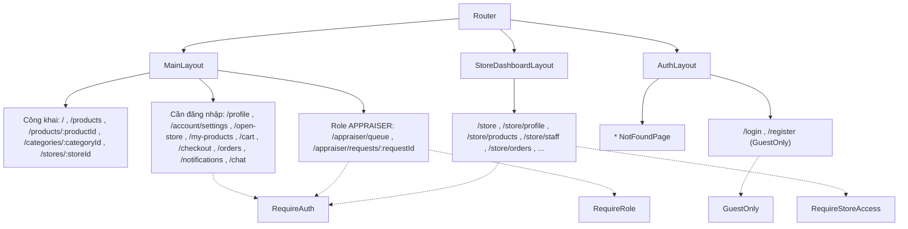
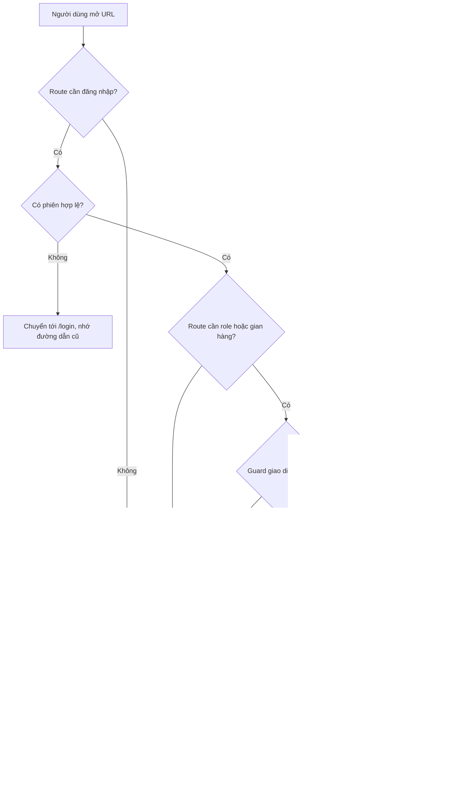

# 04 - Routing và danh sách trang (User Frontend)

> **Trạng thái tài liệu:** BẢN NHÁP v0.1
> **Cập nhật:** 2026-11-08
> **Áp dụng cho:** `Moldy-Market-User-Frontend`
> **Mục đích:** Là nguồn duy nhất liệt kê mọi route của User Frontend: đường dẫn, trang, layout, quyền truy cập, phụ thuộc Backend và trạng thái. Các doc khác (05, 10, 13) chỉ trỏ về đây, không lặp lại bảng route.

Quy ước nhãn dùng trong tài liệu này:

- `[ĐÃ XÁC MINH BACKEND]`: thông tin lấy từ doc 14 (đã đọc code Backend).
- `[ĐÃ CẤU HÌNH]`: đã thực sự có trong repo Frontend.
- `[ĐỀ XUẤT]`: kiến trúc dự kiến, **chưa có code**.

Hiện tại repo chưa có router nào. `src/main.jsx` chỉ render `App` thử i18n và nút. Toàn bộ nội dung dưới đây về route, layout, guard là `[ĐỀ XUẤT]`; phần Backend là `[ĐÃ XÁC MINH BACKEND]` và trích từ doc 14.

---

## 1. Công nghệ routing `[ĐÃ CẤU HÌNH]` và cách dùng `[ĐỀ XUẤT]`

| Mục | Giá trị |
|---|---|
| Thư viện | `react-router` ^7.18.5 (đã cài `[ĐÃ CẤU HÌNH]`) |
| Cách khai báo | `createBrowserRouter` + `RouterProvider` (import `RouterProvider` từ `react-router/dom`) `[ĐỀ XUẤT]` |
| Thư mục | `src/app/router/` (khai báo route, guard), `src/app/layouts/` (layout), `src/features/<module>/pages/` (trang) `[ĐỀ XUẤT]` |
| Tải trang | Mỗi trang tải lười (`lazy`) để giảm bundle ban đầu `[ĐỀ XUẤT]` |
| Trạng thái cần giữ khi chia sẻ link | Đặt trong **query string** (tìm kiếm, lọc, sắp xếp, trang). Xem mục 5 |

Vì sao chọn route dạng object (`createBrowserRouter`) thay vì `<Routes>` lồng JSX: cấu trúc route là dữ liệu nên dễ đọc, dễ gắn layout và guard theo cây, và dễ thống kê khi viết doc. Lỗi hay gặp: viết `import { RouterProvider } from 'react-router'` (bản v7 yêu cầu `react-router/dom` cho DOM) hoặc quên bọc `RouterProvider` trong các provider cần thiết (ví dụ `QueryClientProvider`).

---

## 2. Layout `[ĐỀ XUẤT]`

| Layout | Dùng cho | Thành phần chính | Ghi chú |
|---|---|---|---|
| `MainLayout` | Trang công khai và trang cần đăng nhập thông thường | Header (logo, ô tìm kiếm, giỏ hàng, thông báo, menu tài khoản), vùng nội dung (`Outlet`), Footer | Giỏ hàng, thông báo, chat chỉ hiện khi Backend merge (xem trạng thái ở các bảng dưới) |
| `AuthLayout` | Đăng nhập, đăng ký, 404 | Khung gọn, căn giữa, logo | Nếu đã đăng nhập mà vào `/login` thì chuyển về `/` (guard `GuestOnly`) |
| `StoreDashboardLayout` | Mọi route dưới `/store` | Sidebar trái theo quyền, header nhỏ có tên gian hàng, vùng nội dung | Menu hiển thị theo quyền, nhưng phải coi `403` là quyết định thật (xem mục 4) |

Trang người thẩm định (`/appraiser/*`) dùng `MainLayout` ở giai đoạn đầu; có thể tách layout riêng sau khi module pricing được merge `[ĐỀ XUẤT]`.

---

## 3. Bảng route

Ghi chú các cột:

- **Quyền truy cập:** `Công khai` (ai cũng vào), `Khách` (chỉ người chưa đăng nhập), `Đã đăng nhập`, `Chủ/nhân viên gian hàng`.
- **Backend:** trạng thái theo doc 14 (`IMPLEMENTED`, `IN_PROGRESS`, `PLANNED`, `NOT_FOUND`, `REQUIRES_BUSINESS_CLARIFICATION`).
- **FE:** trạng thái Frontend. Hiện mọi trang là `NOT_STARTED`; phần công cụ (router, i18n, proxy) là `FOUNDATION_ONLY`.
- Tên page component là `[ĐỀ XUẤT]`.

### 3.1 Công khai (`MainLayout`)

| Path | Page | Quyền truy cập | Phụ thuộc Backend (doc 14) | Backend | FE |
|---|---|---|---|---|---|
| `/` | `HomePage` | Công khai | `GET /api/v1/categories`, `GET /api/v1/products/search`. Phần editorial là nội dung tĩnh | `IMPLEMENTED` | `NOT_STARTED` |
| `/products` | `ProductListPage` | Công khai | `GET /api/v1/products/search` (kèm `facets`), `GET /api/v1/products/suggest?q=` | `IMPLEMENTED` | `NOT_STARTED` |
| `/products/:productId` | `ProductDetailPage` | Công khai | `GET /api/v1/products/{id}`. Khối thẩm định, biểu đồ giá, sản phẩm tương tự, đánh giá, wishlist, "Trả giá": chưa có API (xem 05). "Mua ngay": phụ thuộc checkout | `IMPLEMENTED` (chi tiết); phần mở rộng `NOT_FOUND` / `IN_PROGRESS` | `NOT_STARTED` |
| `/categories/:categoryId` | `CategoryPage` | Công khai | `GET /api/v1/categories/{id}`, `GET /api/v1/products/search` với `categoryId` | `IMPLEMENTED` | `NOT_STARTED` |
| `/stores/:storeId` | `StorePublicPage` | Công khai | `GET /api/v1/stores/{id}`, `GET /api/v1/products/search` với `storeId`. Follow và đánh giá: `NOT_FOUND` | `IMPLEMENTED` | `NOT_STARTED` |

### 3.2 Xác thực và lỗi (`AuthLayout`)

| Path | Page | Quyền truy cập | Phụ thuộc Backend | Backend | FE |
|---|---|---|---|---|---|
| `/login` | `LoginPage` | Khách | `POST /api/v1/auth/login` | `IMPLEMENTED` | `NOT_STARTED` |
| `/register` | `RegisterPage` | Khách | `POST /api/v1/auth/register`. Lưu ý B10 và Q14: tài khoản mới ở `PENDING_VERIFICATION`, chưa đăng nhập được | `IMPLEMENTED` (có chặn B10) | `NOT_STARTED` |
| `*` | `NotFoundPage` | Công khai | Không có | Không áp dụng | `NOT_STARTED` |

### 3.3 Cần đăng nhập (`MainLayout`)

| Path | Page | Phụ thuộc Backend | Backend | FE |
|---|---|---|---|---|
| `/profile` | `ProfilePage` | `GET /api/v1/users/me` | `IMPLEMENTED` | `NOT_STARTED` |
| `/profile/edit` | `ProfileEditPage` | `GET`, `PUT /api/v1/users/me` (quyền `PROFILE_MANAGE`) | `IMPLEMENTED` | `NOT_STARTED` |
| `/account/settings` | `AccountSettingsPage` | `PUT /api/v1/users/me/password`. Các tùy chọn khác (ví dụ ngôn ngữ) chỉ là UI cục bộ | `IMPLEMENTED` | `NOT_STARTED` |
| `/open-store` | `OpenStorePage` | `POST /api/v1/stores` (mỗi user một gian hàng, lỗi `STORE_002`) | `IMPLEMENTED` | `NOT_STARTED` |
| `/my-products` | `MyProductsPage` | **Chưa có endpoint đã xác minh để liệt kê riêng sản phẩm của tôi.** Chỉ có `GET /api/v1/products/search` với `storeId`, `sellerType`; tham số lọc theo người bán cá nhân chưa audit. Xem Q19 ở mục 6 | `IMPLEMENTED` (CRUD); phần liệt kê **chưa rõ** | `NOT_STARTED` |
| `/my-products/new` | `ProductCreatePage` | `POST /api/v1/products` (quyền `PRODUCT_CREATE`; `storeId = null` là đăng bán cá nhân) | `IMPLEMENTED` | `NOT_STARTED` |
| `/my-products/:productId/edit` | `ProductEditPage` | `GET /api/v1/products/{id}`, `PUT /api/v1/products/{id}` (bắt buộc `version`), `DELETE`, `PATCH /{id}/status?status=` | `IMPLEMENTED` | `NOT_STARTED` |
| `/cart` | `CartPage` | Các endpoint `/api/v1/carts...` (branch `feature/cart`) | `IN_PROGRESS` | `NOT_STARTED` |
| `/checkout` | `CheckoutPage` | `POST /api/v1/checkout-groups` (branch `feature/order`). Bỏ `quantity` theo quyết định team (Q17) | `IN_PROGRESS` | `NOT_STARTED` |
| `/checkout/:checkoutGroupId` | `CheckoutPaymentPage` | `GET /api/v1/checkout-groups/{id}`, polling `GET /api/v1/payments/{id}`. Chỉ tin `paymentStatus` (B12) | `IN_PROGRESS` | `NOT_STARTED` |
| `/orders` | `OrderListPage` | `GET /api/v1/orders/me` (404 `ORDER_003` là trạng thái rỗng, B13) | `IN_PROGRESS` | `NOT_STARTED` |
| `/orders/:orderId` | `OrderDetailPage` | `GET /api/v1/orders/{orderId}` (B11: Backend chưa kiểm tra chủ order) | `IN_PROGRESS` | `NOT_STARTED` |
| `/notifications` | `NotificationsPage` | `GET /api/v1/notifications?limit&token` (cursor), `PATCH /{id}/read`, `DELETE /{id}`, `PATCH /{id}/restore` | `IN_PROGRESS` | `NOT_STARTED` |
| `/chat` | `ChatPage` | `GET /api/v1/conversations`, STOMP qua SockJS tại `/chat` | `IN_PROGRESS` | `NOT_STARTED` |
| `/chat/:conversationId` | `ChatPage` (cùng trang, chọn cuộc hội thoại) | `GET /api/v1/conversations/{id}/messages`, `PATCH /{id}/read`, WebSocket | `IN_PROGRESS` | `NOT_STARTED` |
| `/appraisals` | `MyAppraisalsPage` | `POST /api/pricing/appraiser/request`, `GET /api/pricing/requests/{requestId}`, `GET /api/pricing/{listingId}` (DTO chưa audit) | `IN_PROGRESS` | `NOT_STARTED` |
| `/wishlist` | `WishlistPage` | Không có | `NOT_FOUND` | `NOT_STARTED` |
| `/transactions` | `TransactionsPage` | Không có endpoint lịch sử giao dịch. Có thể dùng `GET /api/v1/payments/my-payments` cho phần thanh toán, cần xác nhận phạm vi với team | `NOT_FOUND` (chưa có thiết kế) | `NOT_STARTED` |

### 3.4 Người thẩm định (cần role `APPRAISER`, `MainLayout`)

| Path | Page | Phụ thuộc Backend | Backend | FE |
|---|---|---|---|---|
| `/appraiser/queue` | `AppraiserQueuePage` | `GET /api/pricing/appraiser/queue`, `POST /{requestId}/claim` (DTO chưa audit; B2: chưa có `@PreAuthorize`) | `IN_PROGRESS` | `NOT_STARTED` |
| `/appraiser/requests/:requestId` | `AppraiserRequestPage` | `GET /api/pricing/requests/{requestId}`, `POST .../submit` (DTO chưa audit) | `IN_PROGRESS` | `NOT_STARTED` |

Quyền thực tế do Backend quyết định. Frontend chỉ dùng tên role từ `GET /api/v1/users/me` để ẩn hiện menu (xem mục 4).

### 3.5 Store Dashboard (`StoreDashboardLayout`, cần là chủ hoặc nhân viên gian hàng)

| Path | Page | Phụ thuộc Backend | Backend | FE |
|---|---|---|---|---|
| `/store` | `StoreOverviewPage` | Số liệu doanh thu, đơn: không có API (`STORE_STATS_VIEW` chỉ là permission, chưa có controller). Chỉ làm skeleton | `NOT_FOUND` | `NOT_STARTED` |
| `/store/profile` | `StoreProfilePage` | `GET`, `PUT /api/v1/stores/my-store` | `IMPLEMENTED` | `NOT_STARTED` |
| `/store/products` | `StoreProductsPage` | Liệt kê bằng `GET /api/v1/products/search` với `storeId` | `IMPLEMENTED` | `NOT_STARTED` |
| `/store/products/new` | `StoreProductCreatePage` | `POST /api/v1/products` kèm `storeId` | `IMPLEMENTED` | `NOT_STARTED` |
| `/store/products/:productId/edit` | `StoreProductEditPage` | `PUT`, `DELETE`, `PATCH /{id}/status` (xem 3.3) | `IMPLEMENTED` | `NOT_STARTED` |
| `/store/staff` | `StoreStaffPage` | Thêm, danh sách, đổi permission, xóa dưới `/api/v1/stores/my-store/staff` (quyền `STORE_STAFF_MANAGE`). **Mời** staff là `PLANNED` (chỉ có thêm trực tiếp bằng email) | `IMPLEMENTED` (thêm trực tiếp); `PLANNED` (mời) | `NOT_STARTED` |
| `/store/orders` | `StoreOrdersPage` | Không có order phía người bán (Q15) | `NOT_FOUND` | `NOT_STARTED` |
| `/store/vouchers` | `StoreVouchersPage` | Chưa có API voucher cho người bán (`VOUCHER_SELLER_MANAGE` chỉ là permission) | `PLANNED` | `NOT_STARTED` |
| `/store/offers` | `StoreOffersPage` | Không có code offer (Q8) | `NOT_FOUND` | `NOT_STARTED` |
| `/store/revenue` | `StoreRevenuePage` | Không có API thống kê | `NOT_FOUND` | `NOT_STARTED` |
| `/store/reviews` | `StoreReviewsPage` | Không có code review | `NOT_FOUND` | `NOT_STARTED` |
| `/store/settings` | `StoreSettingsPage` | Chưa có endpoint riêng ngoài `my-store`; phạm vi cần xác định với team | `REQUIRES_BUSINESS_CLARIFICATION` | `NOT_STARTED` |

Quy tắc chung cho trang chưa có Backend (`PLANNED`, `NOT_FOUND`): chỉ làm skeleton có `TODO`, **không viết service**, theo quy tắc 1.2 trong doc 14.

---

## 4. Guard (bảo vệ route) `[ĐỀ XUẤT]`

| Guard | Điều kiện | Khi không thỏa | Ghi chú |
|---|---|---|---|
| `GuestOnly` | Chưa đăng nhập | Chuyển về `/` | Bọc `/login`, `/register` |
| `RequireAuth` | Có phiên đăng nhập hợp lệ | Chuyển tới `/login`, giữ đường dẫn cũ trong state để quay lại sau khi đăng nhập | Bọc nhóm 3.3 và 3.4 |
| `RequireRole('APPRAISER')` | `roles` của `GET /api/v1/users/me` có `APPRAISER` | Hiển thị trang "Không có quyền" | Chỉ là tiện ích giao diện |
| `RequireStoreAccess` | Là chủ gian hàng (có kết quả `GET /api/v1/stores/my-store`) hoặc là nhân viên | Chuyển tới `/open-store` (nếu chưa có gian hàng) hoặc trang "Không có quyền" | Xem giới hạn bên dưới |

Giới hạn quan trọng:

1. **Frontend không phải ranh giới bảo mật.** Mọi guard chỉ cải thiện trải nghiệm. Backend là chốt chặn cuối: luôn xử lý `COMMON_003` (401) và `COMMON_004` (403) kể cả khi guard đã cho qua.
2. **Q1:** hiện không có endpoint trả permission code của user. Menu Store Dashboard chỉ có thể ẩn hiện theo tên role, hoặc cho hiển thị đầy đủ rồi dựa vào `403`. Chưa chốt phương án; ghi nhận ở doc 08.
3. **Staff thuộc gian hàng nào:** chưa có endpoint đã xác minh (doc 14 mục 3.4). Vì vậy `RequireStoreAccess` mới xác định được trường hợp **chủ gian hàng**. Trường hợp nhân viên chưa xác định được; câu hỏi mở Q1.
4. **Q14 và B10:** vì tài khoản tự đăng ký chưa đăng nhập được, trang `/register` cần thông báo rõ trạng thái sau khi đăng ký, nội dung phụ thuộc quyết định của team.

---

## 5. Query string cho các trang danh sách `[ĐỀ XUẤT]`

Đưa trạng thái lọc vào URL để chia sẻ link, quay lại bằng nút Back, và dùng làm `queryKey`. Chỉ dùng các tham số có trong doc 14 mục 5.6:

| Tham số URL | Ý nghĩa | Ghi chú đã xác minh |
|---|---|---|
| `q` | Từ khóa | Tối đa 100 ký tự |
| `categoryId` | Danh mục (lặp được) | Tối đa 20 giá trị |
| `condition` | Tình trạng (lặp được) | `NEW`, `LIKE_NEW`, `USED`, `DAMAGED`; tối đa 10 giá trị |
| `minPrice`, `maxPrice` | Khoảng giá | Số |
| `storeId` | Lọc theo gian hàng | Dùng ở `/stores/:storeId` và `/store/products` |
| `sellerType` | Loại người bán | Giá trị hợp lệ **chưa audit** |
| `attr` | Thuộc tính | Tối đa 10; định dạng chuỗi **chưa audit** |
| `sort` | Sắp xếp | `relevance`, `newest`, `price_asc`, `price_desc` |
| `page` | Trang | Bắt đầu từ 1 (xem doc 14 mục 2.2) |
| `size` | Kích thước trang | Tối đa 100, mặc định 20 |

Lưu ý: `/categories/:categoryId` và `/stores/:storeId` lấy `categoryId`, `storeId` từ path, không từ query. Lỗi hay gặp: gửi `page=0` (Backend dùng 1-based cho search) hoặc đưa vào URL các giá trị `sort` ngoài danh sách trên.

---

## 6. Câu hỏi mở riêng của tài liệu này

| ID | Câu hỏi | Chặn việc gì |
|---|---|---|
| Q19 (mới, của doc 04/05) | Frontend liệt kê "sản phẩm cá nhân của tôi" bằng cách nào? `GET /api/v1/products/search` có tham số `sellerType` nhưng giá trị hợp lệ và cách lọc theo chính user hiện tại chưa audit. | Trang `/my-products` |
| Q1 | Xem doc 14: permission code và gian hàng của staff. | `RequireStoreAccess`, menu Store Dashboard |
| Q14 | Xem doc 14: luồng kích hoạt tài khoản. | `/register`, `/login` |
| Q15 | Xem doc 14: ai chuyển trạng thái order. | `/store/orders`, timeline ở `/orders/:orderId` |

Q19 là câu hỏi mới của hai tài liệu này, cần được thêm vào doc 14 mục 7 khi team review. Các câu hỏi còn lại giữ nguyên số trong doc 14.

---

## 7. Sơ đồ routing

### 7.1 Cây layout và route

### 7.2 Luồng quyết định khi vào một route được bảo vệ

---

## Tài liệu liên quan

- 05 - Hướng dẫn từng trang: chi tiết bố cục, dữ liệu, validation của từng route ở trên.
- 06 - Kiến trúc component: layout và component dùng chung.
- 08 - Xác thực và phân quyền: phiên đăng nhập, refresh, Q1, Q2.
- 10 - Luồng tính năng: các luồng nhiều bước xuyên qua nhiều route.
- 13 - Lộ trình phát triển: thứ tự dựng các route.
- 14 - Ma trận tích hợp Backend: nguồn sự thật về Backend.
