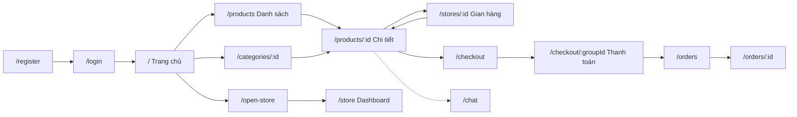

# 05 - Hướng dẫn từng trang (User Frontend)

> **Trạng thái tài liệu:** BẢN NHÁP v0.1
> **Cập nhật:** 2026-11-08
> **Áp dụng cho:** `Moldy-Market-User-Frontend`
> **Mục đích:** Mô tả từng trang chính: mục đích nghiệp vụ, người dùng, bố cục, component, dữ liệu, API, validation, các trạng thái giao diện, quyền và điều hướng. Danh sách route và guard nằm ở doc 04.

Quy ước nhãn: `[ĐÃ XÁC MINH BACKEND]` (từ doc 14), `[ĐÃ CẤU HÌNH]` (đã có trong repo), `[ĐỀ XUẤT]` (dự kiến, chưa có code). **Toàn bộ nội dung bố cục, component, hook, trạng thái giao diện dưới đây là `[ĐỀ XUẤT]`**; hiện repo chưa có trang nào ngoài trang thử `App.jsx`. Tên component, hook là ví dụ minh họa, chưa có trong repo.

---

## 0. Quy tắc chung cho mọi trang

### 0.1 Bốn trạng thái dữ liệu `[ĐỀ XUẤT]`

Trang nào lấy dữ liệu từ API cũng phải xử lý đủ bốn trạng thái, không chỉ trạng thái thành công:

| Trạng thái | Cách thể hiện | Lưu ý |
|---|---|---|
| Đang tải | Skeleton có hình dạng giống nội dung thật | Tránh spinner toàn trang; tránh nhảy bố cục khi dữ liệu về |
| Rỗng | Câu giải thích và nút hành động tiếp theo | Phân biệt "chưa có dữ liệu" với "lọc không ra kết quả" |
| Lỗi | Thông báo thân thiện, nút "Thử lại" | Ánh xạ `code` của Backend sang key i18n, không hiển thị `message` tiếng Anh của Backend |
| Thành công | Nội dung | |

### 0.2 Ánh xạ lỗi Backend `[ĐÃ XÁC MINH BACKEND]` cho mã lỗi, `[ĐỀ XUẤT]` cho cách xử lý

| Mã | Xử lý chung trên giao diện |
|---|---|
| `COMMON_001` (400) | Hiển thị lỗi theo field nếu Backend trả được; nếu không, thông báo chung. Cấu trúc chi tiết của `ApiError` mới biết "có ít nhất đường dẫn request" nên không giả định có danh sách lỗi theo field |
| `COMMON_003` (401) | Thử refresh token một lần; thất bại thì về `/login` |
| `COMMON_004` (403) | Trang hoặc khối "Không có quyền" |
| `COMMON_009` (429) | Báo gọi quá nhiều, tạm khóa nút gửi |
| `COMMON_010` (409) | Báo dữ liệu đã bị người khác sửa, tải lại trước khi cho sửa tiếp |

### 0.3 Điều cần nhớ chung

- Giá, tổng tiền luôn do Backend trả; Frontend chỉ định dạng hiển thị (VND), không tự tính số tiền quyết định thanh toán.
- Ngày giờ Backend trả ở dạng chuỗi ISO; hiển thị theo múi giờ trình duyệt.
- Mọi chuỗi giao diện đi qua i18n (`vi` mặc định, `en` dự phòng); không viết cứng chuỗi trong component `[ĐÃ CẤU HÌNH]` hạ tầng i18n.
- Component nút lấy từ shadcn `button` `[ĐÃ CẤU HÌNH]`. Các component shadcn khác (input, dialog, ...) sẽ được thêm bằng CLI khi cần; hiện chưa cài.

---

## 1. Trang công khai

### 1.1 Trang chủ `/` (`HomePage`)

| Mục | Nội dung |
|---|---|
| Mục đích nghiệp vụ | Cho khách và thành viên khám phá nhanh các danh mục và sản phẩm mới, dẫn vào luồng tìm kiếm và mua |
| Người dùng | Mọi người, kể cả chưa đăng nhập |
| Bố cục | Khối hero (nội dung tĩnh), lưới danh mục, danh sách "sản phẩm mới" theo `sort=newest`, khối editorial/giới thiệu (tĩnh) |
| Component chính | `CategoryGrid`, `ProductCard`, `ProductGrid`, `SearchBar` (trong header) |
| API (đã xác minh) | `GET /api/v1/categories` (cây danh mục), `GET /api/v1/products/search` (ví dụ `sort=newest`, `size` nhỏ) |
| Dữ liệu hiển thị | Tên danh mục; ảnh, tiêu đề, giá, tình trạng của sản phẩm |
| Validation | Không có form |
| Tương tác | Bấm danh mục đi `/categories/:categoryId`; bấm sản phẩm đi `/products/:productId`; tìm kiếm đi `/products?q=...` |
| Trạng thái giao diện | Mỗi khối (danh mục, sản phẩm) tải độc lập, có skeleton riêng; rỗng: ẩn khối sản phẩm, vẫn hiện danh mục; lỗi: khối lỗi cục bộ, không làm hỏng cả trang |
| Quyền | Công khai |
| Điều hướng sau hành động | Như bảng tương tác |
| Trạng thái triển khai | Backend `IMPLEMENTED`; FE `NOT_STARTED`. Chưa biết cấu trúc ảnh trong `ProductResponse` (chưa audit DTO danh sách) nên cần kiểm tra response thật trước khi code `ProductCard` |

### 1.2 Danh sách và tìm kiếm `/products` (`ProductListPage`) và `/categories/:categoryId` (`CategoryPage`)

| Mục | Nội dung |
|---|---|
| Mục đích nghiệp vụ | Tìm, lọc, sắp xếp sản phẩm đồ cũ để chọn món phù hợp |
| Người dùng | Mọi người |
| Bố cục | Cột trái là bộ lọc (facets), phía trên là ô tìm kiếm và sắp xếp, lưới sản phẩm, phân trang. Trên mobile bộ lọc thu thành ngăn kéo |
| Component chính | `SearchBar` (có gợi ý từ khóa), `FilterPanel`, `SortSelect`, `ProductGrid`, `Pagination` |
| API (đã xác minh) | `GET /api/v1/products/search`, `GET /api/v1/products/suggest?q=`. `CategoryPage` thêm `GET /api/v1/categories/{id}` và truyền `categoryId` vào search |
| Tham số search | Xem doc 04 mục 5 (`q` tối đa 100 ký tự, `categoryId[]` tối đa 20, `condition[]` tối đa 10, `minPrice`, `maxPrice`, `storeId`, `sellerType`, `attr[]` tối đa 10, `sort`, `facets`) |
| Response | `ProductSearchResponse { items, page, size, totalElements, totalPages, totalCapped, facets }`. Khi `totalCapped = true` hiển thị "từ 10.000 kết quả trở lên" thay vì số chính xác |
| Dữ liệu hiển thị | Thẻ sản phẩm; số kết quả; các nhóm facet. Cấu trúc chi tiết của `facets` **chưa audit**, cần xem response thật |
| Validation | `q` tối đa 100 ký tự (cắt hoặc chặn nhập); giá: `minPrice` không lớn hơn `maxPrice`. Quy tắc này là kiểm tra giao diện của Frontend, chưa phải ràng buộc đã xác minh của Backend |
| Tương tác | Đổi bộ lọc cập nhật query string rồi gọi lại; đổi bộ lọc đưa `page` về 1; gợi ý từ khóa gọi `suggest` có debounce (khoảng 300 ms, tham số ví dụ) |
| Trạng thái giao diện | Đang tải: skeleton lưới; rỗng: "Không có sản phẩm phù hợp" kèm nút xóa bộ lọc; lỗi: nút thử lại. Giữ dữ liệu cũ mờ đi khi đổi trang (`placeholderData`) để tránh nhấp nháy |
| Quyền | Công khai |
| Điều hướng | Bấm thẻ đi `/products/:productId` |
| Trạng thái triển khai | Backend `IMPLEMENTED`; FE `NOT_STARTED`. `GET /api/v1/products` (danh sách thường) chưa audit tham số; dùng `/search` để duyệt sản phẩm (doc 14 mục 2.2) |

Lỗi hay gặp: gửi `page=0` (search dùng 1-based); để mất bộ lọc khi người dùng quay lại bằng nút Back vì lưu trạng thái trong state thay vì URL.

### 1.3 Chi tiết sản phẩm `/products/:productId` (`ProductDetailPage`)

| Mục | Nội dung |
|---|---|
| Mục đích nghiệp vụ | Cho người mua đánh giá món đồ cũ (ảnh, mô tả, tình trạng, giá, người bán) và quyết định mua |
| Người dùng | Mọi người xem được; hành động mua cần đăng nhập |
| Bố cục | Thư viện ảnh, khối tiêu đề, giá, tình trạng, nút hành động (Mua ngay, thêm vào giỏ, nhắn người bán), mô tả, thuộc tính, thẻ gian hàng hoặc người bán |
| Component chính | `ProductGallery`, `PriceTag`, `ConditionBadge`, `ProductAttributes`, `SellerCard`, `ProductActions` |
| API (đã xác minh) | `GET /api/v1/products/{id}` |
| Dữ liệu hiển thị | Tiêu đề (<= 150 ký tự), giá, tình trạng (`NEW`, `LIKE_NEW`, `USED`, `DAMAGED`), mô tả (<= 2000), tối đa 10 ảnh https, thuộc tính, trạng thái (`ACTIVE`, `HIDDEN`, `SOLD`, `DELETED`, `REMOVED`) |
| Khối chưa có Backend | Khối thẩm định và chiến lược định giá `PARTIALLY_IMPLEMENTED` (chỉ `SELLER_SET` chạy; `AUTO_PRICING`, `APPRAISER` trả `PROD_003`); biểu đồ giá, sản phẩm tương tự, đánh giá, wishlist: `NOT_FOUND`; "Trả giá": `NOT_FOUND` (Q8). Các khối này chỉ là skeleton `TODO`, không gọi API |
| Nút "Mua ngay" | Phụ thuộc checkout (`IN_PROGRESS`); khi checkout chưa merge, nút bị ẩn hoặc vô hiệu hóa kèm chú thích. Không có ô chọn số lượng (Q17) |
| Nút "Nhắn người bán" | Phụ thuộc chat (`IN_PROGRESS`). Chat chỉ gắn hai user, **không gắn product** (Q6); cuộc hội thoại tạo bằng `targetUserId` nên giao diện chưa thể tự chèn thông tin sản phẩm vào chat |
| Validation | Không có form |
| Trạng thái giao diện | Đang tải: skeleton; sản phẩm không tồn tại hoặc đã `REMOVED`/`DELETED`: trang "Sản phẩm không còn". Mã lỗi `PROD_*` cụ thể cho trường hợp không tìm thấy **chưa được đọc**, nên xử lý theo HTTP 404 và `code` mà Backend trả thực tế khi test |
| Quyền | Công khai xem; hành động cần `RequireAuth` |
| Điều hướng | Mua ngay đi `/checkout`; thẻ gian hàng đi `/stores/:storeId` |
| Trạng thái triển khai | Backend `IMPLEMENTED` (chi tiết); FE `NOT_STARTED` |

Lỗi hay gặp: hiển thị nút Mua với sản phẩm `HIDDEN` hoặc `SOLD`; checkout trả `PROD_010` nếu sản phẩm không còn `ACTIVE`.

### 1.4 Trang gian hàng công khai `/stores/:storeId` (`StorePublicPage`)

| Mục | Nội dung |
|---|---|
| Mục đích nghiệp vụ | Cho người mua xem gian hàng và các sản phẩm của gian hàng đó |
| Người dùng | Mọi người |
| Bố cục | Đầu trang thông tin gian hàng; lưới sản phẩm của gian hàng; dùng lại bộ lọc/phân trang của danh sách |
| API (đã xác minh) | `GET /api/v1/stores/{id}` (công khai), `GET /api/v1/products/search` với `storeId` |
| Dữ liệu | Các trường của `StoreResponse` **chưa audit** (doc 14 không liệt kê); cần xem response thật trước khi code |
| Khối chưa có Backend | Theo dõi gian hàng (follow), đánh giá: `NOT_FOUND`, chỉ skeleton |
| Trạng thái giao diện | Gian hàng `BLOCKED` (`STORE_004`, 403): hiển thị "Gian hàng tạm không khả dụng" |
| Quyền | Công khai |
| Trạng thái triển khai | Backend `IMPLEMENTED`; FE `NOT_STARTED` |

---

## 2. Xác thực

### 2.1 Đăng nhập `/login` (`LoginPage`)

| Mục | Nội dung |
|---|---|
| Mục đích nghiệp vụ | Đăng nhập để mua bán, nhắn tin, quản lý gian hàng |
| Bố cục | Form một cột trong `AuthLayout`: email, mật khẩu, nút đăng nhập, liên kết sang đăng ký |
| API (đã xác minh) | `POST /api/v1/auth/login` với `{ email, password }` |
| Response | `{ userId, email, fullName, accessToken, refreshToken, tokenType }` |
| Validation | Email: định dạng email, tối đa 254 ký tự (đã xác minh). Mật khẩu: bắt buộc (không áp quy tắc độ dài ở đăng nhập, để Backend quyết định) |
| Lỗi cần xử lý | `AUTH_001` (sai email hoặc mật khẩu); `AUTH_003` (khóa) và `AUTH_004` (vô hiệu): thông báo khác nhau; `COMMON_009` (429). **Tài khoản `PENDING_VERIFICATION` trả `ACCOUNT_DISABLED`** (B10): thông báo rõ tài khoản chưa được kích hoạt, nội dung chốt khi có quyết định Q14 |
| Sau thành công | Lưu phiên (cách lưu: Q2, **chưa chốt**, xem doc 08), gọi `GET /api/v1/users/me` để lấy role, chuyển về đường dẫn trước đó hoặc `/` |
| Trạng thái giao diện | Nút đăng nhập vô hiệu và hiện tiến trình khi đang gửi; không làm trống ô email khi lỗi |
| Quyền | Khách (`GuestOnly`) |
| Trạng thái triển khai | Backend `IMPLEMENTED`; FE `NOT_STARTED` |

Lỗi hay gặp: dùng một thông báo duy nhất "đăng nhập thất bại" cho mọi mã lỗi; lưu mật khẩu vào state toàn cục.

### 2.2 Đăng ký `/register` (`RegisterPage`)

| Mục | Nội dung |
|---|---|
| Mục đích nghiệp vụ | Tạo tài khoản mới |
| Bố cục | Form: họ tên, email, số điện thoại, mật khẩu, (tùy chọn) nhập lại mật khẩu, nút đăng ký |
| API (đã xác minh) | `POST /api/v1/auth/register` với `{ email, password, fullName, phone }` |
| Response | `{ userId, email, fullName, status }` (status là `PENDING_VERIFICATION`) |
| Validation | Mật khẩu 8 đến 100 ký tự; `fullName` tối đa 100 ký tự (đã xác minh). Định dạng email và `phone`: **chưa audit** quy tắc cụ thể, Frontend chỉ kiểm tra định dạng cơ bản và để Backend trả `COMMON_001`. Ô "nhập lại mật khẩu" là kiểm tra thuần Frontend |
| Sau thành công | Hiển thị form OTP với email đã đăng ký. Người dùng nhập mã và đặt mật khẩu cuối cùng; Backend kiểm tra OTP trước khi lưu mật khẩu và chuyển sang `ACTIVE`. Đăng ký lại email pending trả `EMAIL_NOT_VERIFIED` và mở form tiếp tục xác nhận với nút xin mã mới. Email đã kích hoạt vẫn bị chặn đăng ký trùng. Có thể quay lại `/verify-email` để tiếp tục. |
| Trạng thái giao diện | Như trang đăng nhập; lỗi email trùng: mã lỗi cụ thể **chưa đọc**, xử lý theo `code` thật khi test |
| Quyền | Khách |
| Trạng thái triển khai | Có form đăng ký, xử lý email và số điện thoại trùng, xác nhận và gửi lại OTP. Backend local đã qua test; Chu đã xác nhận gửi OTP qua Gmail thật. Bước đặt mật khẩu cuối cùng khi xác nhận OTP chờ kiểm thử lại toàn luồng. |

### 2.3 Không tìm thấy `*` (`NotFoundPage`)

Hiển thị thông báo, nút về trang chủ và ô tìm kiếm. Đã có sẵn key i18n `notFound.message` trong `common.json` `[ĐÃ CẤU HÌNH]`. Không gọi API.

---

## 3. Tài khoản (cần đăng nhập)

### 3.1 Hồ sơ `/profile` và sửa hồ sơ `/profile/edit`

| Mục | Nội dung |
|---|---|
| Mục đích | Xem và cập nhật thông tin cá nhân |
| API (đã xác minh) | `GET /api/v1/users/me` (trả cả `roles: string[]`), `PUT /api/v1/users/me` (quyền `PROFILE_MANAGE`) |
| Dữ liệu và validation | `fullName` bắt buộc, tối đa 100 ký tự. `phone` tùy chọn, bắt đầu bằng `0` hoặc `+84`, sau đó là 9 chữ số ASCII. Bỏ qua `phone` để giữ số hiện tại. Số đã dùng bởi tài khoản khác trả `409 PHONE_ALREADY_EXISTS`. Xem contract ở mục 3.4 doc 14. |
| Trạng thái giao diện | Form mở sẵn dữ liệu hiện tại; thành công: toast và quay về `/profile`; `403` (thiếu `PROFILE_MANAGE`): khối không có quyền |
| Trạng thái triển khai | Backend `IMPLEMENTED`; FE `NOT_STARTED` |

### 3.2 Cài đặt tài khoản `/account/settings`

| Mục | Nội dung |
|---|---|
| Mục đích | Đổi mật khẩu và chỉnh tùy chọn giao diện |
| API (đã xác minh) | `PUT /api/v1/users/me/password` nhận `currentPassword` và `newPassword`. Xác nhận mật khẩu mới là trường của form Frontend. |
| Validation | Hai mật khẩu bắt buộc. DTO yêu cầu mật khẩu mới tối thiểu 8 ký tự. Backend trả `401 INVALID_CREDENTIALS` nếu mật khẩu hiện tại sai và `400 SAME_PASSWORD` nếu mật khẩu mới trùng mật khẩu hiện tại. |
| Tùy chọn cục bộ | Chọn ngôn ngữ `vi`/`en` (hạ tầng i18n đã có `[ĐÃ CẤU HÌNH]`; lưu lựa chọn bằng Zustand khi làm trang này) |
| Phiên đăng nhập | Tại `21d16cd`, service đổi mật khẩu chỉ cập nhật hash. Frontend giữ phiên đăng nhập khi đổi mật khẩu thành công. |
| Trạng thái triển khai | Backend `IMPLEMENTED`; FE `NOT_STARTED` |

### 3.3 Mở gian hàng `/open-store` (`OpenStorePage`)

| Mục | Nội dung |
|---|---|
| Mục đích | Cho người dùng đã đăng nhập mở gian hàng của mình |
| API (đã xác minh) | `POST /api/v1/stores` |
| Quy tắc đã xác minh | Mỗi user một gian hàng; vi phạm trả `STORE_ALREADY_EXISTS` |
| Dữ liệu và validation | `name` bắt buộc, tối đa 255 ký tự. `description` và `pickupAddress` tùy chọn, DTO không khai báo giới hạn độ dài. |
| Điều hướng | Tạo xong chuyển tới `/store` |
| Trạng thái giao diện | Nếu `GET /api/v1/stores/my-store` trả gian hàng thì chuyển tới `/store`. Hiện form khi API trả `404 STORE_NOT_FOUND`. |
| Quyền | Đã đăng nhập |
| Trạng thái triển khai | Backend `IMPLEMENTED`; FE `NOT_STARTED` |

### 3.4 Sản phẩm cá nhân `/my-products`, `/my-products/new`, `/my-products/:productId/edit`

| Mục | Nội dung |
|---|---|
| Mục đích | Quản lý các tin cá nhân đã có. Tin mới đăng qua gian hàng tại `/store/products/new`. |
| API sửa, xóa, đổi trạng thái | `PUT /api/v1/products/{id}`, `DELETE /api/v1/products/{id}` (không có body trả về), `PATCH /api/v1/products/{id}/status?status=` (quyền `PRODUCT_MANAGE_OWN`) |
| Liệt kê tin của tôi | `GET /api/v1/products/me?page=1&size=20` từ thay đổi Backend local (Q19). Chỉ liệt kê tin cá nhân `ACTIVE` và `HIDDEN` của tài khoản đang đăng nhập. |
| Form tạo, validation đã xác minh | `categoryId` bắt buộc; `title` bắt buộc, tối đa 150 ký tự; `price` bắt buộc, lớn hơn 0 và không quá 1.000.000.000, tối đa 2 chữ số thập phân; `condition` bắt buộc (`NEW`, `LIKE_NEW`, `USED`, `DAMAGED`); `pricingStrategy` bắt buộc; `description` tùy chọn, tối đa 2000; `images` tối đa 10, **chỉ URL https**, mỗi URL tối đa 500 ký tự; `attributes` được Backend kiểm tra bằng `@ValidProductAttributes` (quy tắc thuộc tính theo danh mục **chưa audit**) |
| Chiến lược định giá | Chỉ `SELLER_SET` hoạt động. `AUTO_PRICING` và `APPRAISER` trả `PROD_003` ("chưa hỗ trợ"). Form nên chỉ cho chọn `SELLER_SET` cho đến khi module pricing merge |
| Ảnh | Backend chỉ nhận **URL https**, không có API upload (Q5). Giao diện ảnh ở trạng thái `TODO`; không tự dựng cơ chế upload |
| Form sửa | Bắt buộc gửi `version`. Lỗi `COMMON_010` (409): báo "dữ liệu đã bị thay đổi", tải lại sản phẩm rồi cho sửa lại |
| Đổi trạng thái | Người bán chỉ chuyển qua lại giữa `ACTIVE` và `HIDDEN`; chuyển khác trả `PROD_004`. Đã đạt giới hạn tin đăng: `PROD_008` (409) |
| Trạng thái giao diện | Xóa cần hộp xác nhận; thành công `DELETE` không có body nên không đọc `response.data.data` |
| Quyền | Đã đăng nhập; quyền chi tiết do Backend kiểm tra (`PRODUCT_CREATE`, `PRODUCT_MANAGE_OWN`) |
| Trạng thái triển khai | Backend `IMPLEMENTED` (CRUD), liệt kê chưa rõ; FE `NOT_STARTED` |

### 3.5 Giỏ hàng `/cart`

| Mục | Nội dung |
|---|---|
| Mục đích | Gom sản phẩm cần mua trước khi thanh toán |
| Trạng thái | Q7 doc 14 đã chốt và cho phép tích hợp GET cart, POST item, DELETE item đã sửa và test Backend local. Các endpoint khác của cart chưa nằm trong flow này |
| Dữ liệu | `CartResponse { id, userId, status, items[], subtotal, totalItems, ... }`; item có `listingId = Product.id`, `sellerId`, `quantity = 1`, `priceAtAddTime`, `totalPrice`, `note`. Giỏ chưa tồn tại trả items rỗng và subtotal 0 |
| Thêm sản phẩm | Từ chi tiết sản phẩm ACTIVE; khách chuyển đăng nhập và giữ đường dẫn quay lại. Ẩn nút với tin của mình hoặc storeId liên kết; Backend kiểm tra chủ và mọi staff, trả `403 CART_OWN_PRODUCT` khi không được phép |
| Giao diện | Nhóm `items` theo sellerId tại Frontend; tên và link lấy từ chi tiết sản phẩm. Giá dòng và subtotal dùng snapshot Backend. Sản phẩm không còn truy cập được vẫn xóa khỏi giỏ được. Có loading, empty, error/retry, forbidden và lỗi xóa |
| Cache | Query key theo userId, mutations cùng tài khoản thực hiện tuần tự. Dùng CartResponse sau mutation để cập nhật cache, bỏ response đến muộn nếu tài khoản đã đổi/đăng xuất |
| Phạm vi tiếp theo | Q16/Q17 đã chốt trong doc 14. Đã có UI chọn tối đa 20 món ACTIVE, bỏ chọn và chuyển productId trên URL sang form checkout. Chu đã chép code và được sửa lỗi gõ; 251 test pass trên repo chính. Chưa gọi API tạo đơn |
| FE | INTEGRATED local; service và routing tests đã pass. Chu xác nhận thêm, xem, tải lại và xóa với Backend thật ngày 2026-11-18 |

---

## 4. Mua hàng

### 4.1 Checkout `/checkout` (`CheckoutPage`)

> Kiểm chứng mới nhất: Chu xác nhận ngày 2026-11-20: online checkout → QR → SePay Test mode → webhook HMAC → thanh toán thành công, order đã xác nhận, xóa đúng món khỏi giỏ và giữ trạng thái sau reload. INTEGRATED_LOCAL_SANDBOX; chưa kiểm thử tiền thật/SePay Live hoặc toàn bộ vòng đời COD.

> Cập nhật 2026-11-20: **IMPLEMENTED_LOCAL**. Chu đã chép source/route/i18n theo docs/learning/checkout-payment-ui.md; đã sửa lỗi payload, URL, countdown, export, QR, form bị thiếu field và component đặt nhầm thư mục. Form đã gọi POST tạo checkout, chặn bấm đúp và giữ giỏ theo trạng thái server. Những dòng “nút tắt/chưa gọi API” dưới đây lưu trạng thái cũ trước khi nối flow; chưa xác minh HTTP checkout.

| Mục | Nội dung |
|---|---|
| Mục đích | Người mua nhập thông tin nhận hàng, chọn phương thức thanh toán, tạo đơn |
| Trạng thái | Backend chọn lọc đã nối local trên codex/selective-checkout-integration, xem doc 14 mục 5.7.2. Frontend mới có form; chưa có service submit checkout |
| Dữ liệu theo contract đã audit | `orderItems` (1 đến 20 phần tử, mỗi phần tử có `productId` UUID), `receiverName` (tối đa 255), `phoneNumber` (regex `^(\+84|0)\d{9,10}$`), `shippingAddress` (tối đa 500), `method` (`COD` hoặc `ONLINE_BANKING`), `note` (tùy chọn, tối đa 500). quantity thiếu được mặc định 1, gửi >1 bị chặn; Frontend chỉ cần productId và không có ô số lượng |
| Quy tắc đã xác minh | Giá do Backend tính; Frontend không gửi giá. Không trùng `productId` (`ORDER_005`). Sản phẩm phải `ACTIVE` (`PROD_010`). Một lần checkout có thể tách thành nhiều order theo cặp `(sellerId, storeId)`. Phí ship luôn 0, voucher chưa áp dụng |
| Validation giao diện | Dùng đúng các ràng buộc trên (schema Zod ở `features/products/schemas` hoặc module checkout khi tạo) |
| Sau thành công | `CheckoutResponse { id, totalAmount, expiredAt, orders[], status, paymentResponse }`. Chuyển tới `/checkout/:checkoutGroupId`. `COD`: `expiredAt = null`, `qrBankUrl = null` |
| Điền sẵn thông tin | Chu đã duyệt lấy fullName và phone của session, cho sửa người nhận, giữ nguyên field đã sửa khi profile tải về muộn. Địa chỉ vẫn nhập riêng; không cập nhật profile. Trợ lý đã sửa trực tiếp theo yêu cầu của Chu. Năm regression tests pass, gồm nhập rồi xóa trắng trước khi profile về; tổng 256 test pass |
| UI chuẩn bị | URL chứa productId đã chọn; kiểm tra từ 1–20 ID không trùng, tất cả còn trong giỏ hiện tại và product ACTIVE. Nếu giỏ thay đổi hoặc sản phẩm không sẵn sàng thì yêu cầu kiểm tra lại. Giá là snapshot tạm tính. Form kiểm tra khi rời ô, có COD/chuyển khoản; nút Đặt hàng tắt và thông báo chưa gửi thông tin |
| Giữ hàng và payment | Q15–Q18 đã chốt và Backend nối local: reservation, deadline, online/COD, hủy và cart cleanup. UI chưa gọi các thao tác này |
| FE | `IMPLEMENTED_UI_LOCAL`: Chu đã chép đủ source/route/i18n; format, lint, build và 256/256 test pass trên repo chính. Hướng dẫn học ở docs/learning/checkout-ui.md. Chờ thử giao diện thực tế, chưa tích hợp HTTP checkout |

### 4.2 Thanh toán `/checkout/:checkoutGroupId` (`CheckoutPaymentPage`)

> Hủy checkout: Kiểm chứng repo chính ngày 2026-11-21: format check, lint, build và 362/362 tests trong 41 file pass sau khi sửa lỗi chép. Chu xác nhận ngày 2026-11-21 đã thử hủy checkout với Backend thật từ UI thành công: hủy các đơn trong checkout, ẩn QR, giữ giỏ, reload giữ trạng thái và có thể đặt lại. INTEGRATED_LOCAL cho hủy online chưa thanh toán; không bao gồm refund hoặc hủy COD.

> Hủy checkout (2026-11-21): **INTEGRATED_LOCAL**, source trọn flow ở docs/learning/checkout-cancel-ui.md. Chỉ ONLINE_BANKING, payment PENDING và mọi order PENDING_PAYMENT của buyer hiện tại. Dùng POST /api/v1/orders/buyer/{orderId}/cancel một lần cho cả checkout chung QR; có xác nhận rõ phạm vi. Ẩn QR lúc hủy hoặc kết quả chưa rõ, không tự retry POST hoặc optimistic CANCELLED. Sau request đọc lại checkout/cart/orders và invalidate chi tiết sản phẩm liên quan; không xóa giỏ phía client. COD và refund không thuộc UI lần này. Chu đã chép source hủy; đã sửa URL thiếu dấu /, key stateChanged và i18n vi đặt nhầm cấp. Chu xác nhận ngày 2026-11-21 đã thử hủy checkout với Backend thật từ UI thành công: hủy các đơn trong checkout, ẩn QR, giữ giỏ, reload giữ trạng thái và có thể đặt lại. INTEGRATED_LOCAL cho hủy online chưa thanh toán; không bao gồm refund hoặc hủy COD.

> Kiểm chứng mới nhất: Chu xác nhận ngày 2026-11-20: online checkout → QR → SePay Test mode → webhook HMAC → thanh toán thành công, order đã xác nhận, xóa đúng món khỏi giỏ và giữ trạng thái sau reload. INTEGRATED_LOCAL_SANDBOX; chưa kiểm thử tiền thật/SePay Live hoặc toàn bộ vòng đời COD.

> **IMPLEMENTED_LOCAL**: source đã chép và sửa lỗi trên repo chính. Dùng GET checkout cho cả reload và polling, không cần GET payment riêng. Online chờ tiền/đồng bộ polling mỗi 5 giây; COD cập nhật thủ công. Dừng khi terminal, GET lỗi, logout hoặc rời trang. Chỉ payment SUCCESSFUL cùng group PAID mới hiển thị đã trả tiền. Đồng hồ bằng 0 ẩn QR, không tự kết luận EXPIRED. GET lỗi ẩn QR cũ; 403/404 ẩn snapshot. Cache theo userId; invalidate cart/orders khi server xác nhận kết thúc hoặc thu một phần COD, không tự DELETE cart. Đơn chưa thanh toán có link quay lại checkout cũ. Hướng dẫn đầy đủ: docs/learning/checkout-payment-ui.md; chờ kiểm tra HTTP.

| Mục | Nội dung |
|---|---|
| Mục đích | Hiển thị QR chuyển khoản, đếm ngược hết hạn, báo kết quả thanh toán |
| Trạng thái | Backend IMPLEMENTED_LOCAL, đã test PostgreSQL/HTTP; Frontend chưa viết service/page |
| API dự kiến | `GET /api/v1/checkout-groups/{id}` (chỉ người mua; sai chủ trả `ORDER_011`), `GET /api/v1/payments/{id}` để polling |
| Hiển thị | Ảnh QR từ `qrBankUrl` (URL ảnh do Backend trả; **không tự dựng QR**); `totalAmount` do Backend trả; đếm ngược dựa trên `expiredAt` (`ONLINE_BANKING` là 15 phút) |
| Quy tắc bắt buộc | Chỉ coi là thành công khi `paymentStatus === "SUCCESSFUL"` do Backend trả khi polling. Nút "Tôi đã chuyển khoản" nếu có chỉ làm tăng tần suất kiểm tra, **không bao giờ** tự đổi trạng thái. B12 đã sửa local; vẫn phải đọc paymentStatus, không suy ra COD đã thu tiền từ order CONFIRMED |
| Polling | Không có kênh push. Tần suất polling hợp lý chưa chốt (Q11). Dừng polling khi `SUCCESSFUL`, `FAILED`, hoặc người dùng rời trang |
| Hết hạn | Backend có job 60 giây và kiểm tra deadline tại webhook. Đồng hồ UI chỉ gợi ý, phải đọc group EXPIRED/CANCELLED và payment FAILED từ server |
| Chưa có | Thông tin chuyển khoản dạng chữ chưa có trong response (Q11); tiền trễ/lệch được lưu đối soát, chưa có xử lý refund tự động |
| COD | Dùng paymentResponse.method từ server; COD không có QR. Owner xác nhận, admin giao hàng/ghi nhận thu tiền theo Q18; receipt từng order có thể có trước khi cả group đã thu đủ |
| FE | `NOT_STARTED` |

### 4.3 Danh sách đơn `/orders` và chi tiết đơn `/orders/:orderId`

| Mục | Nội dung |
|---|---|
| Mục đích | Người mua xem lịch sử và tiến trình đơn |
| Trạng thái | GET /orders/me đã audit trên main local tại dc11b09 và được dùng. Chu chọn làm Frontend trước, giữ nguyên Backend |
| API dự kiến | `GET /api/v1/orders/me` (mảng, không phân trang). Chi tiết dùng dữ liệu từ danh sách tài khoản, chưa gọi endpoint /orders/{orderId} |
| Trạng thái rỗng | `GET /orders/me` trả **404 `ORDER_LIST_NOT_FOUND`** (ORDER_003 là mã nội bộ) khi chưa có order: phải xử lý như danh sách rỗng, không phải lỗi (B13) |
| Hiển thị | `orderCode`, trạng thái, `totalAmount`, các item (`productName`, `unitPrice`, `imageUrl`), thông tin nhận hàng, các mốc thời gian |
| Timeline order | Chỉ `PENDING_PAYMENT` (lúc tạo) và `DELIVERED` sang `COMPLETED` (do admin) có code. **Không vẽ timeline đầy đủ** như thể các bước `CONFIRMED`, `SHIPPING`... đã chạy (doc 14 mục 5.7, Q15). Trạng thái lạ xử lý bằng nhánh mặc định |
| Bảo mật | `GET /orders/{orderId}` hiện không kiểm tra chủ order (B11); UI chi tiết tìm trong danh sách /orders/me và kiểm tra buyerId khớp session. Không gọi endpoint detail. Backend vẫn cần sửa kiểm tra quyền; cách đọc dữ liệu của UI không khắc phục B11 |
| FE | IMPLEMENTED_LOCAL: Chu đã chép source/route/menu/i18n theo docs/learning/orders-ui.md. Đã sửa lỗi chép; format/lint/build và 272/272 test pass. CSS và test có trong repo. Chưa xác minh HTTP local |

---

## 5. Giao tiếp

### 5.1 Thông báo `/notifications`

| Mục | Nội dung |
|---|---|
| Trạng thái | `IMPLEMENTED_LOCAL` 22/11: Backend thật + DynamoDB Local qua 5 HTTP tests; chưa xác minh AWS pipeline. Chi tiết doc 14 §5.1 |
| API | GET cursor `limit=20&token`, PATCH `/{id}/read`, DELETE `/{id}`; mutation 204 rỗng. ID/cursor opaque; restore API có nhưng UI chưa dùng |
| Giao diện | `useInfiniteQuery` cache theo user; bấm Tải thêm, không auto-scroll/polling. Trang rỗng có cursor vẫn tải tiếp. Có loading, empty, lỗi, 401/403; giữ trang trước khi tải thêm lỗi |
| Thao tác | Mark read rõ ràng; xóa cần xác nhận inline. Không optimistic update; refetch REST sau thao tác. Chặn double-submit, không khôi phục cache sau logout. Làm mới bắt đầu lại từ trang đầu |
| Contract | REST `read` boolean (đã HTTP test), `message`, `id`, `relatedEntityType/Id`; ngày Instant UTC. Title/message text an toàn cho type chưa biết |
| Giới hạn | Không badge tổng chưa đọc, không realtime/polling, không reference links chưa xác minh. Producer nghiệp vụ sang Lambda chưa nối/kiểm chứng; không giả dữ liệu rỗng khi lỗi cấu hình |
| FE | `IMPLEMENTED_LOCAL`, route RequireAuth và navigation; chờ Chu kiểm thử UI |

### 5.2 Chat `/chat` và `/chat/:conversationId`

| Mục | Nội dung |
|---|---|
| Trạng thái | REST/TEXT realtime/read-unread IMPLEMENTED_LOCAL. Backend verify 314 tests (313 pass, 1 disabled có sẵn); FE 449/449, format/lint/format:check/build pass. Manual UI chờ Chu kiểm tra |
| REST | `POST /api/v1/conversations` (`{ targetUserId }`), `GET /api/v1/conversations`, `GET /api/v1/conversations/{id}/messages?page&size`, PATCH read bắt buộc `{messageId}`, thành công 204 |
| Phân trang lịch sử | Backend page bắt đầu từ 0. Service Frontend nhận page bắt đầu từ 1, chuyển request về 0 và truyền size 20 rõ ràng. normalizeSpringPage đổi content thành items và number về page 1-based, giữ nguyên thứ tự mới nhất trước. Mặc định Backend size 4 (B6) |
| WebSocket | STOMP qua SockJS tại `/chat`; frame `CONNECT` có header `Authorization: Bearer <accessToken>`; gửi tới `/app/conversations/{conversationId}/send` với `{ type, content?, attachmentUrl? }`; nhận tại `/user/queue/messages`; lỗi tại `/user/queue/errors`, payload local thực tế có code, errorMessage, timestamp. Tin được đẩy cho cả người gửi và người nhận |
| Phiên/kết nối | Backend kiểm tra token/account tại CONNECT và SEND/SUBSCRIBE. Frontend refetch session REST trước mỗi CONNECT để dùng refresh interceptor hiện có; đổi token/logout sẽ đóng socket cũ. Không đặt token trong URL |
| Giao diện | Cột trái danh sách hội thoại, cột phải khung tin nhắn; mobile hiển thị lần lượt. Loại tin `TEXT`, `IMAGE`, `FILE` |
| Điểm vào chat | Có nút Chat với gian hàng ở chi tiết sản phẩm và header gian hàng công khai; cùng flow tạo/lấy conversation rồi mở /chat/:id. Luôn nhắn owner, kể cả sản phẩm staff đăng. DTO ownerId đã được Chu chép và kiểm tra trên repo chính (doc 14 mục 5.2.1). Chưa có ownerId thì nút disabled và cho tải lại; không fallback sang sellerId staff |
| FE | Có inbox, REST history và STOMP TEXT cho hội thoại có sẵn; chờ Chu kiểm thử UI hai tài khoản. Tài liệu: docs/learning/chat-realtime.md |
| Inbox/composer | Cache theo user/phòng, tải tin cũ, gộp bỏ trùng và sắp thời gian. Hiện tên peer/sender thật với fallback trung tính. canSend/sendBlockedReason điều khiển chỉ đọc. TEXT nguyên văn; IMAGE/FILE chỉ nhãn. Chỉ xóa draft sau echo; lỗi/timeout/disconnect giữ draft, không tự gửi lại. CLOSED/history 403 không được gửi |
| Read/unread | Badge menu/từng phòng từ server unreadCount, không đếm tin mình gửi. Ack ID prefix chỉ khi document focus/visible và bubble incoming được quan sát trong viewport; lỗi giữ unread, retry thủ công. “Đã đọc” trên tin gửi chỉ từ peer cursor. Queue riêng /user/queue/chat-reads sau commit; một socket toàn MainLayout và poll foreground 30 giây bù event mất. Xem doc 14 mục 5.2 và Backend docs/testing/CHAT-READ-UNREAD.md |
| Mapping Backend | conversationId đã map từ entity thật; attachment giữ null. Không đoán phòng hoặc thêm clientMessageId vào payload chưa có contract |

---

## 6. Trang chưa có hoặc chưa đủ Backend

| Route | Nội dung | Trạng thái |
|---|---|---|
| `/appraiser/profile`, `/appraiser/queue`, `/appraiser/applications`, `/appraiser/invitations`, `/appraiser/assignments`, `/appraiser/assignments/:assignmentId`, `/appraiser/commissions` | Workspace hồ sơ, yêu cầu, ứng tuyển, lời mời, công việc, báo cáo và hoa hồng | UI preview có role gate và điều hướng; không có service/API call hoặc dữ liệu nghiệp vụ mẫu cho tới khi doc 14 được audit |
| `/appraisals`, `/appraiser/queue`, `/appraiser/requests/:requestId` | Yêu cầu thẩm định giá và hàng đợi người thẩm định. DTO pricing, appraiser chưa audit | `IN_PROGRESS`, chỉ skeleton |
| `/wishlist` | Danh sách yêu thích | `NOT_FOUND` |
| `/transactions` | Lịch sử giao dịch | `NOT_FOUND`; phạm vi cần xác nhận |

Các trang này chỉ có khung và nhãn `TODO`, không có service.

---

## 7. Store Dashboard (`/store/*`)

Tại `/store`, chủ gian hàng dùng `GET /api/v1/stores/my-store` để mở phần quản lý. Staff dùng membership từ `GET /api/v1/stores/my-store/staff/me`: storeId và permissions được cấp trong shop, không dùng permissions gộp của `/users/me`. `/open-store` chuyển staff về workspace để kiểm tra membership. Tài khoản có cả hai role ưu tiên gian hàng do họ sở hữu. Backend xác minh quyền cho từng request. Link “Xem trang công khai” mở trang storefront có bộ lọc; link “Sản phẩm của gian hàng” mở danh sách quản lý riêng khi có PRODUCT_MANAGE_OWN.

### 7.1 Hồ sơ gian hàng `/store/profile`

- Form lấy dữ liệu từ `GET /api/v1/stores/my-store` và lưu qua `PUT` cùng đường dẫn. Tên gian hàng bắt buộc, tối đa 255 ký tự. Để trống mô tả hoặc địa chỉ lấy hàng sẽ xóa giá trị cũ.
- Tên bị trùng (`STORE_NAME_TAKEN`, 409) hiển thị lỗi tại ô tên. Gian hàng bị khóa (`BLOCKED` hoặc `STORE_BLOCKED`, 403) hiển thị cảnh báo và chặn lưu.
- Trạng thái Backend: `IMPLEMENTED`. Frontend có form, chờ kiểm tra với Backend thật.

### 7.2 Sản phẩm của gian hàng `/store/products`, `/new`, `/:productId/edit`

- Owner liệt kê bằng `GET /api/v1/stores/my-store/products`; staff được cấp PRODUCT_MANAGE_OWN liệt kê bằng `GET /api/v1/stores/{storeId}/products`. Danh sách phân trang gồm tin `ACTIVE` và `HIDDEN`, không có bộ lọc công khai.
- Tạo tin gửi `storeId` của gian hàng. Chủ gian hàng lấy ID từ `my-store`; nhân viên có `PRODUCT_CREATE` dùng gian hàng liên kết từ hồ sơ phiên. Sửa, xóa và đổi trạng thái dùng contract mục 3.4; form sửa gửi `version` từ chi tiết sản phẩm.
- Chủ gian hàng mở chi tiết từ danh sách để sửa, ẩn/hiện hoặc xóa tin. Trang chi tiết và route sửa đối chiếu `storeId` của tin với gian hàng của tài khoản đang đăng nhập.
- Quyền Backend: `PRODUCT_CREATE`, `PRODUCT_MANAGE_OWN`. Lỗi `STORE_015` (403): không có quyền với tài nguyên của gian hàng này.
- Frontend đã có danh sách và các thao tác quản lý. Test tự động dùng mock service, chờ kiểm tra với Backend thật.

### 7.3 Nhân viên `/store/staff`

- API dưới `/api/v1/stores/my-store/staff`: thêm (`POST`, trực tiếp bằng email), danh sách (`GET`), đổi permission (`PUT /{staffId}/permissions`), xóa (`DELETE /{staffId}`) cần `STORE_STAFF_MANAGE`. Riêng `GET /me` cần `STORE_WORKSPACE_ACCESS`, chỉ trả membership của principal.
- Điều kiện: người được thêm phải có tài khoản `ACTIVE` (liên quan B10).
- **Mời** nhân viên là `PLANNED`: giao diện không có bước "gửi lời mời", chỉ có "thêm trực tiếp".
- Form đổi quyền dùng bảy mã đã đối chiếu với `StoreStaffService`: `PRODUCT_CREATE`, `PRODUCT_MANAGE_OWN` (Chu duyệt thêm 2026-11-21), `APPRAISAL_REQUEST_CREATE`, `ORDER_PROCESS`, `ORDER_CANCEL`, `OFFER_HANDLE`, `CHAT_SEND`. PRODUCT_CREATE và PRODUCT_MANAGE_OWN độc lập; không tự cấp cho staff cũ.
- Frontend có danh sách tên, email, quyền được cấp và form thêm nhân viên bằng email. Form gửi `permissions: []`; Backend tự cấp `STORE_WORKSPACE_ACCESS`. Sau khi thêm thành công, danh sách tải lại.
- Đổi quyền gửi toàn bộ danh sách được chọn qua `PUT` và tải lại danh sách nhân viên. Bỏ chọn hết gửi `[]`; Backend giữ `STORE_WORKSPACE_ACCESS`.
- Xóa nhân viên yêu cầu xác nhận trước khi gọi `DELETE`. Sau khi Backend thu hồi role `STAFF` tại gian hàng và trả thành công, Frontend tải lại danh sách.
- Danh sách, thêm, đổi quyền và xóa chờ kiểm tra với Backend thật.

### 7.4 Các trang chưa có Backend

| Route | Lý do | Trạng thái |
|---|---|---|
| Thống kê ở `/store` | Chưa có API thống kê | `NOT_FOUND` |
| /store/orders | Owner và staff ORDER_PROCESS cùng store xem; chỉ owner xác nhận COD khi payment PENDING. Có phương thức, trạng thái tiền và paidAt từng đơn, hướng dẫn bước tiếp theo và lịch sử timestamp thật. Missing/unknown metadata không đoán từ CONFIRMED/DELIVERED và không cho xác nhận. Phân trang/lọc URL, món/người nhận, refresh và loading/empty/error/forbidden. Không dùng route chi tiết buyer cho seller | IMPLEMENTED_LOCAL; metadata Backend đã được Chu chép và Maven verify 329 tests (328 pass, 1 disabled) ngày 22/11, xem doc 14 §5.7.3. Chờ Chu restart Backend và kiểm thử UI |
| `/store/vouchers` | Chưa có API voucher cho người bán | `PLANNED`, skeleton |
| `/store/offers` | Chưa có code offer (Q8) | `NOT_FOUND`, skeleton |
| `/store/revenue` | Chưa có API doanh thu | `NOT_FOUND`, skeleton |
| `/store/reviews` | Chưa có code review | `NOT_FOUND`, skeleton |
| `/store/settings` | Phạm vi chưa rõ | `REQUIRES_BUSINESS_CLARIFICATION` |

---

## 8. Sơ đồ điều hướng giữa các trang chính

Đường nét đứt (`Detail` tới `Chat`) là điểm vào chưa gắn với product (Q6). Các nút `Checkout`, `Pay`, `Orders`, `Chat` chỉ hoạt động sau khi Backend merge.

---

## Tài liệu liên quan

- 04 - Routing và danh sách trang: bảng route, guard, query string.
- 06 - Kiến trúc component: danh sách component dùng ở từng trang.
- 07 - Tích hợp API: Axios, xử lý lỗi, phân trang.
- 08 - Xác thực và phân quyền: đăng nhập, refresh token, Q1, Q2.
- 10 - Luồng tính năng: mua hàng, thanh toán, đăng ký và đăng nhập, chat, notification.
- 14 - Ma trận tích hợp Backend: nguồn sự thật về Backend.
