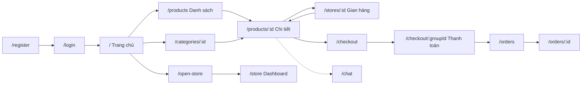

# 05 - Hướng dẫn từng trang (User Frontend)

> **Trạng thái tài liệu:** BẢN NHÁP v0.1
> **Cập nhật:** 2026-11-08
> **Áp dụng cho:** `Moldy-Market-User-Frontend`
> **Mục đích:** Mô tả từng trang chính: mục đích nghiệp vụ, người dùng, bố cục, component, dữ liệu, API, validation, các trạng thái giao diện, quyền và điều hướng. Danh sách route và guard nằm ở doc 04.

Quy ước nhãn: `[ĐÃ XÁC MINH BACKEND]` (từ doc 14), `[ĐÃ CẤU HÌNH]` (đã có trong repo), `[ĐỀ XUẤT]` (dự kiến, chưa có code). **Toàn bộ nội dung bố cục, component, hook, trạng thái giao diện dưới đây là `[ĐỀ XUẤT]`**; hiện repo chưa có trang nào ngoài trang thử `App.jsx`. Tên component, hook là ví dụ minh họa, chưa có trong repo.

---

## 0. Quy tắc chung cho mọi trang

### 0.1 Bốn trạng thái dữ liệu `[ĐỀ XUẤT]`

Trang nào lấy dữ liệu từ API cũng phải xử lý đủ bốn trạng thái, không chỉ trạng thái thành công:

| Trạng thái | Cách thể hiện | Lưu ý |
|---|---|---|
| Đang tải | Skeleton có hình dạng giống nội dung thật | Tránh spinner toàn trang; tránh nhảy bố cục khi dữ liệu về |
| Rỗng | Câu giải thích và nút hành động tiếp theo | Phân biệt "chưa có dữ liệu" với "lọc không ra kết quả" |
| Lỗi | Thông báo thân thiện, nút "Thử lại" | Ánh xạ `code` của Backend sang key i18n, không hiển thị `message` tiếng Anh của Backend |
| Thành công | Nội dung | |

### 0.2 Ánh xạ lỗi Backend `[ĐÃ XÁC MINH BACKEND]` cho mã lỗi, `[ĐỀ XUẤT]` cho cách xử lý

| Mã | Xử lý chung trên giao diện |
|---|---|
| `COMMON_001` (400) | Hiển thị lỗi theo field nếu Backend trả được; nếu không, thông báo chung. Cấu trúc chi tiết của `ApiError` mới biết "có ít nhất đường dẫn request" nên không giả định có danh sách lỗi theo field |
| `COMMON_003` (401) | Thử refresh token một lần; thất bại thì về `/login` |
| `COMMON_004` (403) | Trang hoặc khối "Không có quyền" |
| `COMMON_009` (429) | Báo gọi quá nhiều, tạm khóa nút gửi |
| `COMMON_010` (409) | Báo dữ liệu đã bị người khác sửa, tải lại trước khi cho sửa tiếp |

### 0.3 Điều cần nhớ chung

- Giá, tổng tiền luôn do Backend trả; Frontend chỉ định dạng hiển thị (VND), không tự tính số tiền quyết định thanh toán.
- Ngày giờ Backend trả ở dạng chuỗi ISO; hiển thị theo múi giờ trình duyệt.
- Mọi chuỗi giao diện đi qua i18n (`vi` mặc định, `en` dự phòng); không viết cứng chuỗi trong component `[ĐÃ CẤU HÌNH]` hạ tầng i18n.
- Component nút lấy từ shadcn `button` `[ĐÃ CẤU HÌNH]`. Các component shadcn khác (input, dialog, ...) sẽ được thêm bằng CLI khi cần; hiện chưa cài.

---

## 1. Trang công khai

### 1.1 Trang chủ `/` (`HomePage`)

| Mục | Nội dung |
|---|---|
| Mục đích nghiệp vụ | Cho khách và thành viên khám phá nhanh các danh mục và sản phẩm mới, dẫn vào luồng tìm kiếm và mua |
| Người dùng | Mọi người, kể cả chưa đăng nhập |
| Bố cục | Khối hero (nội dung tĩnh), lưới danh mục, danh sách "sản phẩm mới" theo `sort=newest`, khối editorial/giới thiệu (tĩnh) |
| Component chính | `CategoryGrid`, `ProductCard`, `ProductGrid`, `SearchBar` (trong header) |
| API (đã xác minh) | `GET /api/v1/categories` (cây danh mục), `GET /api/v1/products/search` (ví dụ `sort=newest`, `size` nhỏ) |
| Dữ liệu hiển thị | Tên danh mục; ảnh, tiêu đề, giá, tình trạng của sản phẩm |
| Validation | Không có form |
| Tương tác | Bấm danh mục đi `/categories/:categoryId`; bấm sản phẩm đi `/products/:productId`; tìm kiếm đi `/products?q=...` |
| Trạng thái giao diện | Mỗi khối (danh mục, sản phẩm) tải độc lập, có skeleton riêng; rỗng: ẩn khối sản phẩm, vẫn hiện danh mục; lỗi: khối lỗi cục bộ, không làm hỏng cả trang |
| Quyền | Công khai |
| Điều hướng sau hành động | Như bảng tương tác |
| Trạng thái triển khai | Backend `IMPLEMENTED`; FE `NOT_STARTED`. Chưa biết cấu trúc ảnh trong `ProductResponse` (chưa audit DTO danh sách) nên cần kiểm tra response thật trước khi code `ProductCard` |

### 1.2 Danh sách và tìm kiếm `/products` (`ProductListPage`) và `/categories/:categoryId` (`CategoryPage`)

| Mục | Nội dung |
|---|---|
| Mục đích nghiệp vụ | Tìm, lọc, sắp xếp sản phẩm đồ cũ để chọn món phù hợp |
| Người dùng | Mọi người |
| Bố cục | Cột trái là bộ lọc (facets), phía trên là ô tìm kiếm và sắp xếp, lưới sản phẩm, phân trang. Trên mobile bộ lọc thu thành ngăn kéo |
| Component chính | `SearchBar` (có gợi ý từ khóa), `FilterPanel`, `SortSelect`, `ProductGrid`, `Pagination` |
| API (đã xác minh) | `GET /api/v1/products/search`, `GET /api/v1/products/suggest?q=`. `CategoryPage` thêm `GET /api/v1/categories/{id}` và truyền `categoryId` vào search |
| Tham số search | Xem doc 04 mục 5 (`q` tối đa 100 ký tự, `categoryId[]` tối đa 20, `condition[]` tối đa 10, `minPrice`, `maxPrice`, `storeId`, `sellerType`, `attr[]` tối đa 10, `sort`, `facets`) |
| Response | `ProductSearchResponse { items, page, size, totalElements, totalPages, totalCapped, facets }`. Khi `totalCapped = true` hiển thị "từ 10.000 kết quả trở lên" thay vì số chính xác |
| Dữ liệu hiển thị | Thẻ sản phẩm; số kết quả; các nhóm facet. Cấu trúc chi tiết của `facets` **chưa audit**, cần xem response thật |
| Validation | `q` tối đa 100 ký tự (cắt hoặc chặn nhập); giá: `minPrice` không lớn hơn `maxPrice`. Quy tắc này là kiểm tra giao diện của Frontend, chưa phải ràng buộc đã xác minh của Backend |
| Tương tác | Đổi bộ lọc cập nhật query string rồi gọi lại; đổi bộ lọc đưa `page` về 1; gợi ý từ khóa gọi `suggest` có debounce (khoảng 300 ms, tham số ví dụ) |
| Trạng thái giao diện | Đang tải: skeleton lưới; rỗng: "Không có sản phẩm phù hợp" kèm nút xóa bộ lọc; lỗi: nút thử lại. Giữ dữ liệu cũ mờ đi khi đổi trang (`placeholderData`) để tránh nhấp nháy |
| Quyền | Công khai |
| Điều hướng | Bấm thẻ đi `/products/:productId` |
| Trạng thái triển khai | Backend `IMPLEMENTED`; FE `NOT_STARTED`. `GET /api/v1/products` (danh sách thường) chưa audit tham số; dùng `/search` để duyệt sản phẩm (doc 14 mục 2.2) |

Lỗi hay gặp: gửi `page=0` (search dùng 1-based); để mất bộ lọc khi người dùng quay lại bằng nút Back vì lưu trạng thái trong state thay vì URL.

### 1.3 Chi tiết sản phẩm `/products/:productId` (`ProductDetailPage`)

| Mục | Nội dung |
|---|---|
| Mục đích nghiệp vụ | Cho người mua đánh giá món đồ cũ (ảnh, mô tả, tình trạng, giá, người bán) và quyết định mua |
| Người dùng | Mọi người xem được; hành động mua cần đăng nhập |
| Bố cục | Thư viện ảnh, khối tiêu đề, giá, tình trạng, nút hành động (Mua ngay, thêm vào giỏ, nhắn người bán), mô tả, thuộc tính, thẻ gian hàng hoặc người bán |
| Component chính | `ProductGallery`, `PriceTag`, `ConditionBadge`, `ProductAttributes`, `SellerCard`, `ProductActions` |
| API (đã xác minh) | `GET /api/v1/products/{id}` |
| Dữ liệu hiển thị | Tiêu đề (<= 150 ký tự), giá, tình trạng (`NEW`, `LIKE_NEW`, `USED`, `DAMAGED`), mô tả (<= 2000), tối đa 10 ảnh https, thuộc tính, trạng thái (`ACTIVE`, `HIDDEN`, `SOLD`, `DELETED`, `REMOVED`) |
| Khối chưa có Backend | Khối thẩm định và chiến lược định giá `PARTIALLY_IMPLEMENTED` (chỉ `SELLER_SET` chạy; `AUTO_PRICING`, `APPRAISER` trả `PROD_003`); biểu đồ giá, sản phẩm tương tự, đánh giá, wishlist: `NOT_FOUND`; "Trả giá": `NOT_FOUND` (Q8). Các khối này chỉ là skeleton `TODO`, không gọi API |
| Nút "Mua ngay" | Phụ thuộc checkout (`IN_PROGRESS`); khi checkout chưa merge, nút bị ẩn hoặc vô hiệu hóa kèm chú thích. Không có ô chọn số lượng (Q17) |
| Nút "Nhắn người bán" | Phụ thuộc chat (`IN_PROGRESS`). Chat chỉ gắn hai user, **không gắn product** (Q6); cuộc hội thoại tạo bằng `targetUserId` nên giao diện chưa thể tự chèn thông tin sản phẩm vào chat |
| Validation | Không có form |
| Trạng thái giao diện | Đang tải: skeleton; sản phẩm không tồn tại hoặc đã `REMOVED`/`DELETED`: trang "Sản phẩm không còn". Mã lỗi `PROD_*` cụ thể cho trường hợp không tìm thấy **chưa được đọc**, nên xử lý theo HTTP 404 và `code` mà Backend trả thực tế khi test |
| Quyền | Công khai xem; hành động cần `RequireAuth` |
| Điều hướng | Mua ngay đi `/checkout`; thẻ gian hàng đi `/stores/:storeId` |
| Trạng thái triển khai | Backend `IMPLEMENTED` (chi tiết); FE `NOT_STARTED` |

Lỗi hay gặp: hiển thị nút Mua với sản phẩm `HIDDEN` hoặc `SOLD`; checkout trả `PROD_010` nếu sản phẩm không còn `ACTIVE`.

### 1.4 Trang gian hàng công khai `/stores/:storeId` (`StorePublicPage`)

| Mục | Nội dung |
|---|---|
| Mục đích nghiệp vụ | Cho người mua xem gian hàng và các sản phẩm của gian hàng đó |
| Người dùng | Mọi người |
| Bố cục | Đầu trang thông tin gian hàng; lưới sản phẩm của gian hàng; dùng lại bộ lọc/phân trang của danh sách |
| API (đã xác minh) | `GET /api/v1/stores/{id}` (công khai), `GET /api/v1/products/search` với `storeId` |
| Dữ liệu | Các trường của `StoreResponse` **chưa audit** (doc 14 không liệt kê); cần xem response thật trước khi code |
| Khối chưa có Backend | Theo dõi gian hàng (follow), đánh giá: `NOT_FOUND`, chỉ skeleton |
| Trạng thái giao diện | Gian hàng `BLOCKED` (`STORE_004`, 403): hiển thị "Gian hàng tạm không khả dụng" |
| Quyền | Công khai |
| Trạng thái triển khai | Backend `IMPLEMENTED`; FE `NOT_STARTED` |

---

## 2. Xác thực

### 2.1 Đăng nhập `/login` (`LoginPage`)

| Mục | Nội dung |
|---|---|
| Mục đích nghiệp vụ | Đăng nhập để mua bán, nhắn tin, quản lý gian hàng |
| Bố cục | Form một cột trong `AuthLayout`: email, mật khẩu, nút đăng nhập, liên kết sang đăng ký |
| API (đã xác minh) | `POST /api/v1/auth/login` với `{ email, password }` |
| Response | `{ userId, email, fullName, accessToken, refreshToken, tokenType }` |
| Validation | Email: định dạng email, tối đa 254 ký tự (đã xác minh). Mật khẩu: bắt buộc (không áp quy tắc độ dài ở đăng nhập, để Backend quyết định) |
| Lỗi cần xử lý | `AUTH_001` (sai email hoặc mật khẩu); `AUTH_003` (khóa) và `AUTH_004` (vô hiệu): thông báo khác nhau; `COMMON_009` (429). **Tài khoản `PENDING_VERIFICATION` trả `ACCOUNT_DISABLED`** (B10): thông báo rõ tài khoản chưa được kích hoạt, nội dung chốt khi có quyết định Q14 |
| Sau thành công | Lưu phiên (cách lưu: Q2, **chưa chốt**, xem doc 08), gọi `GET /api/v1/users/me` để lấy role, chuyển về đường dẫn trước đó hoặc `/` |
| Trạng thái giao diện | Nút đăng nhập vô hiệu và hiện tiến trình khi đang gửi; không làm trống ô email khi lỗi |
| Quyền | Khách (`GuestOnly`) |
| Trạng thái triển khai | Backend `IMPLEMENTED`; FE `NOT_STARTED` |

Lỗi hay gặp: dùng một thông báo duy nhất "đăng nhập thất bại" cho mọi mã lỗi; lưu mật khẩu vào state toàn cục.

### 2.2 Đăng ký `/register` (`RegisterPage`)

| Mục | Nội dung |
|---|---|
| Mục đích nghiệp vụ | Tạo tài khoản mới |
| Bố cục | Form: họ tên, email, số điện thoại, mật khẩu, (tùy chọn) nhập lại mật khẩu, nút đăng ký |
| API (đã xác minh) | `POST /api/v1/auth/register` với `{ email, password, fullName, phone }` |
| Response | `{ userId, email, fullName, status }` (status là `PENDING_VERIFICATION`) |
| Validation | Mật khẩu 8 đến 100 ký tự; `fullName` tối đa 100 ký tự (đã xác minh). Định dạng email và `phone`: **chưa audit** quy tắc cụ thể, Frontend chỉ kiểm tra định dạng cơ bản và để Backend trả `COMMON_001`. Ô "nhập lại mật khẩu" là kiểm tra thuần Frontend |
| Sau thành công | **Chưa thể** mô tả luồng đầy đủ: tài khoản ở `PENDING_VERIFICATION` và không đăng nhập được (B10, Q14). Trang kết quả dùng thông báo trung tính ("Tài khoản đã được tạo, đang chờ kích hoạt") cho đến khi team quyết định luồng kích hoạt. Không tự động đăng nhập sau khi đăng ký |
| Trạng thái giao diện | Như trang đăng nhập; lỗi email trùng: mã lỗi cụ thể **chưa đọc**, xử lý theo `code` thật khi test |
| Quyền | Khách |
| Trạng thái triển khai | Backend `IMPLEMENTED` (có chặn B10); FE `NOT_STARTED` |

### 2.3 Không tìm thấy `*` (`NotFoundPage`)

Hiển thị thông báo, nút về trang chủ và ô tìm kiếm. Đã có sẵn key i18n `notFound.message` trong `common.json` `[ĐÃ CẤU HÌNH]`. Không gọi API.

---

## 3. Tài khoản (cần đăng nhập)

### 3.1 Hồ sơ `/profile` và sửa hồ sơ `/profile/edit`

| Mục | Nội dung |
|---|---|
| Mục đích | Xem và cập nhật thông tin cá nhân |
| API (đã xác minh) | `GET /api/v1/users/me` (trả cả `roles: string[]`), `PUT /api/v1/users/me` (quyền `PROFILE_MANAGE`) |
| Dữ liệu và validation | Các trường của hồ sơ và của request cập nhật **chưa audit** trong doc 14 (chỉ biết tên class `UserProfileReSponse`, B9). Cần đọc response thật trước khi dựng form; khi đó bổ sung bảng validation vào tài liệu này |
| Trạng thái giao diện | Form mở sẵn dữ liệu hiện tại; thành công: toast và quay về `/profile`; `403` (thiếu `PROFILE_MANAGE`): khối không có quyền |
| Trạng thái triển khai | Backend `IMPLEMENTED`; FE `NOT_STARTED` |

### 3.2 Cài đặt tài khoản `/account/settings`

| Mục | Nội dung |
|---|---|
| Mục đích | Đổi mật khẩu và chỉnh tùy chọn giao diện |
| API (đã xác minh) | `PUT /api/v1/users/me/password`. Các trường request **chưa audit**; thường gồm mật khẩu cũ và mới, cần xác nhận bằng code Backend trước khi dựng form |
| Validation | Mật khẩu mới: dùng quy tắc 8 đến 100 ký tự giống đăng ký (suy ra từ đăng ký, **cần xác nhận** cho endpoint đổi mật khẩu) |
| Tùy chọn cục bộ | Chọn ngôn ngữ `vi`/`en` (hạ tầng i18n đã có `[ĐÃ CẤU HÌNH]`; lưu lựa chọn bằng Zustand khi làm trang này) |
| Chưa biết | Sau khi đổi mật khẩu Backend có thu hồi refresh token cũ không: chưa đọc. Không giả định |
| Trạng thái triển khai | Backend `IMPLEMENTED`; FE `NOT_STARTED` |

### 3.3 Mở gian hàng `/open-store` (`OpenStorePage`)

| Mục | Nội dung |
|---|---|
| Mục đích | Cho người dùng đã đăng nhập mở gian hàng của mình |
| API (đã xác minh) | `POST /api/v1/stores` |
| Quy tắc đã xác minh | Mỗi user một gian hàng; vi phạm trả `STORE_002` |
| Dữ liệu và validation | Các trường request **chưa audit**; bổ sung sau khi đọc DTO |
| Điều hướng | Tạo xong chuyển tới `/store` |
| Trạng thái giao diện | Nếu `GET /api/v1/stores/my-store` đã trả gian hàng thì không cho mở lần nữa mà chuyển tới `/store` |
| Quyền | Đã đăng nhập |
| Trạng thái triển khai | Backend `IMPLEMENTED`; FE `NOT_STARTED` |

### 3.4 Sản phẩm cá nhân `/my-products`, `/my-products/new`, `/my-products/:productId/edit`

| Mục | Nội dung |
|---|---|
| Mục đích | Người dùng đăng bán đồ cũ cá nhân (không thuộc gian hàng, `storeId = null`) |
| API tạo, sửa, xóa | `POST /api/v1/products` (quyền `PRODUCT_CREATE`), `PUT /api/v1/products/{id}`, `DELETE /api/v1/products/{id}` (không có body trả về), `PATCH /api/v1/products/{id}/status?status=` (quyền `PRODUCT_MANAGE_OWN`) |
| Liệt kê tin của tôi | **Chưa rõ** (Q19). Không bịa tham số. Trang danh sách ở trạng thái `TODO` cho đến khi xác nhận cách lọc |
| Form tạo, validation đã xác minh | `categoryId` bắt buộc; `title` bắt buộc, tối đa 150 ký tự; `price` bắt buộc, lớn hơn 0 và không quá 1.000.000.000, tối đa 2 chữ số thập phân; `condition` bắt buộc (`NEW`, `LIKE_NEW`, `USED`, `DAMAGED`); `pricingStrategy` bắt buộc; `description` tùy chọn, tối đa 2000; `images` tối đa 10, **chỉ URL https**, mỗi URL tối đa 500 ký tự; `attributes` được Backend kiểm tra bằng `@ValidProductAttributes` (quy tắc thuộc tính theo danh mục **chưa audit**) |
| Chiến lược định giá | Chỉ `SELLER_SET` hoạt động. `AUTO_PRICING` và `APPRAISER` trả `PROD_003` ("chưa hỗ trợ"). Form nên chỉ cho chọn `SELLER_SET` cho đến khi module pricing merge |
| Ảnh | Backend chỉ nhận **URL https**, không có API upload (Q5). Giao diện ảnh ở trạng thái `TODO`; không tự dựng cơ chế upload |
| Form sửa | Bắt buộc gửi `version`. Lỗi `COMMON_010` (409): báo "dữ liệu đã bị thay đổi", tải lại sản phẩm rồi cho sửa lại |
| Đổi trạng thái | Người bán chỉ chuyển qua lại giữa `ACTIVE` và `HIDDEN`; chuyển khác trả `PROD_004`. Đã đạt giới hạn tin đăng: `PROD_008` (409) |
| Trạng thái giao diện | Xóa cần hộp xác nhận; thành công `DELETE` không có body nên không đọc `response.data.data` |
| Quyền | Đã đăng nhập; quyền chi tiết do Backend kiểm tra (`PRODUCT_CREATE`, `PRODUCT_MANAGE_OWN`) |
| Trạng thái triển khai | Backend `IMPLEMENTED` (CRUD), liệt kê chưa rõ; FE `NOT_STARTED` |

### 3.5 Giỏ hàng `/cart`

| Mục | Nội dung |
|---|---|
| Mục đích | Gom sản phẩm cần mua trước khi thanh toán |
| Trạng thái | Backend `IN_PROGRESS` (branch `feature/cart`); **chưa được viết service** theo quy tắc 1.2 doc 14. Phần mô tả dưới đây là ý định, chưa phải contract cuối |
| Dữ liệu dự kiến | `CartResponse { id, userId, status, items[], subtotal, totalItems, ... }` với mỗi item có `listingId`, `sellerId`, `quantity`, `priceAtAddTime`, `totalPrice`, `note` |
| Điểm cần làm rõ trước khi dựng | Q7 (`listingId` có phải `Product.id`), Q16 (checkout không đọc từ cart; sau checkout có xóa item không), Q17 (bỏ `quantity` cho đồ cũ nhưng cart hiện vẫn có `quantity >= 1`) |
| Giao diện | Nhóm theo người bán (endpoint `/by-seller` tồn tại); không có ô chọn số lượng theo quyết định Q17 |
| FE | `NOT_STARTED`, chỉ skeleton |

---

## 4. Mua hàng

### 4.1 Checkout `/checkout` (`CheckoutPage`)

| Mục | Nội dung |
|---|---|
| Mục đích | Người mua nhập thông tin nhận hàng, chọn phương thức thanh toán, tạo đơn |
| Trạng thái | Backend `IN_PROGRESS` (`feature/order`); **chưa viết service** cho đến khi branch merge và doc 14 cập nhật |
| Request hiện tại trên branch (có thể đổi) | `orderItems` (1 đến 20 phần tử, mỗi phần tử có `productId` UUID), `receiverName` (tối đa 255), `phoneNumber` (regex `^(\+84|0)\d{9,10}$`), `shippingAddress` (tối đa 500), `method` (`COD` hoặc `ONLINE_BANKING`), `note` (tùy chọn, tối đa 500). Branch hiện còn `quantity` 1 đến 100 nhưng team đã quyết định bỏ (Q17); form **không có ô số lượng** |
| Quy tắc đã xác minh | Giá do Backend tính; Frontend không gửi giá. Không trùng `productId` (`ORDER_005`). Sản phẩm phải `ACTIVE` (`PROD_010`). Một lần checkout có thể tách thành nhiều order theo cặp `(sellerId, storeId)`. Phí ship luôn 0, voucher chưa áp dụng |
| Validation giao diện | Dùng đúng các ràng buộc trên (schema Zod ở `features/products/schemas` hoặc module checkout khi tạo) |
| Sau thành công | `CheckoutResponse { id, totalAmount, expiredAt, orders[], status, paymentResponse }`. Chuyển tới `/checkout/:checkoutGroupId`. `COD`: `expiredAt = null`, `qrBankUrl = null` |
| Điểm chưa rõ | Giữ hàng khi checkout chờ thanh toán (Q17 phần còn mở, B14): hai người có thể đặt cùng một sản phẩm. Giao diện chưa thể hứa "đã giữ hàng" |
| FE | `NOT_STARTED` |

### 4.2 Thanh toán `/checkout/:checkoutGroupId` (`CheckoutPaymentPage`)

| Mục | Nội dung |
|---|---|
| Mục đích | Hiển thị QR chuyển khoản, đếm ngược hết hạn, báo kết quả thanh toán |
| Trạng thái | Backend `IN_PROGRESS`; **chưa viết service** |
| API dự kiến | `GET /api/v1/checkout-groups/{id}` (chỉ người mua; sai chủ trả `ORDER_011`), `GET /api/v1/payments/{id}` để polling |
| Hiển thị | Ảnh QR từ `qrBankUrl` (URL ảnh do Backend trả; **không tự dựng QR**); `totalAmount` do Backend trả; đếm ngược dựa trên `expiredAt` (`ONLINE_BANKING` là 15 phút) |
| Quy tắc bắt buộc | Chỉ coi là thành công khi `paymentStatus === "SUCCESSFUL"` do Backend trả khi polling. Nút "Tôi đã chuyển khoản" nếu có chỉ làm tăng tần suất kiểm tra, **không bao giờ** tự đổi trạng thái. Không tin `status` của order hay checkout group (B12) |
| Polling | Không có kênh push. Tần suất polling hợp lý chưa chốt (Q11). Dừng polling khi `SUCCESSFUL`, `FAILED`, hoặc người dùng rời trang |
| Hết hạn | Đếm ngược về 0 không có nghĩa Backend đã hủy (không có job hết hạn, B12); hiển thị "đã quá hạn thanh toán", tiếp tục chỉ tin `paymentStatus` |
| Chưa có | Thông tin chuyển khoản dạng chữ (số tài khoản, ngân hàng, nội dung) chưa có endpoint (Q11); chuyển khoản trễ hoặc lệch tiền chưa có đường xử lý |
| COD | Không có QR; hiển thị thông tin đơn và hướng dẫn thanh toán khi nhận hàng. Ai thu tiền: Q18 |
| FE | `NOT_STARTED` |

### 4.3 Danh sách đơn `/orders` và chi tiết đơn `/orders/:orderId`

| Mục | Nội dung |
|---|---|
| Mục đích | Người mua xem lịch sử và tiến trình đơn |
| Trạng thái | Backend `IN_PROGRESS`; **chưa viết service** |
| API dự kiến | `GET /api/v1/orders/me` (mảng, không phân trang), `GET /api/v1/orders/{orderId}` |
| Trạng thái rỗng | `GET /orders/me` trả **404 `ORDER_003`** khi chưa có order: phải xử lý như danh sách rỗng, không phải lỗi (B13) |
| Hiển thị | `orderCode`, trạng thái, `totalAmount`, các item (`productName`, `unitPrice`, `imageUrl`), thông tin nhận hàng, các mốc thời gian |
| Timeline order | Chỉ `PENDING_PAYMENT` (lúc tạo) và `DELIVERED` sang `COMPLETED` (do admin) có code. **Không vẽ timeline đầy đủ** như thể các bước `CONFIRMED`, `SHIPPING`... đã chạy (doc 14 mục 5.7, Q15). Trạng thái lạ xử lý bằng nhánh mặc định |
| Bảo mật | `GET /orders/{orderId}` hiện không kiểm tra chủ order (B11); Frontend vẫn chỉ gọi với id của order thuộc người dùng, nhưng không coi đây là bảo vệ |
| FE | `NOT_STARTED` |

---

## 5. Giao tiếp

### 5.1 Thông báo `/notifications`

| Mục | Nội dung |
|---|---|
| Trạng thái | Backend `IN_PROGRESS` (`feature/notification`...); **chưa viết service** |
| API dự kiến | `GET /api/v1/notifications?limit&token` (cursor: mặc định `limit` 20, tối đa 50), `PATCH /{id}/read`, `DELETE /{id}` (xóa mềm), `PATCH /{id}/restore`; ba thao tác cuối không có body |
| Giao diện | Danh sách cuộn vô hạn dùng `useInfiniteQuery` `[ĐỀ XUẤT]` với `nextToken`; `nextToken = null` là hết trang. `type` và `referenceType` là chuỗi tự do nên cần giao diện dự phòng cho type chưa biết |
| Điểm cần xác minh | Cờ đã đọc là `read` hay `isRead` (Q13): kiểm tra response thật |
| Không có | Thông báo thời gian thực (không có kênh push); cập nhật bằng polling hoặc khi mở trang |
| FE | `NOT_STARTED` |

### 5.2 Chat `/chat` và `/chat/:conversationId`

| Mục | Nội dung |
|---|---|
| Trạng thái | Backend `IN_PROGRESS` (bản mới nhất ở `feature/chat`, `feature/order`); **chưa viết service**. Điểm vào chat gắn offer, order, product là chưa có (Q6) |
| REST dự kiến | `POST /api/v1/conversations` (`{ targetUserId }`), `GET /api/v1/conversations`, `GET /api/v1/conversations/{id}/messages?page&size`, `PATCH /api/v1/conversations/{id}/read` |
| Phân trang lịch sử | `page` bắt đầu từ **0**, `size` mặc định **4** (rất nhỏ): luôn truyền `size` rõ ràng; kết quả là `Page<MessageResponse>`, tin mới nhất trước (B6) |
| WebSocket | STOMP qua SockJS tại `/chat`; frame `CONNECT` có header `Authorization: Bearer <accessToken>`; gửi tới `/app/conversations/{conversationId}/send` với `{ type, content?, attachmentUrl? }`; nhận tại `/user/queue/messages`; lỗi tại `/user/queue/errors`. Tin được đẩy cho cả người gửi và người nhận |
| Điểm chưa rõ | Chuyện gì xảy ra khi access token 15 phút hết hạn trên socket đang mở (chỉ kiểm tra lúc CONNECT); chiến lược kết nối lại cần team xác nhận |
| Giao diện | Cột trái danh sách hội thoại, cột phải khung tin nhắn; mobile hiển thị lần lượt. Loại tin `TEXT`, `IMAGE`, `FILE` |
| FE | `NOT_STARTED` |

---

## 6. Trang chưa có hoặc chưa đủ Backend

| Route | Nội dung | Trạng thái |
|---|---|---|
| `/appraisals`, `/appraiser/queue`, `/appraiser/requests/:requestId` | Yêu cầu thẩm định giá và hàng đợi người thẩm định. DTO pricing, appraiser chưa audit; B2 (chưa có kiểm tra quyền) | `IN_PROGRESS`, chỉ skeleton |
| `/wishlist` | Danh sách yêu thích | `NOT_FOUND` |
| `/transactions` | Lịch sử giao dịch | `NOT_FOUND`; phạm vi cần xác nhận |

Các trang này chỉ có khung và nhãn `TODO`, không có service.

---

## 7. Store Dashboard (`/store/*`)

Điều kiện chung: người dùng là chủ gian hàng (xác định được qua `GET /api/v1/stores/my-store`) hoặc nhân viên. **Chưa xác định được trường hợp nhân viên** (Q1). Menu hiển thị theo quyền chỉ ở mức tên role; `403` là quyết định thật.

### 7.1 Hồ sơ gian hàng `/store/profile`

- API (đã xác minh): `GET`, `PUT /api/v1/stores/my-store`. Các trường chưa audit.
- Trạng thái Backend: `IMPLEMENTED`. FE: `NOT_STARTED`.
- Trạng thái đặc biệt: gian hàng bị chặn (`STORE_004`, 403) hiển thị khối cảnh báo và vô hiệu hóa các hành động ghi.

### 7.2 Sản phẩm của gian hàng `/store/products`, `/new`, `/:productId/edit`

- Liệt kê: `GET /api/v1/products/search` với `storeId` của gian hàng.
- Tạo, sửa, xóa, đổi trạng thái: dùng cùng contract với mục 3.4, thêm `storeId`.
- Quyền Backend: `PRODUCT_CREATE`, `PRODUCT_MANAGE_OWN`. Lỗi `STORE_015` (403): không có quyền với tài nguyên của gian hàng này.
- Backend `IMPLEMENTED`; FE `NOT_STARTED`.

### 7.3 Nhân viên `/store/staff`

- API (đã xác minh) dưới `/api/v1/stores/my-store/staff`: thêm (`POST`, trực tiếp bằng email), danh sách (`GET`), đổi permission (`PUT /{staffId}/permissions`), xóa (`DELETE /{staffId}`), `GET /me`. Quyền: `STORE_STAFF_MANAGE`.
- Điều kiện: người được thêm phải có tài khoản `ACTIVE` (liên quan B10).
- **Mời** nhân viên là `PLANNED`: giao diện không có bước "gửi lời mời", chỉ có "thêm trực tiếp".
- Danh sách permission chọn được lấy từ đâu chưa rõ (doc 14 chỉ liệt kê vài mã ví dụ); cần danh mục permission từ team trước khi dựng giao diện chọn quyền.
- Backend `IMPLEMENTED`; FE `NOT_STARTED`.

### 7.4 Các trang chưa có Backend

| Route | Lý do | Trạng thái |
|---|---|---|
| `/store` (tổng quan) | Chưa có API thống kê | `NOT_FOUND`, skeleton |
| `/store/orders` | Chưa có order phía người bán (Q15) | `NOT_FOUND`, skeleton |
| `/store/vouchers` | Chưa có API voucher cho người bán | `PLANNED`, skeleton |
| `/store/offers` | Chưa có code offer (Q8) | `NOT_FOUND`, skeleton |
| `/store/revenue` | Chưa có API doanh thu | `NOT_FOUND`, skeleton |
| `/store/reviews` | Chưa có code review | `NOT_FOUND`, skeleton |
| `/store/settings` | Phạm vi chưa rõ | `REQUIRES_BUSINESS_CLARIFICATION` |

---

## 8. Sơ đồ điều hướng giữa các trang chính

Đường nét đứt (`Detail` tới `Chat`) là điểm vào chưa gắn với product (Q6). Các nút `Checkout`, `Pay`, `Orders`, `Chat` chỉ hoạt động sau khi Backend merge.

---

## Tài liệu liên quan

- 04 - Routing và danh sách trang: bảng route, guard, query string.
- 06 - Kiến trúc component: danh sách component dùng ở từng trang.
- 07 - Tích hợp API: Axios, xử lý lỗi, phân trang.
- 08 - Xác thực và phân quyền: đăng nhập, refresh token, Q1, Q2.
- 10 - Luồng tính năng: mua hàng, thanh toán, đăng ký và đăng nhập, chat, notification.
- 14 - Ma trận tích hợp Backend: nguồn sự thật về Backend.
