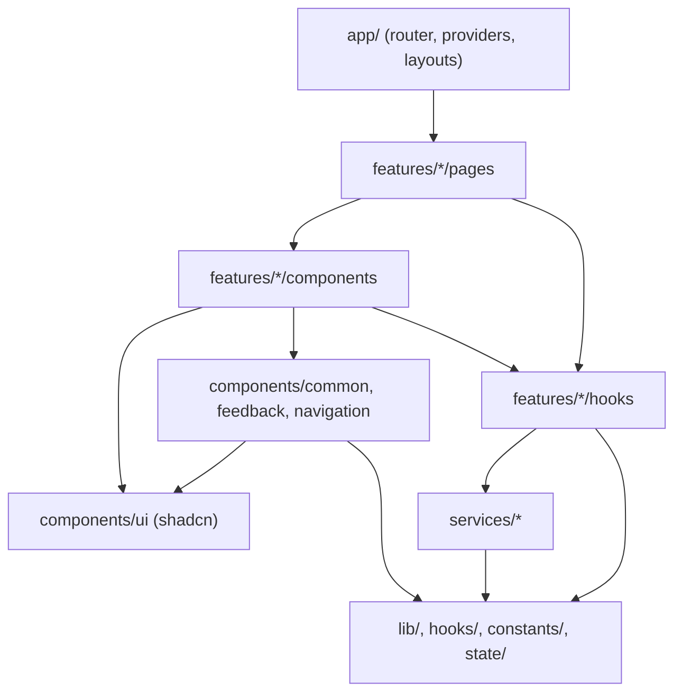
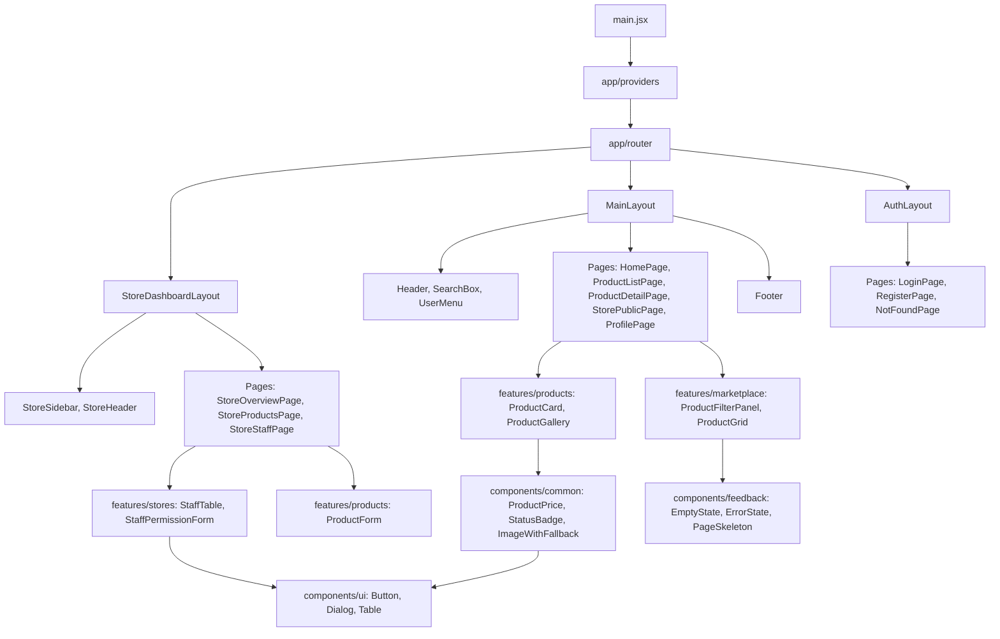

# 06 - Component Architecture (Kiến trúc component)

> **Trạng thái:** BẢN NHÁP v0.1
> **Cập nhật:** 2026-11-08
> **Áp dụng cho:** `Moldy-Market-User-Frontend`
> **Mục đích:** Quy định component được chia thành những loại nào, nằm ở thư mục nào, được phép biết gì và không được phép biết gì, để nhiều người cùng code mà không làm rối cấu trúc.

Nhãn dùng trong tài liệu:
- `[ĐÃ XÁC MINH BACKEND]`: có trong doc 14.
- `[ĐÃ CẤU HÌNH]`: đã thật sự có trong repo.
- `[ĐỀ XUẤT]`: kiến trúc dự kiến, **chưa có code**. Mọi tên component trong tài liệu này là `[ĐỀ XUẤT]` trừ khi ghi khác. Các đoạn code là ví dụ minh họa, chưa có trong repo.

---

## 1. Hiện trạng `[ĐÃ CẤU HÌNH]`

- Thư mục `src/components/ui` đã có, hiện chỉ chứa `button.jsx` do shadcn sinh ra.
- Các thư mục `components/common`, `components/feedback`, `components/navigation`, `app/layouts`, `features/*/components` đã được tạo (Bước 12), phần lớn chỉ có `.gitkeep`.
- Chưa có component ứng dụng nào. `src/App.jsx` chỉ là trang thử i18n và nút.

Mọi thứ còn lại dưới đây là thiết kế để team thống nhất trước khi code.

---

## 2. Nguyên tắc chung `[ĐỀ XUẤT]`

### 2.1 Component chỉ lo hiển thị và tương tác, không lo gọi API trực tiếp

Một component **không** import Axios và **không** import trực tiếp hàm trong `services/`. Việc gọi API đi qua hook trong `features/<module>/hooks/` (TanStack Query). Lý do: khi Backend đổi contract, bạn chỉ sửa `services/` và hook, không phải đi sửa hàng chục component. Xem doc 07 và doc 09.

### 2.2 Phân tầng theo mức độ biết nghiệp vụ

| Tầng | Thư mục | Biết nghiệp vụ Moldy Market không? | Ví dụ |
|---|---|---|---|
| Nguyên thủy (primitive) | `components/ui` | Không | `Button`, `Input`, `Dialog` (shadcn) |
| Dùng chung (common) | `components/common`, `components/feedback`, `components/navigation` | Rất ít (chỉ biết ngôn ngữ giao diện chung) | `PageHeader`, `EmptyState`, `Header` |
| Theo feature | `features/<module>/components` | Có | `ProductCard`, `StaffPermissionForm` |
| Trang (page) | `features/<module>/pages` | Có, nhưng chỉ lắp ráp | `ProductDetailPage` |
| Cấp ứng dụng | `app/layouts`, `app/router`, `app/providers` | Biết cấu trúc app | `MainLayout`, `RequireAuth` |

Quy tắc đọc: tầng nào chỉ được dùng tầng **ở trên nó trong bảng** (trừ `app/` đứng riêng). Ví dụ `components/common` không được import từ `features/`.

### 2.3 Hướng phụ thuộc (import direction)



Các mũi tên chỉ được đi **một chiều**. Hai điều cấm quan trọng:
1. `services/` không import React và không import `features/` (xem doc 07).
2. `features/A` không import trực tiếp từ `features/B`. Nếu cần dùng chung, đưa phần chung lên `components/common` hoặc `hooks/`, hoặc để **page** (tầng lắp ráp) ghép hai feature với nhau.

### 2.4 `components/ui` là code sinh ra `[ĐÃ CẤU HÌNH]`

- Không sửa tay trừ khi cần tùy biến có chủ đích. File trong thư mục này đã được loại khỏi Prettier (`.prettierignore`) và được nới rule ESLint (`eslint.config.js`).
- Khi cần một biến thể (ví dụ nút "Mua ngay" to hơn), **không** sửa `button.jsx`. Tạo component bọc ở `components/common` hoặc trong feature, truyền `className` và `variant` có sẵn.
- Hàm `cn` luôn import từ `@/lib/utils` (không dùng package npm tên `cn`, đã gỡ).

---

## 3. Layout (`app/layouts`) `[ĐỀ XUẤT]`

Layout là component bọc quanh nhiều trang, chứa khung chung và `<Outlet />` của React Router. Bảng route nào dùng layout nào nằm ở doc 04, không lặp lại ở đây.

| Layout | Dùng cho | Thành phần bên trong |
|---|---|---|
| `MainLayout` | Trang công khai và trang cần đăng nhập của người dùng thường | `Header` (logo, ô tìm kiếm, giỏ hàng, thông báo, menu tài khoản), vùng nội dung `<Outlet />`, `Footer` |
| `AuthLayout` | `/login`, `/register`, trang 404 | Khung tối giản, logo, vùng form ở giữa, không có điều hướng chính |
| `StoreDashboardLayout` | Mọi trang dưới `/store` | `StoreSidebar` bên trái (thu gọn thành menu trên mobile), `StoreHeader`, vùng nội dung `<Outlet />` |

Quy tắc layout:
- Layout **không** tự quyết định quyền truy cập. Việc chặn route chưa đăng nhập do `RequireAuth` ở `app/router` làm (doc 08). Layout chỉ lo giao diện.
- Layout không gọi API nghiệp vụ. Ngoại lệ hợp lý: hiển thị số lượng notification hoặc giỏ hàng trên `Header` sẽ dùng hook của feature tương ứng, và chỉ khi các module đó đã `IMPLEMENTED` (hiện là `IN_PROGRESS`, xem doc 14 mục 4.2). Trước đó Header không có các biểu tượng này hoặc chỉ là placeholder.
- Hành vi responsive của layout (desktop-first, thu gọn sidebar) mô tả ở doc 03.

---

## 4. Component dùng chung `[ĐỀ XUẤT]`

### 4.1 `components/common`

| Component | Vai trò | Props chính (dự kiến) |
|---|---|---|
| `Logo` | Hiển thị logo hoặc chữ "Moldy Market" (placeholder, chưa có logo chính thức, xem doc 03) | `size`, `className` |
| `PageHeader` | Tiêu đề trang, mô tả ngắn, vùng nút hành động bên phải | `title`, `description`, `actions` |
| `SectionHeading` | Tiêu đề khối trong trang (dùng font heading) | `title`, `action` |
| `ProductPrice` | Định dạng giá VND theo locale (ví dụ `1.250.000 ₫`) bằng `Intl.NumberFormat` | `value`, `className` |
| `StatusBadge` | Huy hiệu trạng thái, ánh xạ giá trị enum sang màu ngữ nghĩa và key dịch | `type` (`product`, `store`, `payment`...), `value` |
| `ConfirmDialog` | Hộp thoại xác nhận hành động nguy hiểm (xóa product, xóa staff) | `open`, `title`, `description`, `confirmLabel`, `onConfirm`, `loading` |
| `FormField` | Gói `label` + input + thông báo lỗi để mọi form có cùng cách hiển thị lỗi | `label`, `error`, `hint`, `children` |
| `PaginationBar` | Điều khiển phân trang, nhận dạng đã chuẩn hóa (doc 07 mục 6) | `page`, `size`, `hasNext`, `totalElements`, `onPageChange` |
| `LanguageSwitcher` | Đổi ngôn ngữ `vi` / `en` bằng `i18n.changeLanguage` | không |
| `ImageWithFallback` | Ảnh có ảnh dự phòng khi URL lỗi (ảnh product là URL ngoài, chưa kiểm soát được, xem Q5) | `src`, `alt`, `fallback` |

`StatusBadge` đáng chú ý: giá trị enum Backend (ví dụ `ProductStatus`) **không** được dịch trong Backend. Component này giữ bảng ánh xạ `giá trị -> key i18n + màu`, và có nhánh mặc định cho giá trị lạ để không vỡ giao diện khi Backend thêm giá trị mới.

### 4.2 `components/feedback`

| Component | Khi nào dùng |
|---|---|
| `LoadingSpinner` | Tải rất ngắn hoặc nút đang gửi |
| `PageSkeleton`, `CardSkeleton` | Tải dữ liệu lần đầu của trang hoặc danh sách (ưu tiên hơn spinner vì giữ bố cục) |
| `EmptyState` | Danh sách rỗng. **Cũng dùng cho `orders/me` khi Backend trả 404 `ORDER_003`** (B13), không hiện như lỗi |
| `ErrorState` | Lỗi tải dữ liệu, có nút "Thử lại" gọi `refetch` |
| `ForbiddenState` | Nhận `403` (`COMMON_004`, `STORE_015`...) |
| `InlineError` | Lỗi nhỏ ngay dưới form hoặc dưới nút |
| `ToastProvider` (shadcn `sonner` nếu chọn) | Thông báo ngắn sau hành động (đã lưu, đã xóa) |

### 4.3 `components/navigation`

| Component | Vai trò |
|---|---|
| `Header`, `Footer` | Khung của `MainLayout` |
| `UserMenu` | Menu tài khoản: hồ sơ, gian hàng, đăng xuất. Mục "Gian hàng" chỉ hiện khi đủ điều kiện (doc 08) |
| `StoreSidebar` | Menu của Store Dashboard |
| `Breadcrumbs` | Đường dẫn phân cấp ở trang category và dashboard |
| `SearchBox` | Ô tìm kiếm trên Header. Gợi ý từ khóa dùng `GET /api/v1/products/suggest?q=` `[ĐÃ XÁC MINH BACKEND]` |

---

## 5. Component theo feature `[ĐỀ XUẤT]`

Mỗi feature sở hữu component của riêng nó trong `features/<module>/components`. Bảng dưới là **gợi ý khởi điểm**, danh sách thật sẽ lớn lên khi code.

| Feature | Component gợi ý | Ghi chú |
|---|---|---|
| `auth` | `LoginForm`, `RegisterForm` | Schema Zod ở `auth/schemas`. Nhắc B10: sau khi đăng ký chưa đăng nhập được (doc 08) |
| `marketplace` | `HeroSection`, `CategoryGrid`, `FeaturedProducts`, `ProductFilterPanel`, `SortSelect`, `ProductGrid` | Nội dung "editorial" ở trang chủ là tĩnh. Bộ lọc đồng bộ với query string (doc 09) |
| `products` | `ProductCard`, `ProductGallery`, `ProductInfo`, `ProductAttributes`, `ProductForm`, `ProductStatusToggle`, `ProductImageUrlInput` | `ProductForm` dùng chung cho đăng tin cá nhân và đăng trong gian hàng. Ảnh chỉ nhận URL https (Q5), nên `ProductImageUrlInput` chỉ là danh sách ô nhập URL, chưa phải upload |
| `stores` | `StoreHeaderCard`, `OpenStoreForm`, `StoreProfileForm`, `StaffTable`, `StaffPermissionForm`, `AddStaffDialog` | Trang công khai và Dashboard cùng nằm trong feature này. Mời staff là `PLANNED` nên chỉ có "thêm trực tiếp bằng email" |
| `profile` | `ProfileForm`, `ChangePasswordForm`, `AccountSummary` | Đổi mật khẩu là form riêng, không gộp với hồ sơ |

Các feature của module `IN_PROGRESS` (cart, checkout, order, payment, notification, chat, pricing) **chưa có thư mục**. Khi branch Backend merge và doc 14 cập nhật, tạo thư mục feature tương ứng. Ví dụ trước khi làm trang thanh toán, nhớ rằng mã QR là ảnh theo `qrBankUrl` do Backend trả về (doc 14 mục 5.8) nên component `PaymentQrCard` chỉ hiển thị ``, không tự dựng QR.

---

## 6. shadcn/ui `[ĐÃ CẤU HÌNH]` + `[ĐỀ XUẤT]`

- Cấu hình: style `radix-nova`, base color `neutral`, icon `lucide`, không TypeScript, không RSC (`components.json`).
- Hiện có: `button`.
- Thêm component bằng CLI khi **thật sự cần dùng**, không thêm cả bộ từ đầu. Chạy trong thư mục repo (PowerShell): `npx shadcn@latest add <tên>`. Nhờ bước thêm theo nhu cầu, mỗi component vào repo đều có người dùng thật và `git diff` rõ ràng.
- Danh sách thường cần (kiểm tra tên chính xác trong danh mục của CLI khi thêm): `input`, `label`, `textarea`, `select`, `checkbox`, `dialog`, `dropdown-menu`, `sheet` (menu mobile), `tabs`, `badge`, `skeleton`, `avatar`, `separator`, `table`, `alert`, `sonner` (toast), `pagination`, `breadcrumb`.
- Với form, kết nối React Hook Form + Zod theo doc 09. Cách ghép với component form của shadcn bản 4.x cần xem tài liệu CLI lúc làm, không giả định ở đây.

---

## 7. Quy ước props và composition `[ĐỀ XUẤT]`

1. **Props rõ ràng, ít, có JSDoc.** Dự án dùng JavaScript nên JSDoc là cách duy nhất để editor gợi ý kiểu. Mỗi component công khai có `@param`/`@typedef` mô tả props.
2. **Dùng `children` và slot** thay vì cờ boolean quá nhiều. Ví dụ `PageHeader` nhận `actions` là node, không nhận `showCreateButton`.
3. **Controlled bằng props, không tự gọi API.** Component nhận dữ liệu và callback (`onSubmit`, `onConfirm`). Page hoặc hook của feature là nơi nối với API.
4. **Page là nơi lắp ráp.** Page gọi hook, xử lý trạng thái loading, rỗng, lỗi, rồi truyền dữ liệu xuống component trình bày. Component trình bày không biết `useQuery`.
5. **Đặt tên `className` và dùng `cn`** để người dùng component ghi đè được kiểu, không dùng style inline.
6. **Một component một file**, tên file trùng tên component, PascalCase `.jsx` (chi tiết ở doc 11).
7. **Không truyền cả object response của Backend xuống sâu hơn hai tầng.** Nếu cần, ánh xạ sang object nhỏ ở hook (ví dụ `select` của `useQuery`), để component không phụ thuộc hình dạng DTO.
8. **Trạng thái UI cục bộ** (mở dialog, tab đang chọn) dùng `useState` trong component. Chỉ đưa lên Zustand khi nhiều nơi xa nhau cần dùng (doc 09).

### Ví dụ minh họa (chưa có trong repo)

```jsx
// features/products/components/ProductCard.jsx
import { Link } from 'react-router'
import { ImageWithFallback } from '@/components/common/ImageWithFallback'
import { ProductPrice } from '@/components/common/ProductPrice'

/**
 * @typedef {Object} ProductCardProps
 * @property {string} id
 * @property {string} title
 * @property {number} price
 * @property {string} [imageUrl]
 */

/** @param {ProductCardProps} props */
export function ProductCard({ id, title, price, imageUrl }) {
  return (
    <Link to={`/products/${id}`} className="block">
      <ImageWithFallback src={imageUrl} alt={title} />
      <h3 className="mt-2 line-clamp-2 text-sm">{title}</h3>
      <ProductPrice value={price} />
    </Link>
  )
}
```

`ProductCard` chỉ nhận dữ liệu, không biết gì về API. Tên trường `id`, `title`, `price` khớp contract product ở doc 14 mục 5.6; trường ảnh (`imageUrl` ở đây) chỉ là tên minh họa, tên thật trong `ProductResponse` phải xem response thật khi code.

---

## 8. Cây component tổng quát `[ĐỀ XUẤT]`



Danh sách trang đầy đủ và quyền truy cập theo từng trang nằm ở doc 04 và doc 05.

---

## 9. Lỗi thường gặp cần tránh

| Lỗi | Hậu quả | Cách đúng |
|---|---|---|
| Gọi `axios.get` trong component | Khó test, trùng lặp, không có cache | Qua hook `useXxx` của feature |
| Sửa `components/ui/button.jsx` để tạo biến thể riêng | Bị ghi đè khi cập nhật shadcn, lệch giữa hai repo | Bọc component, dùng `className` và `variant` |
| `features/products` import từ `features/stores` | Vòng phụ thuộc, khó tách | Page ghép hai feature, hoặc đưa phần chung lên `components/common` |
| Hiển thị trực tiếp `message` tiếng Anh của Backend | Giao diện lẫn ngôn ngữ | Ánh xạ `code` sang key i18n (doc 07) |
| Tự tính tổng tiền ở checkout để hiển thị số phải trả | Sai lệch với Backend | Chỉ hiển thị `totalAmount` Backend trả (doc 14 mục 5.7) |
| Dựng `if (role === 'ADMIN')` rải rác trong component | Phân quyền phân tán, sai sót | Dùng một nơi (route guard, hook quyền) theo doc 08 |
| Component "lỡ" chứa cả logic nghiệp vụ lẫn UI 400 dòng | Khó đọc | Tách hook, tách component con |

---

## Tài liệu liên quan

- 02 - Frontend Architecture: cấu trúc thư mục và quyết định kiến trúc.
- 03 - Design System: token, typography, hành vi responsive.
- 04 - Routing and Pages: route, layout nào cho route nào.
- 05 - Page by Page Guide: component chính của từng trang.
- 07 - API Integration: lớp service, hook gọi API.
- 08 - Authentication and Authorization: `RequireAuth`, hiển thị theo quyền.
- 09 - State Management: `useState` hay Zustand hay TanStack Query.
- 11 - Coding Conventions: đặt tên file, component, JSDoc.
- 14 - Backend Integration Matrix: nguồn sự thật về Backend.
