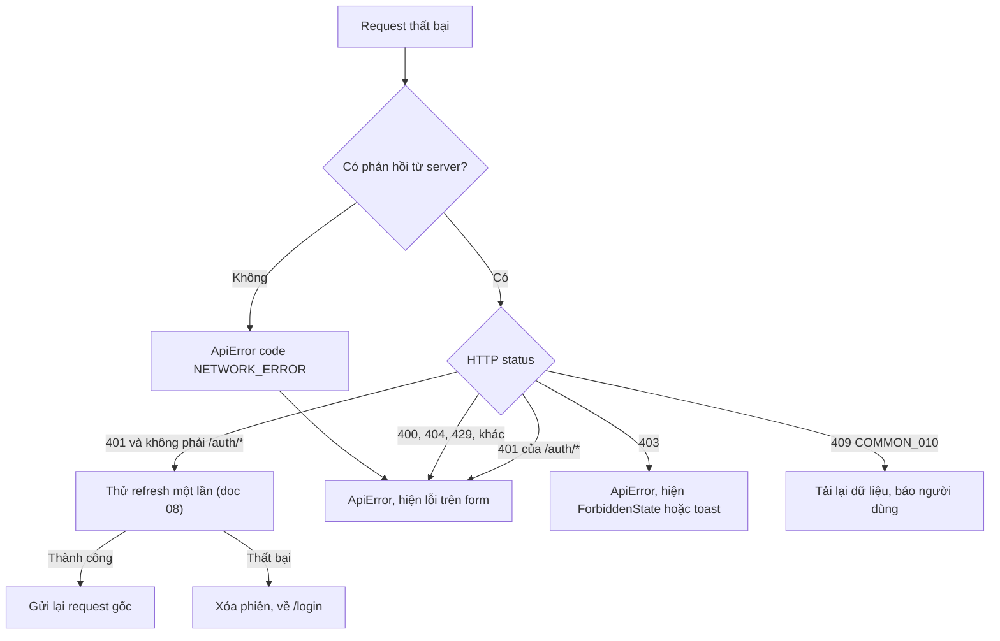
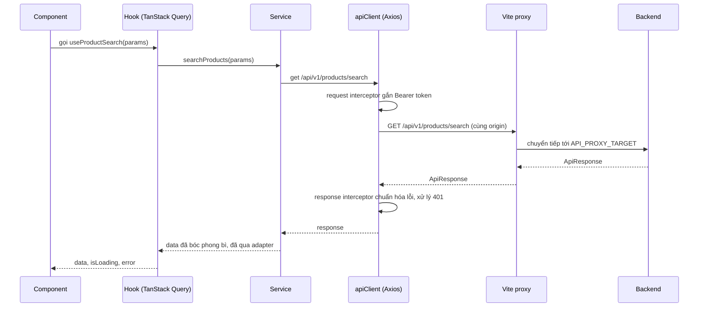

# 07 - API Integration (Tích hợp API)

> **Trạng thái:** v0.2 (cập nhật 2026-11-22: đối chiếu 11 service modules, `authRefreshInterceptor`, `pagination.js` và Backend `07ef520` + local)
> **Cập nhật:** 2026-11-22
> **Áp dụng cho:** `Moldy-Market-User-Frontend`
> **Mục đích:** Quy định cách Frontend nói chuyện với Backend: cấu hình Axios, xử lý lỗi, tổ chức `services/`, các dạng phân trang, và bảng ánh xạ endpoint.

Nhãn dùng trong tài liệu:
- `[ĐÃ XÁC MINH BACKEND]`: có trong doc 14.
- `[ĐÃ TRIỂN KHAI]`: đã có code thực tế trong `src/services/`.
- `[ĐỀ XUẤT]`: thiết kế dự kiến, **chưa có code**.

Quy tắc số một: **mọi endpoint trong tài liệu này phải có trong doc 14.** Thứ gì doc 14 không có thì Frontend coi là chưa biết, không tự bịa.

---

## 1. Hiện trạng `[ĐÃ TRIỂN KHAI]`

- Đã triển khai lớp API lõi trong `src/services/api/`: `client.js`, `unwrap.js`, `ApiError.js`, `pagination.js`, `authRefreshInterceptor.js` kèm unit tests.
- Đã triển khai 10 module service: `auth`, `users`, `categories`, `products`, `stores`, `cart`, `checkout`, `orders` (`orderService`, `cancelOrderService`, `storeOrderService`), `chat` (`chatService`, `chatConnection` STOMP/SockJS).
- Vite proxy: chuyển tiếp `/api` và `/chat` tới `API_PROXY_TARGET` (mặc định `http://localhost:8080`). `.env.example`: `VITE_API_BASE_URL` (để trống khi dev), `API_PROXY_TARGET` (chỉ dev).

---

## 2. Cấu hình Axios `[ĐÃ TRIỂN KHAI]`

### 2.1 Vì sao `baseURL` để trống và không gắn `/api/v1`

1. **Trình duyệt gọi cùng origin với Vite dev server** (`localhost:5173`), Vite proxy chuyển tiếp `/api` và `/chat` sang Backend.
2. **Backend có hai prefix**: `/api/v1/...` và `/api/...` (voucher, pricing, reference prices). Nếu gắn cứng `/api/v1` vào `baseURL`, bạn không gọi được nhóm thứ hai (doc 14 mục 2.3).
3. **Production:** đặt `VITE_API_BASE_URL` hoặc phục vụ cùng origin (lưu ý Backend `SecurityConfig` đã có CORS `/api/**`, nhưng nếu deploy cross-origin dùng HttpOnly cookie cần bổ sung `allowCredentials(true)` và header `X-Moldy-Auth`).

Vì vậy mọi service viết **đường dẫn đầy đủ**, ví dụ `'/api/v1/products/search'`.

### 2.2 Instance (`src/services/api/client.js`)

```js
// src/services/api/client.js
export const apiClient = axios.create({
  baseURL: import.meta.env.VITE_API_BASE_URL || '',
  timeout: 15000,
  headers: { Accept: 'application/json' },
})
```

### 2.3 Request interceptor

Gắn `Authorization: Bearer <accessToken>` từ `src/lib/tokenStorage.js` (`moldy-market:user:access-token`). Các request auth (`/login`, `/refresh`, `/logout`) cấu hình thêm `withCredentials: true` và header `X-Moldy-Auth: 1` (doc 08).

### 2.4 Response interceptor (`client.js` & `authRefreshInterceptor.js`)

1. **Chuẩn hóa lỗi (`client.js`):** chuẩn hóa lỗi HTTP/mạng thành `ApiError` (giữ nguyên cancellation). `unwrap.js` trả `undefined` khi không có body và giữ nguyên `null`, `false`, `0`.
2. **Xử lý `401` (`authRefreshInterceptor.js`):** cài 1 lần tại `src/App.jsx` (eject khi HMR dispose), single-flight refresh-once qua `POST /api/v1/auth/refresh` (cookie `moldy_refresh`), bỏ qua `/api/v1/auth/*` và `PUT /api/v1/users/me/password` 401; không bao giờ refresh trên 403. Nếu refresh thất bại → xóa token, xóa `queryClient` và chuyển về `/login`.

---

## 3. Bóc phong bì `ApiResponse` `[ĐÃ XÁC MINH BACKEND]` + `[ĐỀ XUẤT]`

Backend trả mọi REST response dạng `{ success, code, message, data, timestamp }` (doc 14 mục 2.1). Frontend cần một hàm duy nhất để lấy `data` ra:

```js
// src/services/api/unwrap.js (ví dụ minh họa)
export function unwrap(response) {
  const body = response.data
  // Một số endpoint không có body: DELETE category, DELETE product, PATCH ... /read (notification), v.v.
  if (body === undefined || body === null || body === '') return undefined
  return body.data
}
```

Các ngoại lệ phải nhớ (doc 14 mục 2.1):
- Endpoint **không có body** (xóa category, xóa product, thao tác notification `PATCH`/`DELETE`). Không được giả định luôn có `response.data.data`.
- Payload WebSocket của chat **không** bọc trong `ApiResponse`.
- Webhook SePay trả `{ success: true }` và chỉ do SePay gọi, **Frontend không bao giờ gọi** endpoint này.

---

## 4. Xử lý lỗi `[ĐÃ XÁC MINH BACKEND]` + `[ĐỀ XUẤT]`

### 4.1 Hình dạng lỗi từ Backend

`success = false`, `code` là chuỗi `ErrorCode` (ví dụ `AUTH_001`), `data` là object `ApiError` (có ít nhất đường dẫn request; các trường khác chưa được đọc). `message` là **tiếng Anh**.

### 4.2 `ApiError` phía Frontend

Interceptor biến mọi lỗi Axios thành một dạng thống nhất để phần còn lại của app không phải đọc cấu trúc Axios:

```js
// src/services/api/ApiError.js (ví dụ minh họa)
export class ApiError extends Error {
  /**
   * @param {{ status: number|null, code: string, message: string, details?: unknown }} p
   */
  constructor({ status, code, message, details }) {
    super(message)
    this.name = 'ApiError'
    this.status = status // HTTP status, null nếu không có phản hồi (mất mạng)
    this.code = code // mã của Backend, hoặc mã do Frontend tự đặt
    this.details = details
  }
}
```

Hai mã do **Frontend tự đặt** (không phải mã Backend, không có trong `ErrorCode`): `FE_NETWORK_ERROR` (không nhận được phản hồi) và `FE_UNKNOWN_ERROR`. Hãy giữ chúng tách biệt bằng tiền tố hoặc hằng số riêng để không nhầm với mã Backend.

### 4.3 Ánh xạ mã lỗi sang giao diện

Nguyên tắc: **không hiển thị `message` của Backend**. Dùng `code` làm khóa i18n, ví dụ `errors.AUTH_001` trong namespace `errors` (cần thêm namespace này vào `src/i18n`, hiện mới có `common`). Mã chưa có bản dịch thì rơi về một thông báo chung.

| Mã | HTTP | Hành vi giao diện đề xuất |
|---|---|---|
| `COMMON_001` | 400 | Validation thất bại: hiển thị lỗi theo trường nếu `data` có chi tiết, nếu không hiển thị thông báo chung. Cần đối chiếu response thật để biết hình dạng chi tiết lỗi theo trường |
| `COMMON_003` | 401 | Chưa đăng nhập: chạy cơ chế refresh (doc 08), thất bại thì về `/login` |
| `COMMON_004` | 403 | Hiện `ForbiddenState`. **Không** đăng xuất |
| `COMMON_009` | 429 | Gọi quá nhiều: báo "thử lại sau", không tự động gửi lại ngay |
| `COMMON_010` | 409 | Dữ liệu bị người khác sửa trước (optimistic lock, `version` khi sửa product): tải lại dữ liệu và báo người dùng, **không** tự ghi đè |
| `AUTH_001` | 401 | Sai email hoặc mật khẩu: hiện lỗi ngay trên form đăng nhập |
| `AUTH_003`, `AUTH_004` | 403 | Tài khoản bị khóa, bị vô hiệu. Với tài khoản mới đăng ký chưa được kích hoạt, xem B10 và Q14 ở doc 08 |
| `AUTH_005`, `AUTH_006`, `AUTH_007` | 401 | Refresh token không hợp lệ, hết hạn, bị dùng lại. Xóa phiên, về `/login`. Với `AUTH_007` báo rõ "phiên đã bị đóng vì lý do an toàn" (doc 08) |
| `STORE_004` | 403 | Gian hàng bị chặn |
| `STORE_015` | 403 | Không có quyền với tài nguyên của gian hàng này |
| `PROD_008` | 409 | Đã đạt giới hạn số tin đăng |
| `PROD_010` | 400 | Sản phẩm không còn `ACTIVE` (khi checkout, `IN_PROGRESS`) |
| `ORDER_003` | 404 | Chưa có order nào: **trạng thái rỗng, không phải lỗi** (B13) |
| `ORDER_005` | 400 | Trùng sản phẩm trong một lần checkout |
| `ORDER_008` | 409 | Checkout group không ở trạng thái hợp lệ |
| `ORDER_011` | 403 | Không được truy cập checkout group này |
| `PAYMENT_001` | 404 | Payment không tồn tại (cũng trả khi payment của người khác) |

Mã còn lại xem `ErrorCode.java` ở repo Backend. Hai mã `PAYMENT_002`, `PAYMENT_003` chỉ phía SePay gặp, Frontend không xử lý.

### 4.4 Luồng xử lý lỗi



---

## 5. Tổ chức `services/` `[ĐỀ XUẤT]`

### 5.1 Quy ước

- **Một thư mục cho mỗi module Backend**, mỗi hàm là một lời gọi API: `services/products/productService.js`, `services/auth/authService.js`...
- Hàm service là **hàm async thuần**: nhận tham số, gọi `apiClient`, trả `data` đã bóc phong bì (hoặc đã qua adapter phân trang). Không `useState`, không `useQuery`, không `toast`. Việc cache và hiển thị là của hook (doc 09).
- **Chỉ viết service cho endpoint `IMPLEMENTED`** (doc 14 mục 1.2). Endpoint `IN_PROGRESS` chỉ được viết sau khi branch đã merge vào `main` và doc 14 cập nhật. Endpoint `PLANNED` hoặc `NOT_FOUND` chỉ làm skeleton trang `TODO`, không viết service.
- Tên hàm theo động từ + đối tượng: `searchProducts`, `getProductById`, `createProduct`, `updateProduct`, `deleteProduct`, `setProductStatus`.
- Mỗi hàm có JSDoc ghi: endpoint, quyền cần có, và các lỗi đáng chú ý.
- `services/api/` chứa phần nền: `client.js`, `unwrap.js`, `ApiError.js`, `pagination.js` (adapter), `endpoints.js` (nếu muốn gom đường dẫn).

### 5.2 Ví dụ minh họa (chưa có trong repo)

```js
// src/services/products/productService.js
import { apiClient } from '@/services/api/client'
import { unwrap } from '@/services/api/unwrap'

/**
 * GET /api/v1/products/search  (công khai)
 * Phân trang: page bắt đầu từ 1. totalCapped = true nghĩa là "từ 10.000 kết quả trở lên".
 */
export async function searchProducts(params) {
  const res = await apiClient.get('/api/v1/products/search', { params })
  return unwrap(res)
}

/** DELETE /api/v1/products/{id}  (không có body trả về) */
export async function deleteProduct(id) {
  await apiClient.delete(`/api/v1/products/${id}`)
}
```

Hook của feature gọi các hàm này (doc 09), component gọi hook.

---

## 6. Các dạng phân trang `[ĐÃ XÁC MINH BACKEND]`

Backend có **nhiều dạng**, không thể dùng một bộ phân trang chung (doc 14 mục 2.2). Mỗi dạng cần một **adapter** chuẩn hóa về một hình dạng nội bộ của Frontend, ví dụ `{ items, page, size, totalElements, hasNext }`, để `PaginationBar` và hook dùng chung.

| Dạng | Endpoint | `page` bắt đầu | Response | Adapter (`src/services/api/pagination.js`) |
|---|---|---|---|---|
| `PagedResponse` | `GET /products/me`, `GET /stores/my-store/products`, `GET /stores/{storeId}/products`, `GET /stores/{storeId}/orders` | 1 | `{ content, page, size, hasNext, totalElements }` | `normalizePagedResponse` (`content` → `items`; `totalElements` có thể `null`) |
| `ProductSearchResponse` | `GET /api/v1/products/search` | 1 | `{ items, page, size, totalElements, totalPages, totalCapped, facets }` | `normalizeProductSearchPage` |
| Spring `Page` (lịch sử chat) | `GET /api/v1/conversations/{id}/messages` | **0**, `size` mặc định **4** | `Page<MessageResponse>` | `normalizeSpringPage` (User FE gửi `page: page - 1`, `size: 20`) |
| Spring `Page` (appraisal, admin) | `/api/v1/appraisal-*/**`, `/api/admin/reference-prices` | **1** (request), `number` trả **0** | `Page<...>` | `normalizeSpringPage` (KHÔNG trừ `page - 1` như chat) |
| Cursor (notification) | `GET /api/v1/notifications` (`NOT_STARTED` ở FE) | `limit` (20..50), `token` | `{ items, nextToken, pageSize }` | Chưa viết adapter (dùng `useInfiniteQuery`) |
| Danh sách thuần | `GET /api/v1/orders/me`, `GET /api/v1/conversations`, `GET /api/v1/categories` | không phân trang | mảng | Trả mảng (`orderService` bắt 404 `ORDER_LIST_NOT_FOUND` → `[]`) |

`size` tối đa 100 và mặc định 20 với dạng dùng `PaginationConfig` (doc 14 mục 2.2).

---

## 7. Tìm kiếm, lọc, sắp xếp `[ĐÃ XÁC MINH BACKEND]`

Tham số của `GET /api/v1/products/search` (doc 14 mục 5.6):

| Tham số | Ràng buộc |
|---|---|
| `q` | tối đa 100 ký tự |
| `categoryId[]` | tối đa 20 giá trị |
| `condition[]` | tối đa 10 giá trị, thuộc `NEW`, `LIKE_NEW`, `USED`, `DAMAGED` |
| `minPrice`, `maxPrice` | số |
| `storeId`, `sellerType` | lọc theo gian hàng hoặc loại người bán (giá trị hợp lệ của `sellerType` **chưa audit**) |
| `attr[]` | tối đa 10, parse thành khóa + danh sách giá trị (OR trong cùng một khóa). Định dạng chuỗi chính xác **chưa audit** |
| `sort` | `relevance`, `newest`, `price_asc`, `price_desc` |
| `facets` | yêu cầu trả facet |
| `page`, `size` | page từ 1 |

Gợi ý từ khóa: `GET /api/v1/products/suggest?q=`.

`[ĐỀ XUẤT]` Lưu ý khi viết code:
- **Mảng trong query string.** Axios mặc định serialize mảng thành `categoryId[]=1&categoryId[]=2`. Spring thường mong `categoryId=1&categoryId=2`. Có thể phải cấu hình `paramsSerializer: { indexes: null }`. **Cần thử với Backend thật trước khi chốt** vì doc 14 chưa xác minh định dạng này.
- Trạng thái bộ lọc nằm trên **URL** (query string của trang) để chia sẻ link và nút Back hoạt động, xem doc 09. Giá trị `sort` hợp lệ có thể là hằng số trong `constants/`; **không** đưa giá trị enum Backend vào bản dịch.
- Debounce ô tìm kiếm và `suggest` (khoảng 300 ms) để không gọi mỗi phím bấm.

---

## 8. Upload file `[ĐÃ XÁC MINH BACKEND]`

Hiện **không có API upload ảnh** (`NOT_FOUND`, doc 14 mục 4.3; Q5). Product nhận ảnh dưới dạng **URL HTTPS**, tối đa 10 ảnh, mỗi URL tối đa 500 ký tự. Hệ quả:
- Form đăng tin chỉ có ô nhập URL ảnh, kiểm tra `https://` và độ dài bằng Zod. Đây là giải pháp tạm, không phải trải nghiệm cuối.
- Không viết service upload. Khi team chốt Q5 (pre-signed URL hay dịch vụ ngoài), cập nhật doc 14 rồi mới thêm.
- Chat có `attachmentUrl` ở payload gửi (doc 14 mục 5.2), cũng là URL, không phải upload trực tiếp.

---

## 9. Bảng ánh xạ endpoint (Cập nhật 2026-11-22)

Chi tiết hợp đồng và trạng thái đầy đủ xem tại `docs/14-BACKEND-INTEGRATION-MATRIX.md` (nguồn sự thật duy nhất). Tóm tắt các module service đã triển khai trong `src/services/`:

- **Đã có service (`IMPLEMENTED_LOCAL` / `INTEGRATED`):**
  - `auth/authService.js`: `/register`, `/verify-email`, `/resend-verification`, `/login`, `/refresh`, `/logout`.
  - `users/userService.js`: `GET/PUT /api/v1/users/me`, `PUT /api/v1/users/me/password`.
  - `categories/categoryService.js`: `GET /api/v1/categories`, `GET /api/v1/categories/{id}`.
  - `products/productService.js`: `GET /search`, `GET /{id}`, `POST /`, `PUT /{id}` (kèm `version`), `PATCH /{id}/status`, `DELETE /{id}`, `GET /products/me`, `GET /stores/my-store/products`, `GET /stores/{storeId}/products`.
  - `stores/storeService.js`: `GET /{id}`, `GET/PUT /my-store`, `POST /`, `GET /my-store/staff/me`, `GET/POST /my-store/staff`, `PUT /my-store/staff/{staffId}/permissions`, `DELETE /my-store/staff/{staffId}`.
  - `cart/cartService.js`: `GET /api/v1/carts`, `POST /items`, `DELETE /items/{listingId}`.
  - `checkout/checkoutService.js`: `POST /api/v1/checkout-groups`, `GET /api/v1/checkout-groups/{id}`.
  - `orders/{orderService,cancelOrderService,storeOrderService}.js`: `GET /api/v1/orders/me`, `POST /orders/buyer/{id}/cancel`, `GET /stores/{storeId}/orders`, `POST /orders/seller/{id}/confirm`.
  - `chat/{chatService,chatConnection}.js`: `GET/POST /api/v1/conversations`, `GET /{id}/messages`, `PATCH /{id}/read`, STOMP `/chat`.
- **Chưa viết service (`NOT_STARTED`, cần audit trước khi nối):** Notification (`/api/v1/notifications`), Appraisal (`/api/v1/appraisers/**`, `/api/v1/appraisal-*/**`, `/api/v1/appraiser/commissions/**`), Voucher (`/api/vouchers/{code}`), Auto Pricing (`/api/pricing/auto`), Wallet/Withdrawal (B2 mở), File Storage (`/api/v1/files/**`, RAW JSON), `GET /api/v1/products/suggest`, `GET /api/v1/payments/*`.
- **Không có API (`NOT_FOUND` / `PLANNED`):** Offer, refund, dispute, wishlist, follow gian hàng, đánh giá, thống kê doanh thu, mời staff, notification realtime push. Webhook SePay chỉ server-to-server.

---

## 10. Luồng gọi API tổng quát



Khi chạy production, bước "Vite proxy" không còn. Request đi thẳng tới `VITE_API_BASE_URL` hoặc cùng origin qua reverse proxy (doc 12).

---

## 11. Polling thanh toán `[ĐÃ XÁC MINH BACKEND]` + `[ĐỀ XUẤT]`

Chưa làm ngay vì checkout là `IN_PROGRESS`. Ghi sẵn nguyên tắc để không đi sai hướng (doc 14 mục 5.8):
- Không có kênh push. Frontend **polling** `GET /api/v1/payments/{id}` (hoặc `GET /api/v1/checkout-groups/{id}`).
- Chỉ coi là thành công khi `paymentStatus === "SUCCESSFUL"` do Backend trả. Không bao giờ coi "Tôi đã chuyển khoản" là thành công.
- Không tin `status` của order hay checkout group (B12).
- Tần suất polling hợp lý chưa được chốt (Q11). Dùng `refetchInterval` của TanStack Query, dừng khi thành công, thất bại hoặc quá `expiredAt`, và dừng khi tab ẩn (`refetchIntervalInBackground: false`).

---

## 12. Lỗi thường gặp cần tránh

| Lỗi | Cách đúng |
|---|---|
| Gắn `baseURL: '/api/v1'` | Để trống, dùng đường dẫn đầy đủ (hai prefix) |
| Viết `response.data.data` ở mọi nơi | Dùng `unwrap`, và nhớ có endpoint không có body |
| Hiển thị `message` tiếng Anh của Backend | Ánh xạ `code` sang i18n |
| Coi `ORDER_003` là lỗi | Là trạng thái rỗng (B13) |
| Một bộ phân trang chung cho mọi endpoint | Mỗi dạng một adapter, nhớ `page` từ 0 ở lịch sử chat |
| Viết service cho endpoint `IN_PROGRESS` | Chờ branch merge và doc 14 cập nhật |
| Tự tính tiền thanh toán ở Frontend | Chỉ hiển thị `totalAmount` Backend trả |
| Đưa `.env.local` hoặc secret vào code, hoặc đặt khóa bí mật trong biến `VITE_*` | Biến `VITE_*` bị nhúng vào bundle, ai cũng đọc được |

---

## Tài liệu liên quan

- 02 - Frontend Architecture: lớp `services/` nằm ở đâu.
- 04 - Routing and Pages: trang nào dùng endpoint nào.
- 05 - Page by Page Guide: API cần cho từng trang, ràng buộc validation.
- 08 - Authentication and Authorization: interceptor refresh token, 401 và 403.
- 09 - State Management: hook TanStack Query, query key, invalidation.
- 12 - Environment and Deployment: biến môi trường, proxy, CORS, production.
- 14 - Backend Integration Matrix: nguồn sự thật về endpoint và contract.
