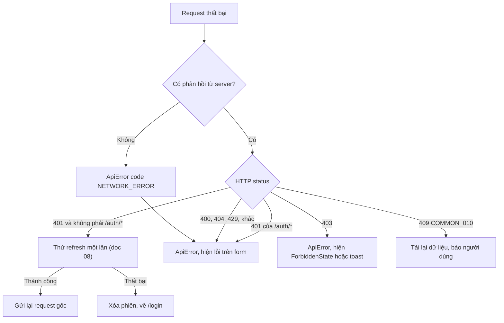
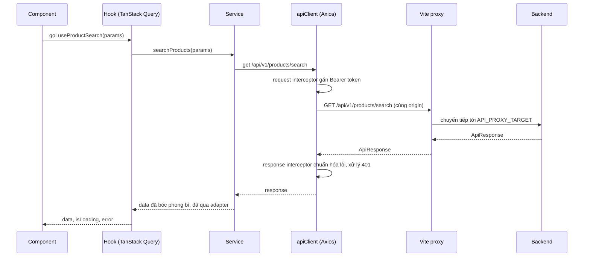

# 07 - API Integration (Tích hợp API)

> **Trạng thái:** BẢN NHÁP v0.1
> **Cập nhật:** 2026-11-08
> **Áp dụng cho:** `Moldy-Market-User-Frontend`
> **Mục đích:** Quy định cách Frontend nói chuyện với Backend: cấu hình Axios, xử lý lỗi, tổ chức `services/`, các dạng phân trang, và bảng ánh xạ endpoint.

Nhãn dùng trong tài liệu:
- `[ĐÃ XÁC MINH BACKEND]`: có trong doc 14.
- `[ĐÃ CẤU HÌNH]`: đã có trong repo (proxy, biến môi trường, thư mục `services/`).
- `[ĐỀ XUẤT]`: thiết kế dự kiến, **chưa có code**. Các đoạn code là ví dụ minh họa, chưa có trong repo.

Quy tắc số một: **mọi endpoint trong tài liệu này phải có trong doc 14.** Thứ gì doc 14 không có thì Frontend coi là chưa biết, không tự bịa.

---

## 1. Hiện trạng `[ĐÃ CẤU HÌNH]`

- Axios ^1.21.0 đã cài. **Chưa có** Axios instance, interceptor hay service nào. Thư mục `src/services/{api,auth,users,stores,categories,products}` đã tạo, đang trống (`.gitkeep`).
- Vite proxy: mọi request bắt đầu bằng `/api` được chuyển tới `API_PROXY_TARGET` (mặc định `http://localhost:8080`). Đã kiểm chứng gọi `/api/v1/categories` qua `http://localhost:5173` chạy được.
- `.env.example`: `VITE_API_BASE_URL` (để trống khi dev), `API_PROXY_TARGET` (chỉ dev, không lộ ra bundle vì không có tiền tố `VITE_`).

---

## 2. Cấu hình Axios `[ĐỀ XUẤT]`

### 2.1 Vì sao `baseURL` để trống và không gắn `/api/v1`

1. **Trình duyệt gọi cùng origin với Vite dev server** (`localhost:5173`), Vite proxy chuyển tiếp sang Backend. Nhờ vậy dev không cần CORS, vì Backend chưa có CORS cho REST (B1, doc 14 mục 2.4).
2. **Backend có hai prefix**: `/api/v1/...` (auth, users, stores, categories, products, order...) và `/api/...` (voucher, pricing, admin pricing). Nếu gắn cứng `/api/v1` vào `baseURL`, bạn không gọi được nhóm thứ hai (doc 14 mục 2.3).
3. **Production:** đặt `VITE_API_BASE_URL` thành URL tuyệt đối của Backend, **hoặc** phục vụ app cùng origin với API. Cả hai đều cần Backend sẵn sàng (thêm CORS, hoặc reverse proxy). Xem doc 12.

Vì vậy mọi service viết **đường dẫn đầy đủ**, ví dụ `'/api/v1/products/search'`.

### 2.2 Instance (ví dụ minh họa, chưa có trong repo)

```js
// src/services/api/client.js
import axios from 'axios'

export const apiClient = axios.create({
  baseURL: import.meta.env.VITE_API_BASE_URL ?? '',
  timeout: 15000,
  headers: { Accept: 'application/json' },
})
```

`?? ''` để khi biến không có giá trị, Axios gọi cùng origin (đúng với dev + proxy).

### 2.3 Request interceptor

Nhiệm vụ duy nhất: gắn `Authorization: Bearer <accessToken>` nếu đang có token. Token lấy từ `state/` (xem doc 08, nơi lưu token **chưa chốt**, Q2). Interceptor chỉ đọc token qua một hàm `getAccessToken()` để khi quyết định lưu ở đâu thì chỉ sửa một chỗ.

Lưu ý: chưa xác minh được Backend phản ứng thế nào nếu gửi access token đã hết hạn tới endpoint **công khai**. Cần thử bằng request thật trước khi quyết định có gắn token cho mọi request hay chỉ endpoint cần đăng nhập.

### 2.4 Response interceptor

**Hiện trạng 2026-11-10:** đã triển khai `services/api/client.js`, `ApiError.js` và `unwrap.js`. Interceptor chuẩn hóa lỗi HTTP/mạng; cancellation giữ nguyên. `unwrap` trả `undefined` khi không có body và giữ nguyên payload `null`, `false`, `0`. Body sai envelope hoặc `success: false` bị từ chối. Chưa có auth interceptor, tự refresh hoặc logout: Q2 đã chốt access token ở `localStorage`, refresh token trong cookie `HttpOnly` do Backend set; chờ contract Backend (doc 14, Q2).

Có hai việc, **tách riêng**:

1. **Chuẩn hóa lỗi** thành một class `ApiError` (xem mục 4).
2. **Xử lý `401`**: thử refresh token đúng một lần rồi gửi lại request gốc. Chi tiết, bao gồm hàng đợi và rủi ro đa tab, nằm ở doc 08. Interceptor **không** thử refresh cho chính các endpoint `/api/v1/auth/*` (vì `AUTH_001` sai mật khẩu cũng là `401`, refresh không giúp gì).

---

## 3. Bóc phong bì `ApiResponse` `[ĐÃ XÁC MINH BACKEND]` + `[ĐỀ XUẤT]`

Backend trả mọi REST response dạng `{ success, code, message, data, timestamp }` (doc 14 mục 2.1). Frontend cần một hàm duy nhất để lấy `data` ra:

```js
// src/services/api/unwrap.js (ví dụ minh họa)
export function unwrap(response) {
  const body = response.data
  // Một số endpoint không có body: DELETE category, DELETE product, PATCH ... /read (notification), v.v.
  if (body === undefined || body === null || body === '') return undefined
  return body.data
}
```

Các ngoại lệ phải nhớ (doc 14 mục 2.1):
- Endpoint **không có body** (xóa category, xóa product, thao tác notification `PATCH`/`DELETE`). Không được giả định luôn có `response.data.data`.
- Payload WebSocket của chat **không** bọc trong `ApiResponse`.
- Webhook SePay trả `{ success: true }` và chỉ do SePay gọi, **Frontend không bao giờ gọi** endpoint này.

---

## 4. Xử lý lỗi `[ĐÃ XÁC MINH BACKEND]` + `[ĐỀ XUẤT]`

### 4.1 Hình dạng lỗi từ Backend

`success = false`, `code` là chuỗi `ErrorCode` (ví dụ `AUTH_001`), `data` là object `ApiError` (có ít nhất đường dẫn request; các trường khác chưa được đọc). `message` là **tiếng Anh**.

### 4.2 `ApiError` phía Frontend

Interceptor biến mọi lỗi Axios thành một dạng thống nhất để phần còn lại của app không phải đọc cấu trúc Axios:

```js
// src/services/api/ApiError.js (ví dụ minh họa)
export class ApiError extends Error {
  /**
   * @param {{ status: number|null, code: string, message: string, details?: unknown }} p
   */
  constructor({ status, code, message, details }) {
    super(message)
    this.name = 'ApiError'
    this.status = status // HTTP status, null nếu không có phản hồi (mất mạng)
    this.code = code // mã của Backend, hoặc mã do Frontend tự đặt
    this.details = details
  }
}
```

Hai mã do **Frontend tự đặt** (không phải mã Backend, không có trong `ErrorCode`): `FE_NETWORK_ERROR` (không nhận được phản hồi) và `FE_UNKNOWN_ERROR`. Hãy giữ chúng tách biệt bằng tiền tố hoặc hằng số riêng để không nhầm với mã Backend.

### 4.3 Ánh xạ mã lỗi sang giao diện

Nguyên tắc: **không hiển thị `message` của Backend**. Dùng `code` làm khóa i18n, ví dụ `errors.AUTH_001` trong namespace `errors` (cần thêm namespace này vào `src/i18n`, hiện mới có `common`). Mã chưa có bản dịch thì rơi về một thông báo chung.

| Mã | HTTP | Hành vi giao diện đề xuất |
|---|---|---|
| `COMMON_001` | 400 | Validation thất bại: hiển thị lỗi theo trường nếu `data` có chi tiết, nếu không hiển thị thông báo chung. Cần đối chiếu response thật để biết hình dạng chi tiết lỗi theo trường |
| `COMMON_003` | 401 | Chưa đăng nhập: chạy cơ chế refresh (doc 08), thất bại thì về `/login` |
| `COMMON_004` | 403 | Hiện `ForbiddenState`. **Không** đăng xuất |
| `COMMON_009` | 429 | Gọi quá nhiều: báo "thử lại sau", không tự động gửi lại ngay |
| `COMMON_010` | 409 | Dữ liệu bị người khác sửa trước (optimistic lock, `version` khi sửa product): tải lại dữ liệu và báo người dùng, **không** tự ghi đè |
| `AUTH_001` | 401 | Sai email hoặc mật khẩu: hiện lỗi ngay trên form đăng nhập |
| `AUTH_003`, `AUTH_004` | 403 | Tài khoản bị khóa, bị vô hiệu. Với tài khoản mới đăng ký chưa được kích hoạt, xem B10 và Q14 ở doc 08 |
| `AUTH_005`, `AUTH_006`, `AUTH_007` | 401 | Refresh token không hợp lệ, hết hạn, bị dùng lại. Xóa phiên, về `/login`. Với `AUTH_007` báo rõ "phiên đã bị đóng vì lý do an toàn" (doc 08) |
| `STORE_004` | 403 | Gian hàng bị chặn |
| `STORE_015` | 403 | Không có quyền với tài nguyên của gian hàng này |
| `PROD_008` | 409 | Đã đạt giới hạn số tin đăng |
| `PROD_010` | 400 | Sản phẩm không còn `ACTIVE` (khi checkout, `IN_PROGRESS`) |
| `ORDER_003` | 404 | Chưa có order nào: **trạng thái rỗng, không phải lỗi** (B13) |
| `ORDER_005` | 400 | Trùng sản phẩm trong một lần checkout |
| `ORDER_008` | 409 | Checkout group không ở trạng thái hợp lệ |
| `ORDER_011` | 403 | Không được truy cập checkout group này |
| `PAYMENT_001` | 404 | Payment không tồn tại (cũng trả khi payment của người khác) |

Mã còn lại xem `ErrorCode.java` ở repo Backend. Hai mã `PAYMENT_002`, `PAYMENT_003` chỉ phía SePay gặp, Frontend không xử lý.

### 4.4 Luồng xử lý lỗi



---

## 5. Tổ chức `services/` `[ĐỀ XUẤT]`

### 5.1 Quy ước

- **Một thư mục cho mỗi module Backend**, mỗi hàm là một lời gọi API: `services/products/productService.js`, `services/auth/authService.js`...
- Hàm service là **hàm async thuần**: nhận tham số, gọi `apiClient`, trả `data` đã bóc phong bì (hoặc đã qua adapter phân trang). Không `useState`, không `useQuery`, không `toast`. Việc cache và hiển thị là của hook (doc 09).
- **Chỉ viết service cho endpoint `IMPLEMENTED`** (doc 14 mục 1.2). Endpoint `IN_PROGRESS` chỉ được viết sau khi branch đã merge vào `main` và doc 14 cập nhật. Endpoint `PLANNED` hoặc `NOT_FOUND` chỉ làm skeleton trang `TODO`, không viết service.
- Tên hàm theo động từ + đối tượng: `searchProducts`, `getProductById`, `createProduct`, `updateProduct`, `deleteProduct`, `setProductStatus`.
- Mỗi hàm có JSDoc ghi: endpoint, quyền cần có, và các lỗi đáng chú ý.
- `services/api/` chứa phần nền: `client.js`, `unwrap.js`, `ApiError.js`, `pagination.js` (adapter), `endpoints.js` (nếu muốn gom đường dẫn).

### 5.2 Ví dụ minh họa (chưa có trong repo)

```js
// src/services/products/productService.js
import { apiClient } from '@/services/api/client'
import { unwrap } from '@/services/api/unwrap'

/**
 * GET /api/v1/products/search  (công khai)
 * Phân trang: page bắt đầu từ 1. totalCapped = true nghĩa là "từ 10.000 kết quả trở lên".
 */
export async function searchProducts(params) {
  const res = await apiClient.get('/api/v1/products/search', { params })
  return unwrap(res)
}

/** DELETE /api/v1/products/{id}  (không có body trả về) */
export async function deleteProduct(id) {
  await apiClient.delete(`/api/v1/products/${id}`)
}
```

Hook của feature gọi các hàm này (doc 09), component gọi hook.

---

## 6. Các dạng phân trang `[ĐÃ XÁC MINH BACKEND]`

Backend có **nhiều dạng**, không thể dùng một bộ phân trang chung (doc 14 mục 2.2). Mỗi dạng cần một **adapter** chuẩn hóa về một hình dạng nội bộ của Frontend, ví dụ `{ items, page, size, totalElements, hasNext }`, để `PaginationBar` và hook dùng chung.

| Dạng | Endpoint (trạng thái) | `page` bắt đầu | Response | Adapter / cách dùng |
|---|---|---|---|---|
| `PagedResponse` | Danh sách user và store của admin (User Frontend không dùng) | 1 | `{ content, page, size, hasNext, totalElements }`, `totalElements` có thể `null` | `content` thành `items`; nếu `totalElements` null chỉ hiển thị "Trước/Sau" |
| `ProductSearchResponse` | `GET /api/v1/products/search` (`IMPLEMENTED`) | 1 | `{ items, page, size, totalElements, totalPages, totalCapped, facets }` | Dùng `items`; nếu `totalCapped` thì hiển thị "10.000+" |
| `PagedResponse<ProductResponse>` | `GET /api/v1/products` (`IMPLEMENTED`, tham số **chưa audit**) | 1 | theo chữ ký method | Ưu tiên dùng `/search` để duyệt sản phẩm |
| Cursor (notification) | `GET /api/v1/notifications` (`IN_PROGRESS`) | không có page, dùng `limit` (mặc định 20, tối đa 50) và `token` | `{ items, nextToken, pageSize }` | `useInfiniteQuery`, `getNextPageParam` trả `nextToken`, `null` là hết |
| Spring `Page` thô (lịch sử chat) | `GET /api/v1/conversations/{id}/messages` (`IN_PROGRESS`) | **0**, `size` mặc định **4** | `Page<MessageResponse>` | Luôn truyền `size` rõ ràng (mặc định 4 quá nhỏ), nhớ `page` từ 0 (B6). Tên trường của Spring `Page` cần đối chiếu response thật |
| Danh sách thuần | `GET /api/v1/orders/me`, `GET /api/v1/payments/my-payments` (`IN_PROGRESS`) | không phân trang | `List<...>` | Trả mảng. Riêng `orders/me` trả 404 `ORDER_003` khi rỗng (B13), service **bắt lỗi này và trả mảng rỗng** |
| Danh sách thuần | `GET /api/v1/conversations`, category cây | không phân trang | mảng | trả mảng |

`size` tối đa 100 và mặc định 20 với dạng dùng `PaginationConfig` (doc 14 mục 2.2).

---

## 7. Tìm kiếm, lọc, sắp xếp `[ĐÃ XÁC MINH BACKEND]`

Tham số của `GET /api/v1/products/search` (doc 14 mục 5.6):

| Tham số | Ràng buộc |
|---|---|
| `q` | tối đa 100 ký tự |
| `categoryId[]` | tối đa 20 giá trị |
| `condition[]` | tối đa 10 giá trị, thuộc `NEW`, `LIKE_NEW`, `USED`, `DAMAGED` |
| `minPrice`, `maxPrice` | số |
| `storeId`, `sellerType` | lọc theo gian hàng hoặc loại người bán (giá trị hợp lệ của `sellerType` **chưa audit**) |
| `attr[]` | tối đa 10, parse thành khóa + danh sách giá trị (OR trong cùng một khóa). Định dạng chuỗi chính xác **chưa audit** |
| `sort` | `relevance`, `newest`, `price_asc`, `price_desc` |
| `facets` | yêu cầu trả facet |
| `page`, `size` | page từ 1 |

Gợi ý từ khóa: `GET /api/v1/products/suggest?q=`.

`[ĐỀ XUẤT]` Lưu ý khi viết code:
- **Mảng trong query string.** Axios mặc định serialize mảng thành `categoryId[]=1&categoryId[]=2`. Spring thường mong `categoryId=1&categoryId=2`. Có thể phải cấu hình `paramsSerializer: { indexes: null }`. **Cần thử với Backend thật trước khi chốt** vì doc 14 chưa xác minh định dạng này.
- Trạng thái bộ lọc nằm trên **URL** (query string của trang) để chia sẻ link và nút Back hoạt động, xem doc 09. Giá trị `sort` hợp lệ có thể là hằng số trong `constants/`; **không** đưa giá trị enum Backend vào bản dịch.
- Debounce ô tìm kiếm và `suggest` (khoảng 300 ms) để không gọi mỗi phím bấm.

---

## 8. Upload file `[ĐÃ XÁC MINH BACKEND]`

Hiện **không có API upload ảnh** (`NOT_FOUND`, doc 14 mục 4.3; Q5). Product nhận ảnh dưới dạng **URL HTTPS**, tối đa 10 ảnh, mỗi URL tối đa 500 ký tự. Hệ quả:
- Form đăng tin chỉ có ô nhập URL ảnh, kiểm tra `https://` và độ dài bằng Zod. Đây là giải pháp tạm, không phải trải nghiệm cuối.
- Không viết service upload. Khi team chốt Q5 (pre-signed URL hay dịch vụ ngoài), cập nhật doc 14 rồi mới thêm.
- Chat có `attachmentUrl` ở payload gửi (doc 14 mục 5.2), cũng là URL, không phải upload trực tiếp.

---

## 9. Bảng ánh xạ endpoint

Cột "FE" là trạng thái tích hợp phía Frontend. Hiện tại **mọi dòng là `NOT_STARTED`** (chưa có service nào). "Xác thực" ghi theo doc 14. `U` = User Frontend dùng.

### 9.1 Dùng được ngay (`IMPLEMENTED` trên `main`)

| Tính năng | Endpoint | Method | Xác thực | Backend | FE |
|---|---|---|---|---|---|
| Đăng ký | `/api/v1/auth/register` | POST | không | `IMPLEMENTED` | `NOT_STARTED` |
| Đăng nhập | `/api/v1/auth/login` | POST | không | `IMPLEMENTED` | `NOT_STARTED` |
| Refresh token | `/api/v1/auth/refresh` | POST | không | `IMPLEMENTED` | `NOT_STARTED` |
| Đăng xuất | `/api/v1/auth/logout` | POST | không (gửi `refreshToken`) | `IMPLEMENTED` | `NOT_STARTED` |
| Hồ sơ của tôi | `/api/v1/users/me` | GET | đã đăng nhập | `IMPLEMENTED` | `NOT_STARTED` |
| Cập nhật hồ sơ | `/api/v1/users/me` | PUT | `PROFILE_MANAGE` | `IMPLEMENTED` | `NOT_STARTED` |
| Đổi mật khẩu | `/api/v1/users/me/password` | PUT | đã đăng nhập | `IMPLEMENTED` | `NOT_STARTED` |
| Tạo gian hàng | `/api/v1/stores` | POST | đã đăng nhập (mỗi user một gian hàng, `STORE_002`) | `IMPLEMENTED` | `NOT_STARTED` |
| Gian hàng của tôi | `/api/v1/stores/my-store` | GET, PUT | đã đăng nhập | `IMPLEMENTED` | `NOT_STARTED` |
| Trang gian hàng công khai | `/api/v1/stores/{id}` | GET | công khai | `IMPLEMENTED` | `NOT_STARTED` |
| Staff: thêm, danh sách | `/api/v1/stores/my-store/staff` | POST, GET | `STORE_STAFF_MANAGE` | `IMPLEMENTED` | `NOT_STARTED` |
| Staff: sửa permission | `/api/v1/stores/my-store/staff/{staffId}/permissions` | PUT | `STORE_STAFF_MANAGE` | `IMPLEMENTED` | `NOT_STARTED` |
| Staff: xóa | `/api/v1/stores/my-store/staff/{staffId}` | DELETE | `STORE_STAFF_MANAGE` | `IMPLEMENTED` | `NOT_STARTED` |
| Staff: thông tin của tôi | `/api/v1/stores/my-store/staff/me` | GET | `STORE_STAFF_MANAGE` (xem Q1) | `IMPLEMENTED` | `NOT_STARTED` |
| Category: cây | `/api/v1/categories` | GET | công khai | `IMPLEMENTED` | `NOT_STARTED` |
| Category: chi tiết | `/api/v1/categories/{id}` | GET | công khai | `IMPLEMENTED` | `NOT_STARTED` |
| Product: tạo | `/api/v1/products` | POST | `PRODUCT_CREATE` | `IMPLEMENTED` | `NOT_STARTED` |
| Product: sửa (cần `version`) | `/api/v1/products/{id}` | PUT | `PRODUCT_MANAGE_OWN` | `IMPLEMENTED` | `NOT_STARTED` |
| Product: xóa | `/api/v1/products/{id}` | DELETE | `PRODUCT_MANAGE_OWN` | `IMPLEMENTED` | `NOT_STARTED` |
| Product: đổi trạng thái (`ACTIVE` hoặc `HIDDEN`) | `/api/v1/products/{id}/status?status=` | PATCH | `PRODUCT_MANAGE_OWN` | `IMPLEMENTED` | `NOT_STARTED` |
| Product: danh sách | `/api/v1/products` | GET | công khai (tham số chưa audit) | `IMPLEMENTED` | `NOT_STARTED` |
| Product: chi tiết | `/api/v1/products/{id}` | GET | công khai | `IMPLEMENTED` | `NOT_STARTED` |
| Product: tìm kiếm | `/api/v1/products/search` | GET | công khai | `IMPLEMENTED` | `NOT_STARTED` |
| Product: gợi ý từ khóa | `/api/v1/products/suggest?q=` | GET | công khai | `IMPLEMENTED` | `NOT_STARTED` |

Ghi chú: **chưa có endpoint đã xác minh để liệt kê riêng "sản phẩm của tôi"**. Muốn liệt kê sản phẩm của một gian hàng thì dùng `search` với `storeId`. Với tin đăng cá nhân (`storeId = null`) cách lọc theo chính người đăng chưa được doc 14 xác nhận (có tham số `sellerType` nhưng giá trị chưa audit). Việc này cần hỏi team Backend trước khi làm trang `/my-products` (xem doc 04 và 05).

### 9.2 Đang phát triển (`IN_PROGRESS`, **chưa được viết service**)

| Tính năng | Endpoint | Method | Branch |
|---|---|---|---|
| Notification | `/api/v1/notifications` (`?limit&token`), `/{id}`, `/{id}/read`, `/{id}/restore` | GET, PATCH, DELETE | `feature/notification` |
| Chat REST | `/api/v1/conversations`, `/{id}/messages`, `/{id}/read` | POST, GET, PATCH | `feature/chat`, `feature/order` |
| Chat realtime | STOMP qua SockJS tại `/chat` | không phải REST | `feature/chat` |
| Checkout | `/api/v1/checkout-groups`, `/api/v1/checkout-groups/{id}` | POST, GET | `feature/order` |
| Order của tôi | `/api/v1/orders/me`, `/api/v1/orders/{orderId}` (B11) | GET | `feature/order` |
| Payment của tôi | `/api/v1/payments/my-payments`, `/api/v1/payments/{id}` | GET | `feature/order` |
| Cart | `/api/v1/carts`, `/summary`, `/by-seller`, `/items`, `/items/{listingId}`, `/items/{listingId}/exists`, `/items/count` | GET, POST, PATCH, DELETE | `feature/cart` |
| Voucher (kiểm tra mã) | `/api/vouchers/{code}` | GET | `feature/voucher` |
| Auto pricing, thẩm định | `/api/pricing/auto`, `/api/pricing/appraiser/...`, `/api/pricing/requests/{requestId}`, `/api/pricing/{listingId}` | nhiều | `feature/pricing`, `feature/cart` |
| Số dư ví, rút tiền | `/api/v1/wallets/{userId}/balance`, `/api/v1/withdrawals` | GET, POST | `feature/escrow-wallet` |

Escrow (`/api/v1/escrows/...`) trông là thao tác nội bộ của service, Frontend có gọi hay không là câu hỏi mở (Q4), nên không đưa vào bảng làm endpoint để Frontend dùng. Webhook SePay `/api/v1/payment_transactions/webhook/sepay` **không bao giờ** được Frontend gọi.

### 9.3 Chưa có (`NOT_FOUND` hoặc `PLANNED`)

Offer, refund, dispute, wishlist, follow gian hàng, đánh giá, thống kê doanh thu của gian hàng, upload ảnh, mời staff, order phía người bán, notification realtime (doc 14 mục 4.3). **Không có service**, chỉ có skeleton `TODO`.

---

## 10. Luồng gọi API tổng quát



Khi chạy production, bước "Vite proxy" không còn. Request đi thẳng tới `VITE_API_BASE_URL` hoặc cùng origin qua reverse proxy (doc 12).

---

## 11. Polling thanh toán `[ĐÃ XÁC MINH BACKEND]` + `[ĐỀ XUẤT]`

Chưa làm ngay vì checkout là `IN_PROGRESS`. Ghi sẵn nguyên tắc để không đi sai hướng (doc 14 mục 5.8):
- Không có kênh push. Frontend **polling** `GET /api/v1/payments/{id}` (hoặc `GET /api/v1/checkout-groups/{id}`).
- Chỉ coi là thành công khi `paymentStatus === "SUCCESSFUL"` do Backend trả. Không bao giờ coi "Tôi đã chuyển khoản" là thành công.
- Không tin `status` của order hay checkout group (B12).
- Tần suất polling hợp lý chưa được chốt (Q11). Dùng `refetchInterval` của TanStack Query, dừng khi thành công, thất bại hoặc quá `expiredAt`, và dừng khi tab ẩn (`refetchIntervalInBackground: false`).

---

## 12. Lỗi thường gặp cần tránh

| Lỗi | Cách đúng |
|---|---|
| Gắn `baseURL: '/api/v1'` | Để trống, dùng đường dẫn đầy đủ (hai prefix) |
| Viết `response.data.data` ở mọi nơi | Dùng `unwrap`, và nhớ có endpoint không có body |
| Hiển thị `message` tiếng Anh của Backend | Ánh xạ `code` sang i18n |
| Coi `ORDER_003` là lỗi | Là trạng thái rỗng (B13) |
| Một bộ phân trang chung cho mọi endpoint | Mỗi dạng một adapter, nhớ `page` từ 0 ở lịch sử chat |
| Viết service cho endpoint `IN_PROGRESS` | Chờ branch merge và doc 14 cập nhật |
| Tự tính tiền thanh toán ở Frontend | Chỉ hiển thị `totalAmount` Backend trả |
| Đưa `.env.local` hoặc secret vào code, hoặc đặt khóa bí mật trong biến `VITE_*` | Biến `VITE_*` bị nhúng vào bundle, ai cũng đọc được |

---

## Tài liệu liên quan

- 02 - Frontend Architecture: lớp `services/` nằm ở đâu.
- 04 - Routing and Pages: trang nào dùng endpoint nào.
- 05 - Page by Page Guide: API cần cho từng trang, ràng buộc validation.
- 08 - Authentication and Authorization: interceptor refresh token, 401 và 403.
- 09 - State Management: hook TanStack Query, query key, invalidation.
- 12 - Environment and Deployment: biến môi trường, proxy, CORS, production.
- 14 - Backend Integration Matrix: nguồn sự thật về endpoint và contract.
