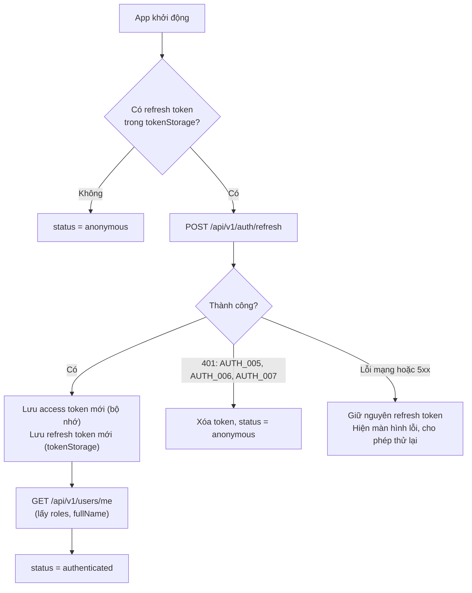
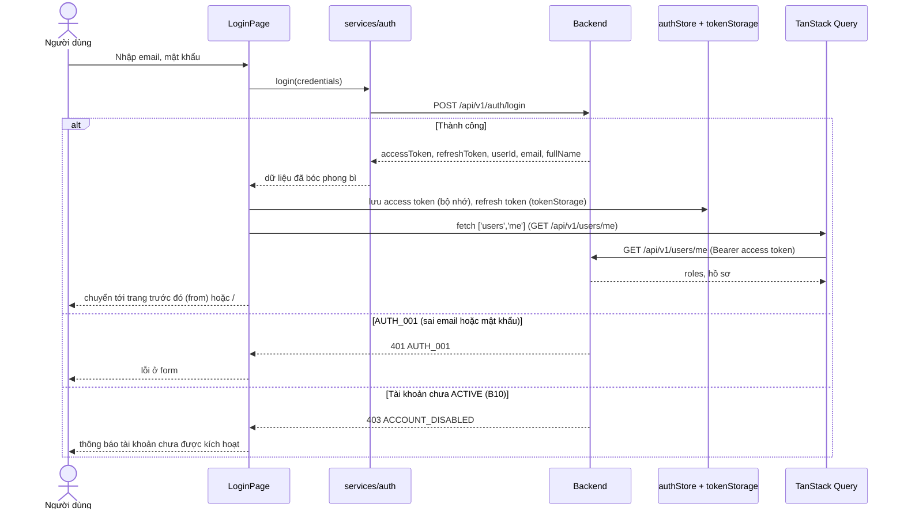
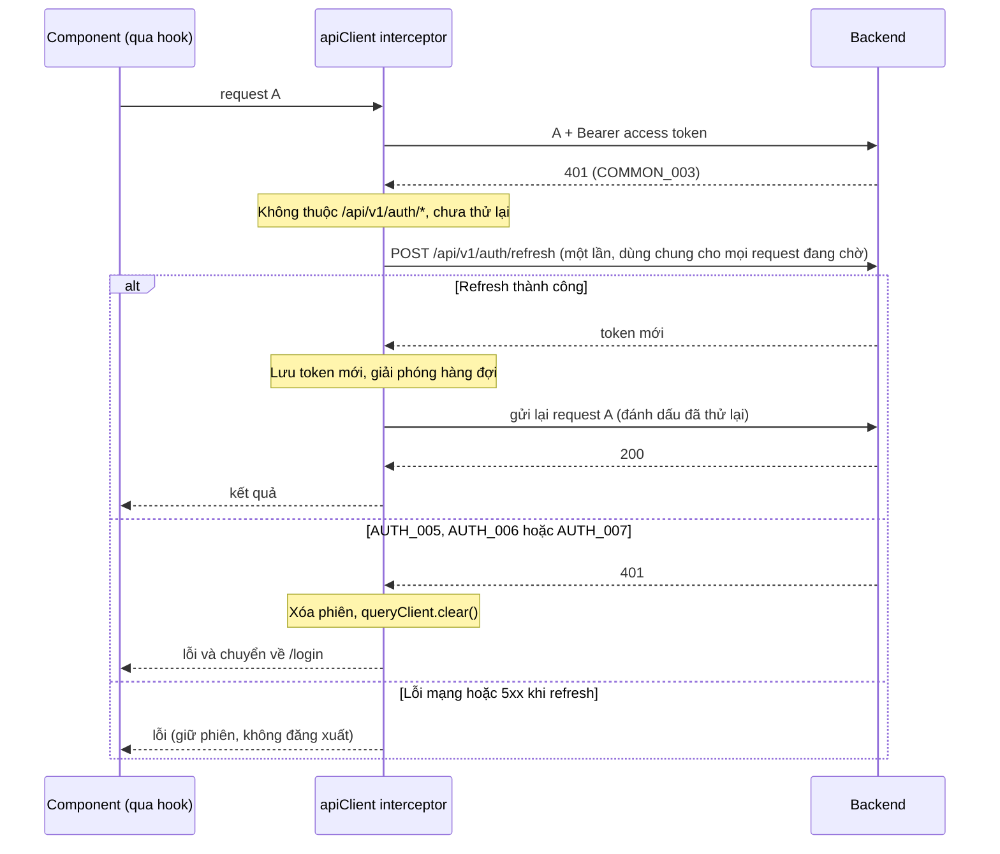

# 08 - Authentication and Authorization (Xác thực và phân quyền)

> **Trạng thái:** BẢN NHÁP v0.1
> **Cập nhật:** 2026-11-08
> **Áp dụng cho:** `Moldy-Market-User-Frontend`
> **Mục đích:** Mô tả Frontend đăng ký, đăng nhập, giữ phiên, làm mới token, đăng xuất và phân quyền giao diện như thế nào, dựa trên cách Backend thật sự hoạt động.

Nhãn dùng trong tài liệu:
- `[ĐÃ XÁC MINH BACKEND]`: có trong doc 14.
- `[ĐÃ CẤU HÌNH]`: đã thật sự có trong repo.
- `[ĐỀ XUẤT]`: kiến trúc dự kiến, **chưa có code**. Mọi tên hook, store, guard, hàm trong tài liệu này là `[ĐỀ XUẤT]`. Các đoạn code là ví dụ minh họa, chưa có trong repo.

Hai quyết định **CHƯA CHỐT** xuyên suốt tài liệu này (cần team quyết định, không được coi là đã quyết):
- **Q2**: lưu token ở đâu (mục 4).
- **Q1**: Frontend không đọc được permission code của user (mục 8).

---

## 1. Hiện trạng

- `[ĐÃ CẤU HÌNH]` Thư viện đã cài: `axios`, `zustand`, `react-router`, `@tanstack/react-query`, `react-hook-form`, `zod`. Thư mục `src/services/auth`, `src/features/auth/*`, `src/state`, `src/app/router` đã tạo nhưng **trống**.
- Chưa có Axios instance, interceptor, store, guard, trang đăng nhập hay đăng ký nào.
- Mọi thứ dưới đây là thiết kế để team thống nhất trước khi code.

---

## 2. Backend thật sự làm gì `[ĐÃ XÁC MINH BACKEND]`

Trích từ doc 14 mục 2.5, 3.1 đến 3.5.

| Chủ đề | Sự thật |
|---|---|
| Endpoint | `POST /api/v1/auth/register`, `/login`, `/refresh`, `/logout`. Cả bốn đều công khai (không cần header `Authorization`). |
| Đăng ký | Body `{ email, password(8-100), fullName(tối đa 100), phone }`. Trả `{ userId, email, fullName, status }`. |
| Đăng nhập | Body `{ email(tối đa 254), password }`. Trả `{ userId, email, fullName, accessToken, refreshToken, tokenType }`. **Không trả role.** |
| Refresh | Body `{ refreshToken }`. Trả giống login. |
| Logout | Body `{ refreshToken }`. Không có `data`. Chỉ thu hồi phiên của refresh token được gửi lên. |
| Token nằm ở đâu | Cả hai trong JSON body (không có cookie). |
| Thời hạn | Access token 15 phút, refresh token 30 ngày (**chỉ xác minh ở profile local**, production có thể khác). |
| Claim của access token | `sub`, `email`, `tokenType = "ACCESS"`. Không có role hay permission. |
| Xoay vòng (rotation) | Mỗi lần refresh, refresh token cũ bị thu hồi, token mới được cấp. |
| Phát hiện dùng lại | Gửi lên một refresh token **đã bị thu hồi** thì Backend trả `AUTH_007` và **thu hồi mọi phiên đăng nhập của user** (mọi thiết bị, mọi tab). |
| Role của user | `GET /api/v1/users/me` trả `roles: string[]` (tên role: `USER`, `APPRAISER`, `STAFF`, `ADMIN`, `OWNER`). |
| Permission code của user | **Không có endpoint nào** (Q1). |
| Tài khoản mới | Trạng thái `PENDING_VERIFICATION`, chưa đăng nhập được, chưa có luồng kích hoạt (B10, Q14). |

Các mã lỗi liên quan:

| Mã | HTTP | Ý nghĩa | Frontend làm gì |
|---|---|---|---|
| `AUTH_001` | 401 | Sai email hoặc mật khẩu | Hiện lỗi ở form đăng nhập. **Không** refresh. |
| `AUTH_003` / `AUTH_004` | 403 | Tài khoản bị khóa / bị vô hiệu | Hiện thông báo tài khoản không dùng được. |
| `AUTH_005` / `AUTH_006` | 401 | Refresh token không hợp lệ / hết hạn | Xóa phiên, về trang đăng nhập. |
| `AUTH_007` | 401 | Refresh token bị dùng lại, mọi phiên đã bị thu hồi | Xóa phiên, về trang đăng nhập, hiện thông báo riêng (mục 7). |
| `COMMON_003` | 401 | Cần đăng nhập | Thử refresh một lần (mục 6). |
| `COMMON_004` | 403 | Không đủ quyền | Hiện "không có quyền", **không** xóa phiên (mục 9). |
| `COMMON_009` | 429 | Quá nhiều request | Hiện thông báo thử lại sau. |
| `STORE_004` | 403 | Gian hàng bị chặn | Hiện thông báo theo ngữ cảnh. |
| `STORE_015` | 403 | Không có quyền với tài nguyên của gian hàng này | Hiện "không có quyền". |

Lưu ý: khi đăng nhập một tài khoản chưa `ACTIVE`, doc 14 mục 3.5 ghi Backend trả lỗi `ACCOUNT_DISABLED`; chưa xác định đó là `AUTH_003` hay `AUTH_004`. Phải thử thật để biết `code` chính xác, và không đoán.

---

## 3. Mô hình phiên của Frontend `[ĐỀ XUẤT]`

### 3.1 Ba nơi giữ thông tin, mỗi nơi một việc

| Thông tin | Nơi giữ | Lý do |
|---|---|---|
| Access token | Bộ nhớ (store Zustand **không persist**) | Sống 15 phút, mất khi tải lại trang là chấp nhận được vì có refresh token. Ít bị lộ nhất khi có XSS (không nằm trong storage). |
| Refresh token | Qua một module duy nhất `lib/tokenStorage.js`, nơi lưu **CHƯA CHỐT** (Q2, mục 4) | Một chỗ để đổi khi team quyết định. |
| Thông tin user (`email`, `fullName`, `roles`...) | **TanStack Query**, query key `['users', 'me']` | Đây là dữ liệu từ server, không để trong Zustand (doc 09). |

### 3.2 Store phiên

```js
// src/state/authStore.js (ví dụ minh họa, chưa có trong repo)
import { create } from 'zustand'

// status: 'unknown' = đang khôi phục phiên lúc mở app
//         'authenticated' | 'anonymous'
export const useAuthStore = create((set) => ({
  status: 'unknown',
  accessToken: null,
  setAccessToken: (accessToken) => set({ accessToken, status: 'authenticated' }),
  clearSession: () => set({ accessToken: null, status: 'anonymous' }),
}))

// Interceptor chỉ cần hàm này, không cần biết token nằm ở đâu.
export const getAccessToken = () => useAuthStore.getState().accessToken
```

`status` có giá trị `'unknown'` để guard biết "đang khôi phục phiên, chưa được kết luận là chưa đăng nhập". Thiếu giá trị này, người dùng đã đăng nhập sẽ bị chuyển về `/login` trong tích tắc mỗi lần tải lại trang.

### 3.3 Khôi phục phiên khi mở app (bootstrap)



Điểm quan trọng: **chỉ xóa refresh token khi Backend nói rõ token không còn dùng được** (`AUTH_005`, `AUTH_006`, `AUTH_007`). Lỗi mạng hay `5xx` không được xóa phiên, nếu không người dùng bị đăng xuất oan mỗi lần Backend khởi động lại.

Trong lúc `status === 'unknown'`, router hiển thị màn hình chờ (skeleton toàn trang), không render trang bảo vệ và không chuyển hướng.

---

## 4. Nơi lưu token: Q2 đã chốt, chờ Backend

**Quyết định của Chu ngày 2026-11-10:** access token lưu trong `localStorage`; refresh token dùng cookie `HttpOnly` do Backend set. Chờ Backend bổ sung và xác minh contract cookie trước khi triển khai auth/refresh. Frontend không tự ghi hoặc đọc refresh cookie. Quyết định này thay thế mọi đề xuất access token trong bộ nhớ và refresh token trong JavaScript storage, kể cả ví dụ, bảng và sơ đồ cũ trong doc 08/09. Không dùng các ví dụ JSON token bên dưới để suy ra contract cookie mới.

### Khảo sát trước quyết định (tham khảo lịch sử)

Backend trả refresh token trong JSON body, nên cookie `httpOnly` (an toàn nhất trước XSS) đòi hỏi **Backend phải đổi**. Các phương án:

| Phương án | Sống sót khi tải lại trang | Đa tab | Rủi ro | Ghi chú |
|---|---|---|---|---|
| A. `localStorage` | Có | Dùng chung giữa các tab | Script XSS đọc được token (sống 30 ngày) | Phổ biến, đơn giản. Dễ gặp lỗi đa tab (mục 6.3). |
| B. `sessionStorage` | Có (cùng tab) | Mỗi tab một phiên riêng, phải đăng nhập lại ở tab mới | Như A nhưng mất khi đóng tab | Tránh được xung đột refresh giữa các tab, đổi lại là bất tiện. |
| C. Chỉ trong bộ nhớ | Không | Mỗi tab riêng | Ít lộ nhất khi XSS | Tải lại trang là phải đăng nhập lại. Quá bất tiện cho người dùng thật. |
| D. Cookie `httpOnly` do Backend set | Có | Dùng chung | Chống XSS đọc token; cần chống CSRF; cần CORS và cookie đúng cấu hình (B1) | Phải sửa Backend: không có trong code hiện tại. |

**Khuyến nghị tạm thời (chưa phải quyết định):** phương án A để bắt đầu nhanh trong giai đoạn đồ án, kèm các biện pháp: access token ở bộ nhớ, tuyệt đối không render HTML thô từ dữ liệu người dùng, không log token. Ghi lại phương án D như hướng nâng cấp nếu team Backend nhận làm. Quyết định cuối cùng thuộc về team, vì nó ảnh hưởng cả Backend.

Bất kể chọn phương án nào, mọi thao tác đọc ghi refresh token đi qua `lib/tokenStorage.js` (ví dụ minh họa):

```js
// src/lib/tokenStorage.js (ví dụ minh họa, chưa có trong repo)
const KEY = 'mm.refreshToken'

export const tokenStorage = {
  get() {
    try { return localStorage.getItem(KEY) } catch { return null }
  },
  set(token) {
    try { localStorage.setItem(KEY, token) } catch { /* trình duyệt chặn storage */ }
  },
  clear() {
    try { localStorage.removeItem(KEY) } catch { /* bỏ qua */ }
  },
}
```

Bọc `try/catch` vì storage có thể bị chặn (chế độ riêng tư, chặn dữ liệu trang web).

---

## 5. Đăng ký, đăng nhập, đăng xuất

### 5.1 Đăng ký `[ĐỀ XUẤT]`

- Form dùng React Hook Form + Zod (`features/auth/schemas`). Ràng buộc lấy đúng từ Backend: `email` hợp lệ, `password` 8 đến 100 ký tự, `fullName` tối đa 100, `phone` bắt buộc (định dạng chưa audit nên chỉ kiểm tra không rỗng, để Backend là nơi quyết định, `COMMON_001` nếu sai).
- Mã lỗi khi trùng email chưa được đọc. Xử lý theo `code` thật khi test, không đoán.
- **Không tự đăng nhập sau khi đăng ký.** Vì B10, tài khoản mới ở `PENDING_VERIFICATION` và đăng nhập sẽ thất bại. Sau khi đăng ký thành công, hiện màn hình "Tài khoản đã được tạo, đang chờ kích hoạt". Nội dung chính xác của màn hình này **phụ thuộc Q14** (email xác minh, OTP hay admin duyệt); hiện chỉ ghi chung và không hứa hẹn cơ chế nào.
- Trong giai đoạn phát triển: tài khoản test do admin chuyển sang `ACTIVE` (`PUT /api/v1/users/{id}/status`) hoặc dùng tài khoản admin seed.

### 5.2 Đăng nhập `[ĐỀ XUẤT]`



Chi tiết:
- Sau khi đăng nhập, bắt buộc gọi `GET /api/v1/users/me` vì response của login không có role.
- Chuyển hướng sau đăng nhập: guard lưu đường dẫn đang cố vào trong `location.state.from`; đăng nhập xong quay lại đó. Chỉ chấp nhận đường dẫn nội bộ (bắt đầu bằng `/`), để tránh chuyển hướng ra ngoài.
- Nút đăng nhập bị vô hiệu trong lúc gửi để tránh gửi hai lần. Gặp `429` (`COMMON_009`) thì hiện thông báo thử lại sau.

### 5.3 Đăng xuất `[ĐỀ XUẤT]`

1. Gọi `POST /api/v1/auth/logout` với `{ refreshToken }` để Backend thu hồi phiên.
2. **Dù lệnh này thành công hay lỗi**, vẫn xóa token cục bộ và `queryClient.clear()`, rồi chuyển về trang đăng nhập hoặc trang chủ. Người dùng bấm đăng xuất là muốn thoát, không để họ kẹt vì lỗi mạng.
3. `queryClient.clear()` là bắt buộc: nếu không, dữ liệu của user cũ (hồ sơ, gian hàng, sản phẩm của tôi) còn trong cache và hiện cho user kế tiếp dùng chung máy.

Đăng xuất đồng bộ giữa các tab: khi một tab xóa token, các tab khác lắng nghe sự kiện `storage` (phương án A) để cũng chuyển về `anonymous`.

---

## 6. Cơ chế xử lý 401 và refresh token `[ĐỀ XUẤT]`

Doc 07 mục 2.4 mô tả vị trí của interceptor; đây là phần chi tiết.

### 6.1 Luồng



### 6.2 Quy tắc bắt buộc

1. **Chỉ một lần refresh tại một thời điểm (single-flight).** Giữ một `refreshPromise` ở mức module. Khi nhiều request cùng nhận 401, tất cả cùng chờ promise đó. Đây không chỉ là tối ưu: Backend xoay vòng refresh token, nên **hai lần refresh song song dùng cùng một token sẽ khiến lần thứ hai bị coi là "dùng lại" (`AUTH_007`) và Backend thu hồi mọi phiên của user**.
2. **Mỗi request chỉ được thử lại một lần.** Đánh dấu request (ví dụ cờ `_retried`). Nếu request gửi lại vẫn 401 thì dừng và đăng xuất, không lặp vô hạn.
3. **Không refresh cho `/api/v1/auth/*`.** Sai mật khẩu (`AUTH_001`) cũng là 401, refresh không giúp gì. Bản thân lệnh refresh mà lỗi cũng không được kích hoạt refresh lần nữa.
4. **Chỉ xóa phiên với `AUTH_005`, `AUTH_006`, `AUTH_007`** (hoặc refresh trả 401). Lỗi mạng và 5xx giữ nguyên phiên.
5. **Token mới phải lưu cả hai.** Phản hồi refresh có refresh token mới; token cũ đã bị thu hồi. Nếu quên lưu, lần refresh sau sẽ dùng token cũ và gây `AUTH_007`.
6. **Làm mới trước khi hết hạn** (tùy chọn, tối ưu): decode `exp` của JWT và refresh khi còn dưới một phút. Không bắt buộc, vì cơ chế 401 ở trên đã đủ.

### 6.3 Rủi ro đa tab (đặc biệt với phương án A của Q2)

Hai tab cùng dùng chung một refresh token trong `localStorage`. Nếu cả hai tab cùng hết hạn access token và cùng refresh, tab chậm hơn gửi token đã bị thu hồi, nhận `AUTH_007`, **và mọi phiên bị thu hồi**, người dùng bị đăng xuất ở tất cả nơi.

Biện pháp `[ĐỀ XUẤT]`:
- Dùng khóa liên tab (`navigator.locks.request('mm-refresh', ...)` của Web Locks API). Sau khi giành được khóa, **đọc lại** refresh token mới nhất từ storage rồi mới gọi refresh, vì tab khác có thể vừa xoay vòng xong.
- Hoặc chấp nhận rủi ro ở giai đoạn đầu và ghi vào known issues. Nếu chọn phương án B (`sessionStorage`), mỗi tab có phiên riêng và rủi ro này biến mất.

### 6.4 Rủi ro không tránh được

Nếu Backend đã xoay vòng token nhưng phản hồi bị mất trên đường về (rớt mạng), Frontend vẫn giữ token cũ. Lần refresh kế tiếp bị `AUTH_007` và mọi phiên bị thu hồi. Đây là thuộc tính của thiết kế Backend, không xử lý triệt để được ở Frontend; chỉ cần thông báo rõ ràng ở mục 7.

---

## 7. Thông báo cho người dùng khi phiên bị thu hồi (trả lời Q3)

| Tình huống | Thông báo gợi ý (qua i18n, key do Frontend đặt) |
|---|---|
| `AUTH_005` hoặc `AUTH_006` | "Phiên đăng nhập đã hết hạn, vui lòng đăng nhập lại." |
| `AUTH_007` | "Vì lý do bảo mật, bạn đã bị đăng xuất khỏi tất cả thiết bị. Vui lòng đăng nhập lại." (Backend đã thu hồi mọi phiên.) |
| `AUTH_003` / `AUTH_004` | "Tài khoản của bạn hiện không thể sử dụng." |

Không hiển thị trực tiếp `message` tiếng Anh của Backend. Ánh xạ `code` sang key i18n (xem doc 07).

---

## 8. Phân quyền trên giao diện

### 8.1 Nguyên tắc

> **Frontend không phải ranh giới bảo mật.** Ẩn nút chỉ để trải nghiệm tốt hơn. Backend kiểm tra quyền ở mỗi request và là nơi quyết định cuối cùng. Phản hồi `403` luôn đúng hơn bất kỳ phán đoán nào của giao diện.

`[ĐÃ XÁC MINH BACKEND]` Backend dùng `hasAuthority(PERMISSION)`, tính lại ở **mỗi request** từ role (`ROLE_<tên>`), permission của role, và permission được ủy quyền cho staff. Gán role gắn theo gian hàng (`UserRole(user_id, role_id, store_id)`).

### 8.2 Frontend biết được gì và không biết gì

| Nhu cầu | Có không? | Hệ quả cho giao diện |
|---|---|---|
| Đã đăng nhập hay chưa | Có | `RequireAuth` |
| Tên role (`roles` từ `/users/me`) | Có | Dùng cho điều hướng thô |
| Permission code của user | **Không** (Q1) | Không thể ẩn nút "đúng từng permission" |
| Staff thuộc gian hàng nào, được cấp quyền gì | **Không** (chỉ có `GET /api/v1/stores/my-store/staff/me`, mà endpoint này cần `STORE_STAFF_MANAGE`) | Chưa nhận diện được staff một cách đáng tin |
| User có gian hàng của riêng mình không | Có thể thử `GET /api/v1/stores/my-store` (đã đăng nhập) | Dùng để biết chủ gian hàng. Mã lỗi khi chưa có gian hàng chưa audit, xử lý theo `code` thật khi test. |

Ghi chú: `roles` là danh sách tên, không cho biết role thuộc gian hàng nào (`store_id` không lộ ra). Tên role `OWNER` và `STAFF` vì thế không đủ để biết "vào dashboard của gian hàng nào".

### 8.3 Các guard `[ĐỀ XUẤT]`

Danh sách route và guard nào bảo vệ route nào nằm ở **doc 04**; ở đây chỉ định nghĩa hành vi.

| Guard | Điều kiện | Khi không đạt |
|---|---|---|
| `RequireAuth` | `status === 'authenticated'` | `unknown`: màn hình chờ. `anonymous`: chuyển `/login`, kèm `state.from`. |
| `RequireRole(roles)` | `/users/me` có ít nhất một role trong danh sách | Trang "không có quyền" (403 cục bộ), **không** đăng xuất. |
| `RequireStoreAccess` | Xác định được chủ gian hàng qua `GET /api/v1/stores/my-store`. Xác định staff: **chưa làm được** (Q1). | Chủ chưa có gian hàng: gợi ý `/open-store`. Không có quyền: trang "không có quyền". |

Guard `RequireStoreAccess` hiện chỉ đáng tin cho **chủ gian hàng**. Staff có thể vẫn vào được dashboard nếu Backend cho phép, vì vậy nếu chưa giải quyết Q1, guard không được chặn cứng những người có role `STAFF`; thay vào đó cho vào và để từng lời gọi API trả `403`.

### 8.4 Các permission code đã biết `[ĐÃ XÁC MINH BACKEND]`

Doc 14 chỉ nêu các code sau; bảng này là bản đồ tham khảo, không phải danh sách đầy đủ.

| Permission | Dùng cho | Liên quan trong User Frontend |
|---|---|---|
| `PROFILE_MANAGE` | `PUT /api/v1/users/me` | Sửa hồ sơ |
| `PRODUCT_CREATE`, `PRODUCT_MANAGE_OWN` | Tạo, sửa, xóa, đổi trạng thái product | Đăng và quản lý tin |
| `STORE_STAFF_MANAGE` | Quản lý staff của gian hàng | Trang `/store/staff` |
| `ADMIN_PORTAL_ACCESS`, `CATEGORY_MANAGE`, `USER_STORE_MANAGE`, `PRODUCT_MODERATE` | Khu quản trị | Không dùng trong User Frontend (xem repo Admin) |

### 8.5 Phương án tạm cho điều hướng theo quyền (đến khi Q1 được giải quyết)

1. Menu chỉ ẩn/hiện theo **tên role** và theo việc đã đăng nhập hay chưa.
2. Mục menu cho tính năng đòi permission cụ thể (ví dụ `/store/staff`) vẫn hiện cho người dùng có gian hàng, nhưng trang phải xử lý `403` đẹp (`ForbiddenState`).
3. Khi Backend cung cấp danh sách permission (ví dụ thêm vào `/users/me`), chỉ cần thêm một hook `usePermissions()`; các guard và nút được thiết kế gọi qua một hàm `can(permission)` duy nhất để thay thế dễ dàng. Trong lúc chưa có dữ liệu, `can()` trả về `true` (cho phép thử) và `403` quyết định.

---

## 9. Xử lý 401 và 403 trên giao diện

| Mã | Ở đâu xử lý | Hành vi |
|---|---|---|
| 401 | Interceptor | Refresh một lần; thất bại thì xóa phiên (mục 6) |
| 403 `COMMON_004`, `STORE_015` | Hook của feature (`onError`) hoặc lớp hiển thị lỗi chung | Hiện "Bạn không có quyền thực hiện thao tác này". **Không xóa phiên**, không chuyển trang. |
| 403 `AUTH_003`, `AUTH_004` | Lúc đăng nhập hoặc refresh | Thông báo tài khoản không dùng được; xóa phiên nếu đang đăng nhập |
| 403 `STORE_004` | Màn hình gian hàng | Thông báo gian hàng bị chặn |
| 429 `COMMON_009` | Lớp hiển thị lỗi chung | Thông báo thử lại sau; không tự động gửi lại ồ ạt |

Lỗi 403 trên trang: hiển thị `ForbiddenState` (component trong `components/feedback`, xem doc 06) thay vì trang trống.

---

## 10. Bảo mật phía Frontend (checklist)

- Không ghi token ra `console`, log hay công cụ theo dõi lỗi.
- Không đặt token trong URL hay query string.
- Không dùng `dangerouslySetInnerHTML` với dữ liệu do người dùng nhập (mô tả sản phẩm, tên gian hàng...).
- Hình ảnh chỉ là URL https (Q5); không tin nội dung từ URL ngoài.
- Không lưu mật khẩu, kể cả tạm thời, ngoài state của form.
- Biến môi trường `VITE_*` đều lộ ra bundle; không đặt bí mật vào đó.
- Chưa rõ Backend có thu hồi phiên khác sau khi đổi mật khẩu (`PUT /api/v1/users/me/password`) hay không; doc 14 không nêu. Không giả định.
- WebSocket chat (`IN_PROGRESS`): gửi `Authorization: Bearer <access token>` trong CONNECT. Access token chỉ sống 15 phút, nên mỗi lần kết nối lại phải dùng token mới nhất. Chỉ dựng khi branch chat đã merge.

---

## 11. Câu hỏi mở liên quan

| Mã | Câu hỏi | Ảnh hưởng |
|---|---|---|
| Q1 | Biết permission code và gian hàng của staff bằng cách nào? | Guard, menu Store Dashboard |
| Q2 | Lưu token ở đâu? | `tokenStorage`, mục 4, rủi ro đa tab |
| Q14 | Luồng kích hoạt tài khoản (B10) | Màn hình sau đăng ký, thông báo khi đăng nhập thất bại |

---

## Tài liệu liên quan

- 04 - Routing and Pages: danh sách route, guard nào bảo vệ route nào.
- 05 - Page-by-Page Guide: trang đăng nhập, đăng ký, hồ sơ.
- 06 - Component Architecture: `ForbiddenState`, guard trong `app/router`.
- 07 - API Integration: Axios instance, interceptor, `ApiError`.
- 09 - State Management: store phiên, query `['users', 'me']`, xóa cache khi đăng xuất.
- 14 - Backend Integration Matrix: mục 2.5, 3.1 đến 3.5, B10, Q1, Q2, Q3, Q14.
