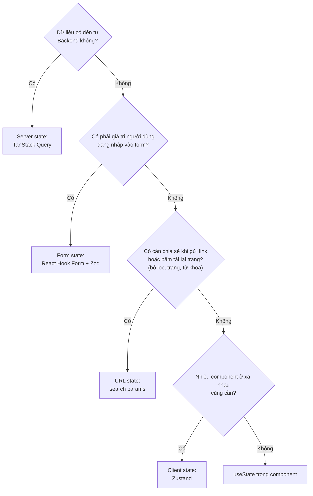
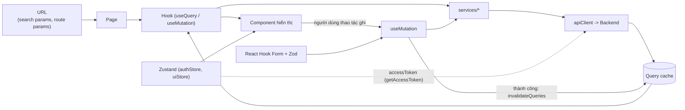

# 09 - State Management (Quản lý state)

> **Trạng thái:** BẢN NHÁP v0.1
> **Cập nhật:** 2026-11-08
> **Áp dụng cho:** `Moldy-Market-User-Frontend`
> **Mục đích:** Quy định mỗi loại dữ liệu trong ứng dụng được giữ ở đâu (TanStack Query, Zustand, React Hook Form, URL, state cục bộ) và vì sao, để không ai phải đoán khi viết một tính năng mới.

Nhãn dùng trong tài liệu:
- `[ĐÃ XÁC MINH BACKEND]`: có trong doc 14.
- `[ĐÃ CẤU HÌNH]`: đã thật sự có trong repo.
- `[ĐỀ XUẤT]`: kiến trúc dự kiến, **chưa có code**. Mọi tên hook, store, query key trong tài liệu này là `[ĐỀ XUẤT]`. Các đoạn code là ví dụ minh họa, chưa có trong repo.

---

## 1. Hiện trạng

- `[ĐÃ CẤU HÌNH]` Đã cài `@tanstack/react-query` 5, `zustand` 5, `react-hook-form` 7, `zod` 4, `@hookform/resolvers`, `react-router` 7.
- `[ĐÃ CẤU HÌNH]` Thư mục `src/state`, `src/hooks`, `src/app/providers`, `features/*/hooks`, `features/*/schemas` đã tạo, đang trống (`.gitkeep`).
- Chưa có `QueryClient`, provider, store, hook, schema nào.

---

## 2. Năm loại state và nơi giữ chúng `[ĐỀ XUẤT]`

Câu hỏi đầu tiên khi viết bất kỳ đoạn code nào có "dữ liệu": **dữ liệu này thuộc loại nào?**

| Loại | Ví dụ trong Moldy Market | Công cụ | Nằm ở |
|---|---|---|---|
| Server state (dữ liệu thuộc về Backend) | Danh sách sản phẩm, chi tiết sản phẩm, hồ sơ, gian hàng, cây danh mục | **TanStack Query** | `features/*/hooks` |
| Client state (giao diện thuần, Backend không biết) | Sidebar đóng/mở, ngôn ngữ đã chọn, access token trong bộ nhớ | **Zustand** | `state/` |
| Form state | Giá trị đang nhập ở form đăng ký, form đăng sản phẩm, lỗi validation | **React Hook Form + Zod** | `features/*/schemas` và component form |
| URL state | Từ khóa tìm kiếm, bộ lọc, sắp xếp, số trang | **React Router** (`useSearchParams`, `useParams`) | trang |
| State cục bộ | Dialog đang mở, tab đang chọn, ô nhập chưa gửi | `useState` | component |



Quy tắc ngắn: **đừng sao chép dữ liệu server vào chỗ khác.** Mỗi dữ liệu chỉ có một nguồn sự thật.

---

## 3. TanStack Query (server state)

### 3.1 Là gì, vì sao dùng

TanStack Query quản lý việc **gọi API, cache, đánh dấu cũ (stale), tải lại và đồng bộ** dữ liệu từ server. Nếu không dùng, mỗi trang tự viết `useEffect` + `useState` cho loading, error, dữ liệu, và gặp các lỗi cổ điển: gọi trùng, race condition khi đổi tham số nhanh, dữ liệu cũ khi quay lại trang, không biết khi nào cần tải lại.

Cách hoạt động ngắn gọn: mỗi truy vấn có một **query key**. Cùng key thì dùng chung cache. Dữ liệu có thời gian "tươi" (`staleTime`); hết thời gian đó, lần dùng kế tiếp sẽ tải lại ngầm trong khi vẫn hiện dữ liệu cũ.

### 3.2 Phân tầng

```
component  ->  hook (features/<module>/hooks)  ->  service (services/<module>)  ->  apiClient
```

- `services/` là hàm async thuần, trả `data` đã bóc phong bì (doc 07). Không biết gì về cache.
- Hook bọc service bằng `useQuery` / `useMutation`. **Component không gọi service trực tiếp.**

### 3.3 Cấu hình `QueryClient` (mặc định đề xuất)

Đặt ở `app/providers/QueryProvider.jsx` (ví dụ minh họa):

```js
// src/app/providers/queryClient.js (ví dụ minh họa, chưa có trong repo)
import { QueryClient } from '@tanstack/react-query'

export const queryClient = new QueryClient({
  defaultOptions: {
    queries: {
      staleTime: 30_000, // 30 giây: tránh tải lại liên tục khi chuyển trang qua lại
      gcTime: 5 * 60_000, // dữ liệu không còn được dùng giữ 5 phút
      refetchOnWindowFocus: true, // quay lại tab thì cập nhật, hữu ích cho đồng bộ
      retry: (failureCount, error) => {
        // Không thử lại lỗi 4xx (sai quyền, không tồn tại, sai dữ liệu): thử lại vô ích.
        if (error?.status >= 400 && error?.status < 500) return false
        return failureCount < 2
      },
    },
    mutations: { retry: false }, // thao tác ghi không tự thử lại (tránh tạo trùng)
  },
})
```

Các con số là **giá trị khởi đầu**, điều chỉnh khi có dữ liệu thật. `error.status` đến từ lớp `ApiError` chuẩn hóa (doc 07 mục 4.2).

`retry: false` cho mutation là có chủ đích: tự gửi lại một `POST` (ví dụ tạo sản phẩm) khi mạng chập chờn có thể tạo bản ghi trùng.

### 3.4 Query key: quy ước

Key là mảng, đi từ tổng quát đến cụ thể, và **chứa mọi tham số ảnh hưởng đến kết quả**. Mỗi feature có một "key factory" để không viết key bằng tay ở nhiều nơi (ví dụ minh họa):

```js
// src/features/products/hooks/productKeys.js (ví dụ minh họa)
export const productKeys = {
  all: ['products'],
  search: (params) => ['products', 'search', params],
  suggest: (q) => ['products', 'suggest', q],
  detail: (id) => ['products', 'detail', id],
}
```

```js
// src/features/products/hooks/useProductSearch.js (ví dụ minh họa)
import { keepPreviousData, useQuery } from '@tanstack/react-query'
import { searchProducts } from '@/services/products/productService'
import { productKeys } from './productKeys'

export function useProductSearch(params) {
  return useQuery({
    queryKey: productKeys.search(params),
    queryFn: () => searchProducts(params),
    placeholderData: keepPreviousData, // giữ kết quả cũ khi đổi trang, tránh chớp trắng
  })
}
```

Bảng key đề xuất, chỉ cho các endpoint `IMPLEMENTED` `[ĐÃ XÁC MINH BACKEND]`:

| Key | Endpoint | Ghi chú |
|---|---|---|
| `['users','me']` | `GET /api/v1/users/me` | Nguồn duy nhất của hồ sơ và `roles` (doc 08). |
| `['categories','tree']` | `GET /api/v1/categories` | Ít đổi: `staleTime` dài hơn (ví dụ 10 phút). |
| `['categories','detail', id]` | `GET /api/v1/categories/{id}` | |
| `['products','search', params]` | `GET /api/v1/products/search` | `params` là object chuẩn hóa (xem 3.6). |
| `['products','suggest', q]` | `GET /api/v1/products/suggest?q=` | Gõ phím: cần debounce, xem 3.7. |
| `['products','detail', id]` | `GET /api/v1/products/{id}` | |
| `['stores','public', id]` | `GET /api/v1/stores/{id}` | |
| `['stores','mine']` | `GET /api/v1/stores/my-store` | |
| `['stores','mine','staff']` | `GET /api/v1/stores/my-store/staff` | Chỉ khi có `STORE_STAFF_MANAGE`. |

Key luôn dùng chuỗi và số rõ ràng; **không** nhét object có hàm hay thứ không serialize được vào key. Với `params`, loại bỏ giá trị `undefined` và chuẩn hóa thứ tự trước khi đưa vào key, để `{ a: 1 }` và `{ a: 1, b: undefined }` không thành hai cache khác nhau.

### 3.5 Mutation và invalidation

Sau khi ghi thành công, đánh dấu các query liên quan là cũ để chúng tải lại. Ví dụ minh họa:

| Thao tác (`IMPLEMENTED`) | Invalidate |
|---|---|
| `PUT /api/v1/users/me` (sửa hồ sơ) | `['users','me']` |
| `POST /api/v1/stores` (mở gian hàng) | `['stores','mine']` |
| `PUT /api/v1/stores/my-store` | `['stores','mine']`, `['stores','public', id]` |
| `POST /api/v1/products` | `['products','search']` (toàn bộ nhóm tìm kiếm) |
| `PUT /api/v1/products/{id}` | `['products','detail', id]`, `['products','search']` |
| `DELETE /api/v1/products/{id}` | `['products','search']`, và `removeQueries` cho `['products','detail', id]` |
| `PATCH /api/v1/products/{id}/status` | `['products','detail', id]`, `['products','search']` |
| Thêm, sửa permission, xóa staff | `['stores','mine','staff']` |

Gọi `invalidateQueries({ queryKey: ['products','search'] })` sẽ khớp mọi key bắt đầu bằng tiền tố đó, đây là lý do key đi từ tổng quát đến cụ thể.

Không dùng `useEffect` để "đồng bộ" sau khi ghi. Invalidation là cách duy nhất.

Không dùng cập nhật lạc quan (optimistic update) ở giai đoạn đầu: quy tắc giá và trạng thái do Backend quyết định, và dữ liệu trả về từ Backend mới là chuẩn.

### 3.6 Khóa lạc quan (optimistic locking) của product `[ĐÃ XÁC MINH BACKEND]`

Cập nhật product **bắt buộc** gửi `version`. Nếu người khác (hoặc một tab khác) đã sửa trước, Backend trả `409 COMMON_010`.

Quy trình `[ĐỀ XUẤT]`:
1. Form sửa lấy `version` từ `['products','detail', id]` cùng lúc với dữ liệu.
2. Gửi `version` đó kèm các trường sửa.
3. Khi nhận `COMMON_010`: thông báo "Tin đăng vừa được thay đổi ở nơi khác", invalidate `['products','detail', id]`, **không ghi đè** nội dung người dùng đang nhập; cho người dùng so sánh hoặc nhập lại.
4. Sau khi cập nhật thành công, dùng dữ liệu trả về (hoặc invalidate) để có `version` mới; không tái sử dụng version cũ.

### 3.7 Các dạng phân trang `[ĐÃ XÁC MINH BACKEND]`

Doc 14 mục 2.2 có nhiều dạng phân trang; adapter nằm ở `services/api/pagination.js` (doc 07). Phía hook:

| Dạng | Hook | Ghi chú |
|---|---|---|
| `ProductSearchResponse` (`page` từ 1, có `totalPages`, `totalCapped`) | `useQuery` + `keepPreviousData` | `totalCapped = true` nghĩa là "từ 10.000 kết quả trở lên": hiện "10.000+", không hiện số trang chính xác. |
| `PagedResponse` (`totalElements` có thể `null`) | `useQuery` | Khi `totalElements` là `null`, dùng `hasNext` để điều khiển nút "Trang sau", không hiện tổng số trang. |
| Notification (cursor `token`, `IN_PROGRESS`) | `useInfiniteQuery` | `getNextPageParam` trả `nextToken`; `null` nghĩa là hết. Chỉ làm khi branch đã merge. |
| Lịch sử chat (`page` từ 0, `IN_PROGRESS`) | `useInfiniteQuery` hoặc `useQuery` | Chỉ làm khi branch đã merge. Lưu ý lệch chỉ số trang (B6). |
| Danh sách thuần (`orders/me`, `payments/my-payments`, `IN_PROGRESS`) | `useQuery` | `orders/me` trả 404 `ORDER_003` khi rỗng, hook phải chuyển thành `[]` (B13). |

### 3.8 Polling thanh toán `IN_PROGRESS` (chỉ là ý định)

Backend không có kênh đẩy; Frontend phải polling `GET /api/v1/payments/{id}` và chỉ tin `paymentStatus === 'SUCCESSFUL'`. Dự kiến dùng `refetchInterval` dạng hàm, dừng khi trạng thái là cuối cùng hoặc khi quá hạn (ONLINE_BANKING hết hạn sau 15 phút). Chỉ viết khi branch order đã merge (doc 14 mục 1.2). Tần suất polling hợp lý là câu hỏi mở (Q11).

### 3.9 Cache và phiên đăng nhập

- Đăng xuất hoặc phiên bị thu hồi: `queryClient.clear()` (doc 08). Nếu bỏ sót, dữ liệu cũ hiện cho user sau.
- Query có `enabled`: các query cần đăng nhập đặt `enabled: status === 'authenticated'`, để không gọi API khi chưa biết trạng thái phiên.
- Lỗi 401 được interceptor xử lý trước khi tới hook; hook chỉ thấy lỗi cuối cùng.

### 3.10 Xử lý lỗi và loading

| Trạng thái | Hiển thị |
|---|---|
| `isPending` (lần tải đầu) | Skeleton đúng hình dáng nội dung (doc 06) |
| `isFetching && !isPending` (tải lại ngầm) | Chỉ báo nhỏ, không che nội dung |
| `isError` | `ErrorState` kèm nút thử lại (`refetch`) |
| Dữ liệu rỗng | `EmptyState` (khác với lỗi) |
| Lỗi 403 | `ForbiddenState` |

Chi tiết quy ước hiển thị: doc 06. Message hiển thị lấy từ i18n theo `error.code`, không in `message` tiếng Anh của Backend.

---

## 4. Zustand (client state)

### 4.1 Dùng cho gì, không dùng cho gì

| Dùng | Không dùng |
|---|---|
| `authStore`: `status`, `accessToken` (bộ nhớ, không persist) | Dữ liệu trả về từ API (sản phẩm, hồ sơ, gian hàng...) |
| `uiStore`: sidebar của Store Dashboard, ngôn ngữ đã chọn | Trạng thái form (đã có React Hook Form) |
| | Bộ lọc tìm kiếm (thuộc URL) |

**Vì sao không lưu response API trong Zustand:** bạn sẽ phải tự viết lại phần cache, tải lại, hết hạn, loại bỏ trùng, đồng bộ sau khi ghi, tức là viết lại TanStack Query và viết sai. Hai nguồn sự thật cho cùng một dữ liệu sớm muộn sẽ lệch nhau. Hồ sơ người dùng là ví dụ điển hình: nó nằm ở `['users','me']`, chỉ `status` và token nằm trong Zustand.

### 4.2 Thư mục và quy ước

- Thư mục `state/`, không phải `stores/` (tránh nhầm với gian hàng, doc 02) `[ĐÃ CẤU HÌNH]`.
- Một file một store: `authStore.js`, `uiStore.js`. Tên hook `useAuthStore`, `useUiStore`.
- **Luôn dùng selector** để component chỉ đăng ký những gì nó cần:

```js
// Đúng: chỉ re-render khi status đổi
const status = useAuthStore((s) => s.status)

// Sai: re-render mỗi khi bất kỳ giá trị nào trong store đổi
const { status } = useAuthStore()
```

- Hành động đặt tên là động từ (`setAccessToken`, `clearSession`, `toggleSidebar`).
- Ngoài React (interceptor) đọc bằng `useAuthStore.getState()`, như trong `getAccessToken()` (doc 08).

### 4.3 Persist

Chỉ persist những giá trị thuần giao diện (ngôn ngữ, sidebar) bằng middleware `persist`, bọc `try/catch` vì storage có thể bị chặn. **Không persist access token.** Refresh token đi qua `lib/tokenStorage.js` (Q2, doc 08), không đi qua middleware `persist` của Zustand, để chỗ lưu token chỉ có một nơi.

Ví dụ minh họa:

```js
// src/state/uiStore.js (ví dụ minh họa, chưa có trong repo)
import { create } from 'zustand'
import { persist } from 'zustand/middleware'

export const useUiStore = create(
  persist(
    (set) => ({
      language: 'vi',
      sidebarOpen: true,
      setLanguage: (language) => set({ language }),
      toggleSidebar: () => set((s) => ({ sidebarOpen: !s.sidebarOpen })),
    }),
    { name: 'mm.ui' },
  ),
)
```

Việc nối `language` với `i18next.changeLanguage` làm khi dựng phần cài đặt; hiện i18n mặc định `vi` và chưa lưu lựa chọn `[ĐÃ CẤU HÌNH]`.

---

## 5. React Hook Form + Zod (form state)

### 5.1 Vì sao

- **React Hook Form** giữ giá trị và lỗi của form mà không re-render cả form mỗi lần gõ phím.
- **Zod** là nơi duy nhất mô tả luật validation, dùng chung cho kiểu dữ liệu và thông báo lỗi.
- `@hookform/resolvers` (`zodResolver`) nối hai thứ.

### 5.2 Vị trí và quy ước

- Schema ở `features/<module>/schemas/` (ví dụ `registerSchema.js`). Component form ở `features/<module>/components/`.
- Luật validation **lấy từ Backend** (doc 14), không tự nghĩ ra. Backend vẫn là nơi quyết định cuối cùng; validation Frontend chỉ để phản hồi sớm.
- Thông báo lỗi dùng key i18n, không viết cứng chuỗi trong schema.

Các ràng buộc đã xác minh `[ĐÃ XÁC MINH BACKEND]`:

| Form | Ràng buộc |
|---|---|
| Đăng ký | `email` hợp lệ; `password` 8 đến 100; `fullName` tối đa 100; `phone` bắt buộc (định dạng chưa audit) |
| Đăng nhập | `email` tối đa 254; `password` bắt buộc |
| Tạo product | `categoryId`, `title` (tối đa 150), `price` (lớn hơn 0 và không quá 1.000.000.000, tối đa 2 chữ số thập phân), `condition`, `pricingStrategy` bắt buộc; `storeId` tùy chọn (`null` là tin cá nhân); `description` tối đa 2000 |
| Sửa product | Như trên và bắt buộc `version` |
| Hồ sơ, đổi mật khẩu, gian hàng | **Chưa audit DTO.** Chỉ dựng ràng buộc cơ bản, ghi `TODO`, để Backend trả `COMMON_001` |

Với product, Backend còn quy tắc khác (ví dụ `pricingStrategy` `AUTO_PRICING` và `APPRAISER` báo `PROD_003` chưa hỗ trợ). Form tạo tin chỉ nên cho chọn `SELLER_SET` cho đến khi Backend hỗ trợ.

Ví dụ minh họa (Zod 4):

```js
// src/features/auth/schemas/loginSchema.js (ví dụ minh họa)
import { z } from 'zod'

export const loginSchema = z.object({
  email: z.string().min(1, 'auth.errors.emailRequired').max(254),
  password: z.string().min(1, 'auth.errors.passwordRequired'),
})
```

### 5.3 Lỗi từ server

- `COMMON_001` (validation thất bại): doc 14 cho biết `data` của lỗi có đường dẫn request, nhưng **các trường khác chưa được đọc**, nên chưa thể chắc Backend có trả lỗi theo từng trường hay không. Cho đến khi kiểm chứng, hiện lỗi chung ở đầu form, không ánh xạ lỗi vào từng ô bằng `setError`.
- Lỗi nghiệp vụ (ví dụ `PROD_008` đã đạt giới hạn số tin đăng, `STORE_002` mỗi người một gian hàng): hiện thông báo rõ ràng ngoài form, theo `code`.
- Gặp `COMMON_010`: xem 3.6.

### 5.4 Điền sẵn dữ liệu cho form sửa

Dữ liệu ban đầu của form sửa đến từ TanStack Query. Dùng `reset(data)` (hoặc tùy chọn `values`) khi dữ liệu về, và chỉ khi người dùng chưa chỉnh sửa, để việc tải lại ngầm không ghi đè phần đang nhập. Nếu cần chắc chắn, đặt `refetchOnWindowFocus: false` cho query của form sửa.

---

## 6. URL state

Bộ lọc, từ khóa, sắp xếp, trang của `/products` và trang gian hàng nằm ở **query string**:
- Người dùng chia sẻ được đường dẫn, nút Back và tải lại trang hoạt động đúng.
- Hook đọc `useSearchParams`, chuẩn hóa thành `params` rồi đưa vào query key (mục 3.4).
- `page` của search bắt đầu từ **1** `[ĐÃ XÁC MINH BACKEND]`. Khi đổi bộ lọc, đặt lại `page = 1`.
- Giá trị trong URL là chuỗi: chuyển kiểu (số, boolean) có kiểm tra, và bỏ qua giá trị không hợp lệ thay vì gửi thẳng lên Backend.
- Chi tiết các tham số bộ lọc: doc 05 và doc 07. Danh sách tham số của `GET /products` (không phải `/search`) chưa audit.

---

## 7. Luồng dữ liệu và đồng bộ



Cách các phần giữ đồng bộ:
1. **Sau khi ghi:** invalidate các key liên quan (mục 3.5). Không sửa tay cache và không dùng `useEffect`.
2. **Quay lại tab:** `refetchOnWindowFocus` cập nhật dữ liệu cũ.
3. **Giữa các tab:** không có kênh đẩy từ Backend. Các tab đồng bộ khi lấy lại focus hoặc hết `staleTime`. Đăng xuất đồng bộ qua sự kiện `storage` (doc 08).
4. **Cùng một dữ liệu nhiều nơi:** cùng key thì dùng chung cache, tự đồng bộ.

---

## 8. Những điều không được làm (anti-pattern)

| Không làm | Làm thay vào đó |
|---|---|
| `useEffect(() => { fetch... setState }, [])` để tải dữ liệu | `useQuery` |
| Sao chép dữ liệu `useQuery` vào `useState` hay Zustand | Dùng trực tiếp dữ liệu từ hook, tính toán ngay trong render |
| Bộ lọc tìm kiếm nằm trong Zustand | Đưa vào URL |
| Gọi `services/*` thẳng trong component | Qua hook của feature |
| Viết query key bằng tay ở nhiều file | Key factory |
| Subscribe cả store: `useStore()` | Selector |
| Lưu access token vào `localStorage` | Bộ nhớ (doc 08) |
| Quên `queryClient.clear()` khi đăng xuất | Luôn xóa cache khi mất phiên |
| `retry` cho mutation ghi | `retry: false` |
| Mutation xong rồi tự `setQueryData` bằng dữ liệu đoán | `invalidateQueries`, hoặc dùng dữ liệu Backend trả về |
| Tin `status` của order để biết đã thanh toán (B12) | Chỉ tin `paymentStatus` từ polling payment |

---

## 9. Câu hỏi mở liên quan

| Mã | Câu hỏi | Ảnh hưởng |
|---|---|---|
| Q1 | Permission code của user? | Có thể cần thêm query hoặc mở rộng `['users','me']` |
| Q2 | Nơi lưu token? | `lib/tokenStorage.js` |
| Q11 | Tần suất polling thanh toán hợp lý? | `refetchInterval` |
| Q12 | Khi nào các branch được merge? | Khi nào được viết hook cho notification, chat, cart, order |
| Q13 | `isRead` của notification serialize thành `read` hay `isRead`? | Selector và hiển thị notification |

---

## Tài liệu liên quan

- 02 - Frontend Architecture: vì sao `state/`, phân lớp tổng thể.
- 04 - Routing and Pages: route và tham số URL.
- 05 - Page-by-Page Guide: bộ lọc, form của từng trang.
- 06 - Component Architecture: skeleton, `EmptyState`, `ErrorState`, `ForbiddenState`.
- 07 - API Integration: `apiClient`, `ApiError`, adapter phân trang.
- 08 - Authentication and Authorization: store phiên, token, 401/403.
- 14 - Backend Integration Matrix: mục 2.2 (phân trang), 2.5 (mã lỗi), B6, B12, B13.
