# 10 - Feature Flows (Luồng nghiệp vụ theo tính năng)

> **Trạng thái:** BẢN NHÁP v0.1
> **Cập nhật:** 2026-11-08
> **Áp dụng cho:** `Moldy-Market-User-Frontend`
> **Mục đích:** Mô tả từng luồng nghiệp vụ chính của người dùng cuối từ góc nhìn Frontend: ai làm gì, Frontend gọi gì, Backend trả gì, lỗi nào phải xử lý. Mỗi luồng ghi rõ phần nào đã xác minh với Backend, phần nào mới là kế hoạch.

---

## 0. Cách đọc tài liệu này

Mọi luồng bên dưới đều thuộc loại `[ĐỀ XUẤT]` về phía Frontend, vì **Frontend chưa có code ứng dụng nào** (mọi tính năng ở trạng thái `NOT_STARTED`). Các sơ đồ mô tả cách Frontend **sẽ** hoạt động, không phải cách nó đang hoạt động.

Phần Backend được gắn nhãn:

- `[ĐÃ XÁC MINH BACKEND]`: có trong doc 14.
- `[ĐỀ XUẤT]`: thiết kế Frontend dự kiến.
- `NOT_FOUND`, `PLANNED`, `IN_PROGRESS`, `REQUIRES_BUSINESS_CLARIFICATION`: trạng thái Backend theo doc 14 mục 1.1.

Tài liệu này **không lặp lại bảng route**. Route, layout và quyền truy cập của từng trang nằm ở [04-ROUTING-AND-PAGES.md](./04-ROUTING-AND-PAGES.md); chi tiết từng màn hình nằm ở [05-PAGE-BY-PAGE-GUIDE.md](./05-PAGE-BY-PAGE-GUIDE.md). Ở đây chỉ nhắc tên trang hoặc path khi cần để hiểu luồng.

### Bảng tổng hợp

| # | Luồng | Backend | Frontend | Chặn bởi |
|---|---|---|---|---|
| 1 | Đăng ký và đăng nhập | `IMPLEMENTED` | `NOT_STARTED` | B10, Q14, Q2 |
| 2 | Tạo gian hàng | `IMPLEMENTED` | `NOT_STARTED` | Không |
| 3 | Đăng và sửa sản phẩm | `IMPLEMENTED` (định giá `PARTIALLY_IMPLEMENTED`) | `NOT_STARTED` | Q5 (ảnh) |
| 4 | Mua hàng (checkout) | `IN_PROGRESS` (`feature/order`) | `NOT_STARTED` | Q12, Q16, Q17, B14 |
| 5 | Thanh toán chuyển khoản qua SePay | `IN_PROGRESS` (`feature/order`) | `NOT_STARTED` | B12, Q11 |
| 6 | Offer (trả giá) | `NOT_FOUND` | `NOT_STARTED` | Q8 |
| 7 | Escrow | `IN_PROGRESS` (chưa mở cho người dùng) | `NOT_STARTED` | B2, Q4, Q18 |
| 8 | Refund | `NOT_FOUND` | `NOT_STARTED` | Q9, Q10 |
| 9 | Thẩm định giá | `IN_PROGRESS` (`feature/pricing`) | `NOT_STARTED` | DTO chưa audit, Q12 |
| 10 | Quản lý gian hàng và staff | `IMPLEMENTED` (mời staff `PLANNED`) | `NOT_STARTED` | Q1 |
| 11 | Notification | `IN_PROGRESS` | `NOT_STARTED` | Q12, Q13 |
| 12 | Chat | `IN_PROGRESS` (`feature/chat`) | `NOT_STARTED` | Q6, Q12 |

---

## 1. Đăng ký và đăng nhập

**Trạng thái:** Backend `IMPLEMENTED`. Frontend `NOT_STARTED`. **Bị chặn một phần bởi B10 và Q14.**

### 1.1 `[ĐÃ XÁC MINH BACKEND]`

- `POST /api/v1/auth/register` nhận `{ email, password (8-100), fullName (tối đa 100), phone }`, trả `{ userId, email, fullName, status }`.
- User mới có `status = PENDING_VERIFICATION`. Đăng nhập chỉ cho `ACTIVE`, và hiện chưa có luồng nào đặt user thành `ACTIVE` ngoài admin (doc 14 mục 3.5, B10, đã được team xác nhận).
- `POST /api/v1/auth/login` nhận `{ email (tối đa 254), password }`, trả `{ userId, email, fullName, accessToken, refreshToken, tokenType }`.
- `GET /api/v1/users/me` trả hồ sơ kèm `roles: string[]`.
- Mã lỗi cần xử lý: `COMMON_001` (validation), `AUTH_001` (sai email hoặc mật khẩu), `AUTH_003` và `AUTH_004` (tài khoản bị khóa hoặc vô hiệu), `COMMON_009` (rate limit). Với user `PENDING_VERIFICATION`, doc 14 ghi Backend trả lỗi `ACCOUNT_DISABLED`; mã chính xác và thông điệp cần kiểm tra bằng response thật trước khi viết code xử lý.

### 1.2 Sơ đồ `[ĐỀ XUẤT]`

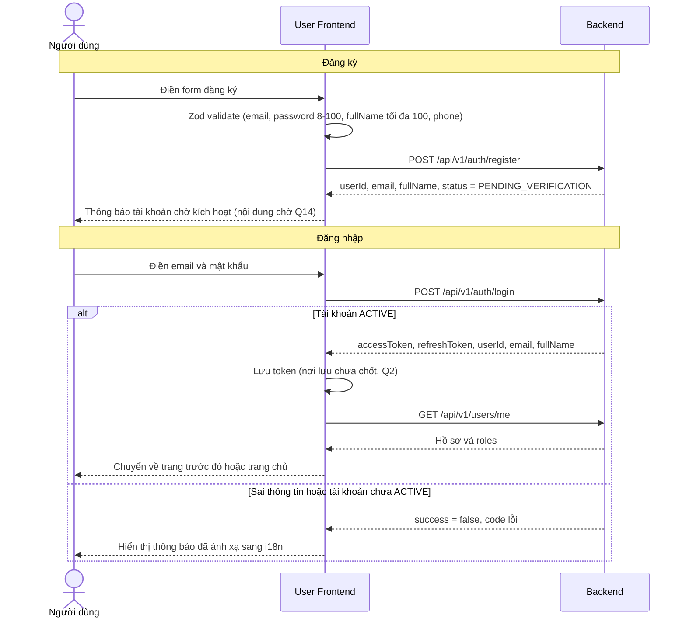

### 1.3 Điểm cần chú ý

1. **Không tự đăng nhập sau khi đăng ký.** Vì tài khoản mới chưa `ACTIVE` nên Backend sẽ từ chối. Màn hình sau đăng ký chỉ báo "đã đăng ký" và hướng dẫn chờ kích hoạt; nội dung thật phụ thuộc quyết định ở Q14 (email xác minh, OTP hay admin duyệt).
2. **Trong lúc chờ Q14**, tài khoản test phải được admin chuyển `ACTIVE` bằng `PUT /api/v1/users/{id}/status` (qua Admin Frontend hoặc công cụ khác), hoặc dùng tài khoản admin được seed lúc khởi động.
3. **Sau khi đăng nhập, luôn gọi `GET /users/me`** để lấy `roles`, vì JWT không chứa role hay permission (doc 14 mục 3.2).
4. **Không hiển thị message tiếng Anh của Backend.** Ánh xạ `code` sang key i18n (doc 07 và doc 11).
5. Cơ chế refresh token, xử lý 401 và `AUTH_007` nằm ở [08-AUTHENTICATION-AND-AUTHORIZATION.md](./08-AUTHENTICATION-AND-AUTHORIZATION.md). Nơi lưu token **CHƯA CHỐT** (Q2).

---

## 2. Tạo gian hàng

**Trạng thái:** Backend `IMPLEMENTED`. Frontend `NOT_STARTED`.

### 2.1 `[ĐÃ XÁC MINH BACKEND]`

- `POST /api/v1/stores` chỉ yêu cầu đã đăng nhập (controller không có `@PreAuthorize`). Backend giới hạn mỗi user một gian hàng bằng lỗi `STORE_002`.
- `GET /api/v1/stores/my-store` và `PUT /api/v1/stores/my-store` để xem và sửa gian hàng của mình.
- `GET /api/v1/stores/{id}` là trang công khai.
- Doc 14 **chưa liệt kê các trường** của request tạo gian hàng. Khi viết form, đọc DTO thực tế trong Backend và cập nhật doc 14 trước.

### 2.2 Sơ đồ `[ĐỀ XUẤT]`

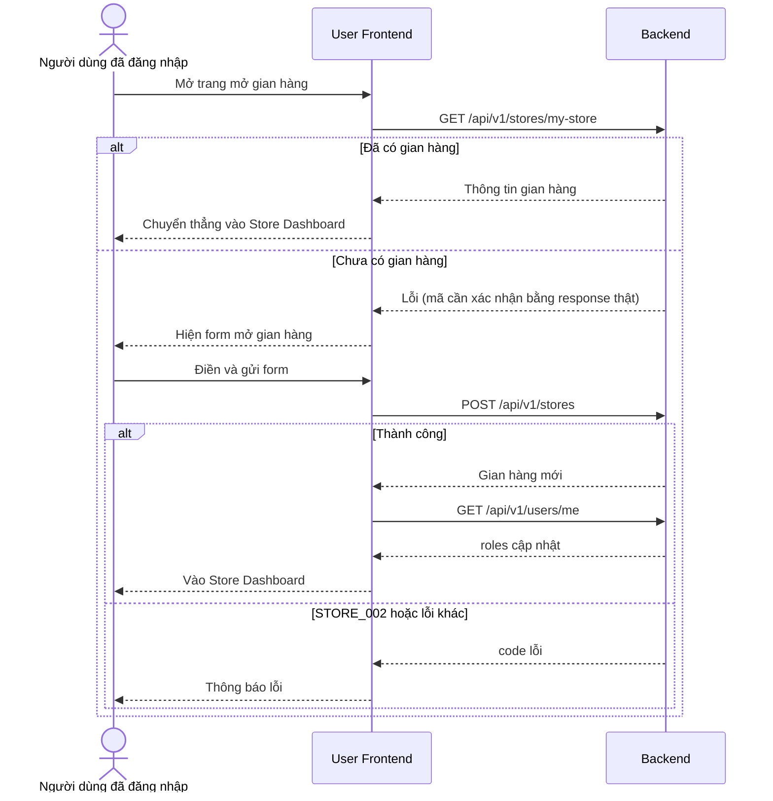

### 2.3 Điểm cần chú ý

- Doc 14 **không xác minh** việc Backend gán role gì cho user sau khi tạo gian hàng (có thể là `OWNER`, chưa đọc code ở mức đó). Vì vậy bước gọi lại `GET /users/me` để xem role mới là việc nên làm, nhưng **không được giả định** role cụ thể cho đến khi kiểm tra bằng response thật.
- Cách Frontend phân biệt "chưa có gian hàng" với lỗi khác khi gọi `GET /stores/my-store` chưa được xác minh (mã lỗi trả về chưa có trong doc 14). Phải kiểm tra trước khi viết logic rẽ nhánh theo mã lỗi.
- `STORE_004` (gian hàng bị chặn) có thể xuất hiện ở mọi thao tác của dashboard; cần một màn hình thông báo chung.

---

## 3. Đăng và sửa sản phẩm

**Trạng thái:** Backend `IMPLEMENTED`; riêng định giá `PARTIALLY_IMPLEMENTED`. Frontend `NOT_STARTED`.

### 3.1 `[ĐÃ XÁC MINH BACKEND]`

| Thao tác | Endpoint | Quyền |
|---|---|---|
| Tạo | `POST /api/v1/products` | `PRODUCT_CREATE` |
| Sửa | `PUT /api/v1/products/{id}` | `PRODUCT_MANAGE_OWN` |
| Xóa | `DELETE /api/v1/products/{id}` (không có body) | `PRODUCT_MANAGE_OWN` |
| Ẩn hoặc hiện lại | `PATCH /api/v1/products/{id}/status?status=` | `PRODUCT_MANAGE_OWN` |
| Xem chi tiết | `GET /api/v1/products/{id}` | công khai |

Ràng buộc request tạo (doc 14 mục 5.6):

- Bắt buộc: `categoryId`, `title` (tối đa 150), `price` (lớn hơn 0 và tối đa 1.000.000.000, tối đa 2 chữ số thập phân), `condition`, `pricingStrategy`.
- Tùy chọn: `storeId` (`null` nghĩa là đăng bán cá nhân), `description` (tối đa 2000), `images` (tối đa 10 URL, chỉ `https`, mỗi URL tối đa 500 ký tự), `attributes`.
- `ProductCondition`: `NEW`, `LIKE_NEW`, `USED`, `DAMAGED`. `PricingStrategy`: `SELLER_SET`, `AUTO_PRICING`, `APPRAISER`.
- Cập nhật **bắt buộc có `version`** (optimistic locking). Version cũ trả `COMMON_010` (409).
- Người bán chỉ được chuyển qua lại giữa `ACTIVE` và `HIDDEN` (`PROD_004` nếu vi phạm).
- Giới hạn số tin đăng: `PROD_008` (409).
- Định giá khác `SELLER_SET` có thể trả `PROD_003` ("This pricing strategy is not supported yet").
- Ảnh chỉ nhận URL HTTPS; **cơ chế upload chưa rõ** (Q5).

### 3.2 Sơ đồ `[ĐỀ XUẤT]`

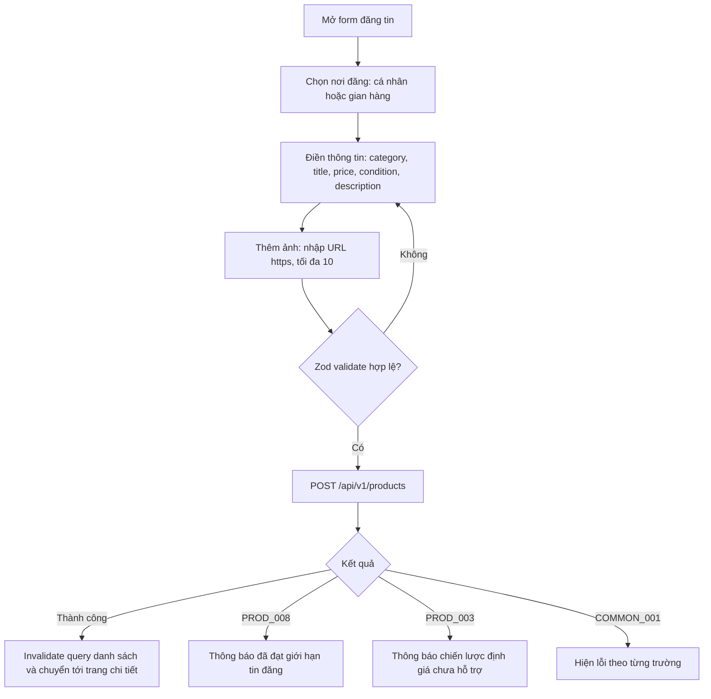

Luồng sửa tin:

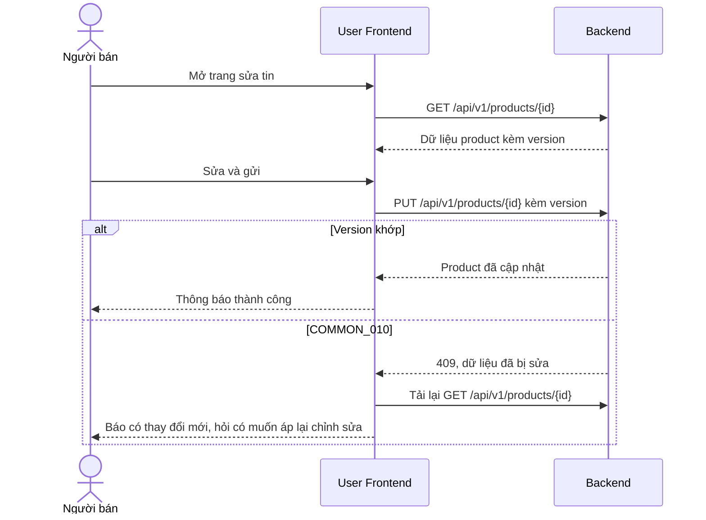

### 3.3 Điểm cần chú ý

1. **Chỉ cho chọn `SELLER_SET`** ở giai đoạn đầu (`[ĐỀ XUẤT]`), vì `AUTO_PRICING` và `APPRAISER` chưa chắc được hỗ trợ (`PROD_003`).
2. Form phải **giữ lại `version`** từ lần tải gần nhất và gửi kèm khi cập nhật.
3. **Chưa có endpoint đã xác minh để liệt kê riêng "sản phẩm của tôi"** (doc 14 không có). Có thể dùng `GET /api/v1/products/search` với `storeId` cho gian hàng; với tin cá nhân (`storeId = null`) cần hỏi team Backend. Đây là câu hỏi mở, chưa có số Qn trong doc 14.
4. Định dạng chính xác của `attributes` (kiểm tra bằng `@ValidProductAttributes`) chưa được audit; không tự suy đoán.

---

## 4. Mua hàng (checkout)

**Trạng thái:** Backend `IN_PROGRESS` (`feature/order`, commit `3b3d67c`). Frontend `NOT_STARTED`. **Không được viết service code cho đến khi branch merge vào `main` và doc 14 cập nhật** (doc 14 mục 1.2).

### 4.1 `[ĐÃ XÁC MINH BACKEND]` (tạm thời)

- `POST /api/v1/checkout-groups` với `orderItems`, `receiverName` (tối đa 255), `phoneNumber` (regex `^(\+84|0)\d{9,10}$`), `shippingAddress` (tối đa 500), `method` (`COD` hoặc `ONLINE_BANKING`), `note` (tối đa 500).
- Team đã quyết định **bỏ `quantity`** (Q17). Branch hiện vẫn nhận `quantity` từ 1 đến 100, nên contract sẽ đổi. Frontend **không làm ô chọn số lượng**.
- **Giá do Backend tính.** Frontend không gửi giá, không tự tính tổng để quyết định số tiền; chỉ hiển thị `totalAmount` do Backend trả.
- Backend **tự tách thành nhiều order** theo cặp `(sellerId, storeId)`, nên một lần checkout có thể trả nhiều order.
- `ONLINE_BANKING`: `expiredAt` bằng bây giờ cộng 15 phút. `COD`: `expiredAt = null`.
- Phí ship luôn 0, voucher chưa áp dụng, tồn kho chưa giữ (B14).
- Lỗi cần xử lý: `ORDER_005` (trùng sản phẩm), `PROD_010` (sản phẩm không còn `ACTIVE`), `COMMON_001`.
- `GET /api/v1/checkout-groups/{id}` trả lại `CheckoutResponse`; chỉ người mua xem được (`ORDER_011`).

### 4.2 Sơ đồ `[ĐỀ XUẤT]`

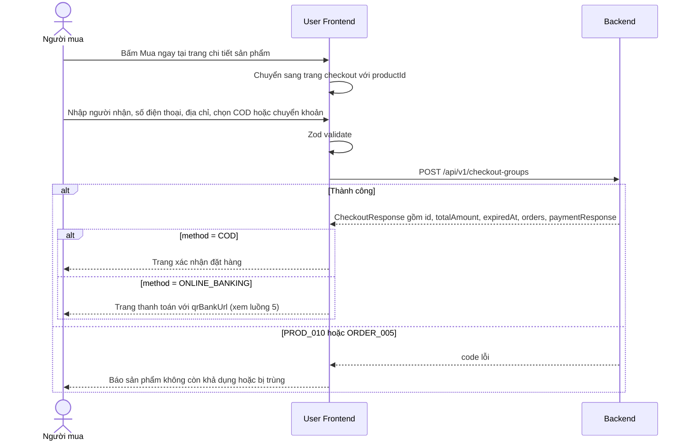

### 4.3 Điểm cần chú ý

- **Giỏ hàng:** cart là `IN_PROGRESS` trên `feature/cart`, **không có** trong `feature/order`. Cart dùng `listingId`, checkout dùng `productId`, và checkout không đọc từ cart (Q16). Do đó giai đoạn đầu chỉ có luồng "Mua ngay" từ trang chi tiết; luồng giỏ hàng sang checkout **chưa thể thiết kế** cho đến khi Q16 có đáp án.
- **Sản phẩm có thể bị người khác mua trước.** Backend chưa giữ hàng (B14, Q17). Frontend phải sẵn sàng nhận `PROD_010` ở bước submit.
- **Danh sách order** (`GET /api/v1/orders/me`) trả 404 `ORDER_003` khi rỗng; phải coi là trạng thái rỗng (B13). Danh sách không phân trang.
- **`GET /api/v1/orders/{orderId}` không kiểm tra chủ sở hữu** (B11). Đây là lỗi Backend, Frontend không được dựa vào việc "chỉ chủ order mới xem được".
- **Timeline order:** chỉ `PENDING_PAYMENT` và `DELIVERED` sang `COMPLETED` (do admin) có trong code. Frontend **không được vẽ timeline** như thể các bước `CONFIRMED`, `SHIPPING`, `DELIVERED` đã chạy (Q15).
- **Phía người bán** (xác nhận, giao hàng, huỷ) là `NOT_FOUND`.

---

## 5. Thanh toán chuyển khoản qua SePay

**Trạng thái:** Backend `IN_PROGRESS` (`feature/order`). Frontend `NOT_STARTED`. **Bị chặn một phần bởi B12 và Q11.**

### 5.1 `[ĐÃ XÁC MINH BACKEND]`

- `PaymentResponse { id, amount, paymentStatus, qrBankUrl, checkoutGroupId }`. `qrBankUrl` là URL ảnh QR do Backend tạo (dạng `https://vietqr.app/img?...`), và là `null` khi `COD`.
- `PaymentStatus`: `PENDING`, `PROCESSING`, `SUCCESSFUL`, `FAILED`.
- Frontend **không gọi webhook**. SePay gọi `POST /api/v1/payment_transactions/webhook/sepay`; Backend xác thực HMAC rồi đổi payment sang `SUCCESSFUL` nếu số tiền **khớp chính xác** và mã `MM[A-Z0-9]{8}` tìm thấy trong nội dung chuyển khoản.
- **Không có kênh push** (doc 14 mục 4.3 và 5.8). Muốn biết đã thanh toán phải polling `GET /api/v1/payments/{id}` hoặc `GET /api/v1/checkout-groups/{id}`.
- **B12:** sau khi thanh toán thành công chỉ `Payment` đổi trạng thái; `CheckoutGroup.status` và `Order.status` vẫn `PENDING_PAYMENT`. Team dự định gắn listener cho `PaymentCompletedEvent` nhưng chưa có code.
- Không có job hết hạn: đếm ngược về 0 không có nghĩa Backend đã huỷ. Chuyển khoản trễ hoặc sai số tiền chưa có đường xử lý.
- Chưa có endpoint trả thông tin chuyển khoản dạng chữ (số tài khoản, ngân hàng, nội dung) (Q11).

### 5.2 Sơ đồ `[ĐỀ XUẤT]`

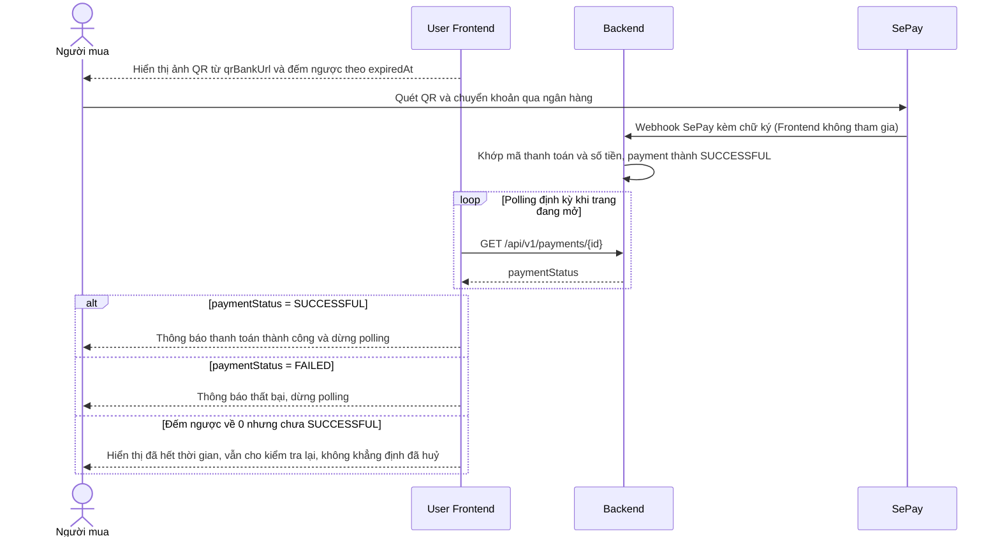

Trạng thái của trang thanh toán:

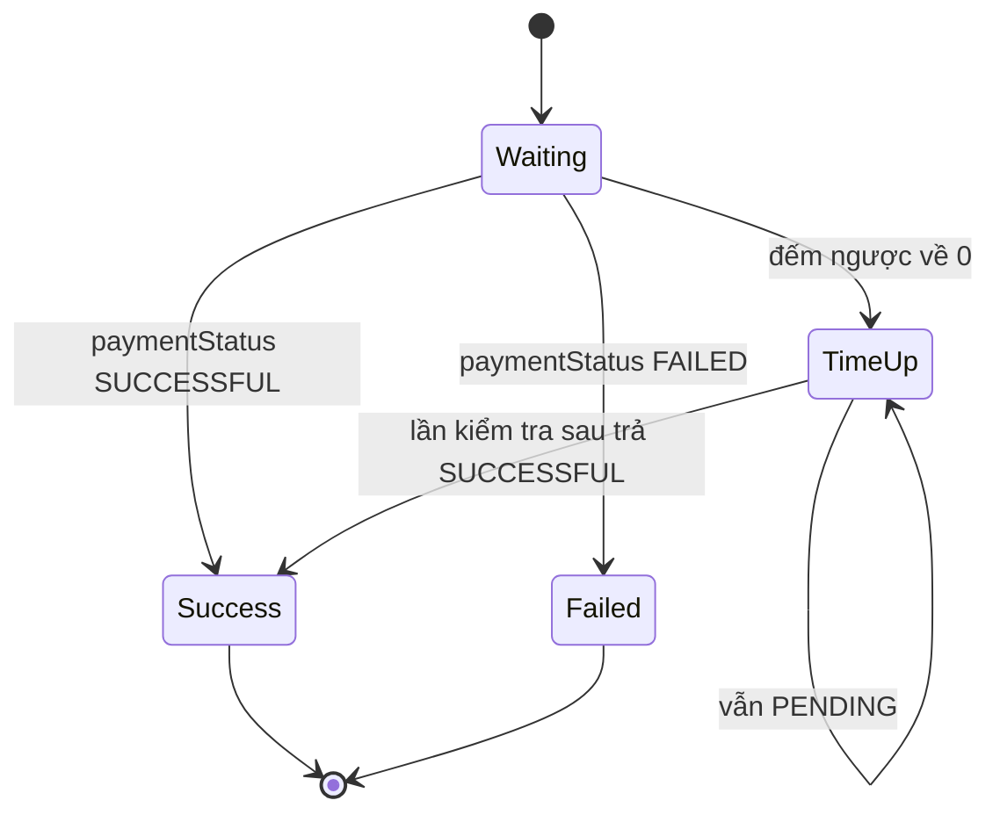

### 5.3 Quy tắc bất biến

1. **Frontend không bao giờ tự tuyên bố thanh toán thành công.** Nút "Tôi đã chuyển khoản", nếu có, chỉ kích hoạt một lần kiểm tra ngay, không đổi trạng thái hiển thị.
2. **Chỉ tin `paymentStatus` do Backend trả.** Không dùng `status` của order hay checkout group để kết luận đã thanh toán (B12).
3. **Không tự dựng QR.** Chỉ hiển thị ảnh theo `qrBankUrl`. Thêm domain `vietqr.app` vào danh sách ảnh được phép nếu sau này có Content Security Policy.
4. **Tần suất polling và thời điểm dừng** chưa được quyết định (Q11). Đề xuất khởi đầu: vài giây một lần, dừng khi rời trang hoặc có trạng thái cuối. Phải tính đến rate limit `COMMON_009`.
5. **Số tiền hiển thị lấy từ `totalAmount` hoặc `amount` của Backend.**

---

## 6. Offer (trả giá)

**Trạng thái:** Backend `NOT_FOUND`. Frontend `NOT_STARTED`. `REQUIRES_BUSINESS_CLARIFICATION` (Q8).

Doc 14 xác nhận không có code offer ở bất kỳ branch nào, và tài liệu thiết kế `offer-negotiation.md` rỗng. Số vòng thương lượng, thời hạn và ai được counter đều chưa biết.

Vì vậy **không có sơ đồ luồng** trong tài liệu này: vẽ ra sẽ buộc phải bịa trạng thái và quy tắc. Việc duy nhất được phép ở Frontend:

- Nút "Trả giá" ở trang chi tiết sản phẩm và trang `/store/offers` chỉ là skeleton đánh dấu `TODO`, không có service.
- Khi Backend có thiết kế, cập nhật doc 14 trước, sau đó mới bổ sung luồng vào doc này.

Lưu ý liên quan: chat hiện chỉ gắn hai user và **không liên kết với offer** (Q6), nên không thể xây "chat theo offer" từ code hiện có.

---

## 7. Escrow

**Trạng thái:** Backend `IN_PROGRESS` (`feature/escrow-wallet`). Frontend `NOT_STARTED`. **Cần làm rõ: B2, B7, Q4, Q18.**

### 7.1 `[ĐÃ XÁC MINH BACKEND]`

- `EscrowStatus`: `HELD`, `CAPTURED`, `RELEASED`, `DISPUTED`. `DisputeOutcome`: `PAY_SELLER`, `REFUND_BUYER`.
- Endpoint: `POST /api/v1/escrows/hold`, `POST /api/v1/escrows/orders/{orderId}/capture`, `POST /api/v1/escrows/orders/{orderId}/release`.
- Các endpoint này trông như **thao tác nội bộ của service**: client có thể gọi `hold` với buyer và số tiền tùy ý, và không có `@PreAuthorize` (B2).
- `orderId` là chuỗi ở request nhưng số ở response, trong khi `Order.id` là UUID (B7). Escrow hiện **chưa thể gắn với order thật**.

### 7.2 Quyết định cho Frontend

**User Frontend không gọi các endpoint escrow.** Người mua và người bán không có màn hình thao tác escrow ở giai đoạn này. Frontend chỉ có thể sau này hiển thị trạng thái escrow của một order, nhưng không có endpoint đọc đã xác minh (doc 14 không liệt kê endpoint "xem escrow"). Việc ai gọi `hold`, `capture`, `release` là câu hỏi Q4 và Q18 cho team Backend.

Vì chưa biết chuyển trạng thái nào hợp lệ, **không vẽ sơ đồ chuyển trạng thái escrow**; chỉ có danh sách giá trị enum là đã xác minh.

---

## 8. Refund

**Trạng thái:** Backend `NOT_FOUND` dưới dạng API. Frontend `NOT_STARTED`. Q9, Q10.

- Class `Refund` trên `feature/order` hiện rỗng. Entity `DisputeRequest` có `userId`, `orderId`, `description`, `imagesUrl`, `createdAt` nhưng chưa có controller hay service.
- Requirements nói Admin xử lý refund thủ công (Q9); quy trình dispute chưa được định nghĩa (`REQUIRES_BUSINESS_CLARIFICATION`, Q10).
- Không có sơ đồ. Không làm trang yêu cầu hoàn tiền. Nếu cần chỗ giữ chỗ, chỉ dùng skeleton `TODO`.

---

## 9. Thẩm định giá (appraisal)

**Trạng thái:** Backend `IN_PROGRESS` (`feature/pricing`, `feature/cart`). Frontend `NOT_STARTED`. **DTO chưa được audit** (doc 14 mục 4.2).

### 9.1 `[ĐÃ XÁC MINH BACKEND]` (chỉ tên endpoint)

Prefix là `/api/...`, không có `v1`. Endpoint (đều chỉ yêu cầu đăng nhập, B2):

- `POST /api/pricing/auto`
- Hồ sơ appraiser: `POST /api/pricing/appraiser/apply`, `GET /me`, `GET /{id}`, `GET /list`
- Yêu cầu thẩm định: `POST /api/pricing/appraiser/request`, `GET /queue`, `POST /{requestId}/claim`, `/submit`, `/accept`, `/reject`, `GET /api/pricing/requests/{requestId}`, `GET /api/pricing/{listingId}`

Doc 14 **không mô tả** ý nghĩa nghiệp vụ, trạng thái hay request/response của các endpoint này. Việc đoán rằng "người bán gửi yêu cầu, appraiser nhận, nộp kết quả, người bán chấp nhận hoặc từ chối" chỉ là suy ra từ tên và **chưa được xác minh**.

### 9.2 Quyết định cho Frontend

- Trang của người mua và người bán về thẩm định, cùng khu vực appraiser, là skeleton `TODO`.
- Trước khi làm, phải: (1) chờ branch `pricing` merge, (2) audit DTO và quy tắc, (3) cập nhật doc 14.
- Hiển thị "giá tham khảo" hay "biểu đồ giá" trong trang chi tiết sản phẩm là `NOT_FOUND`; không có endpoint trả giá trung bình theo category.

---

## 10. Quản lý gian hàng và staff

**Trạng thái:** Backend `IMPLEMENTED` (mời staff `PLANNED`; thống kê và đơn hàng phía người bán `NOT_FOUND`). Frontend `NOT_STARTED`.

### 10.1 `[ĐÃ XÁC MINH BACKEND]`

- Hồ sơ gian hàng: `GET` và `PUT /api/v1/stores/my-store`.
- Staff, dưới `/api/v1/stores/my-store/staff`: `POST` (thêm trực tiếp bằng email), `GET` (danh sách), `PUT /{staffId}/permissions`, `DELETE /{staffId}`, `GET /me`. Tất cả yêu cầu `STORE_STAFF_MANAGE`.
- Staff phải ở trạng thái `ACTIVE` (`StoreStaffService`).
- Phân quyền theo từng gian hàng: `UserRole(user_id, role_id, store_id)`. Staff có thêm permission do chủ gian hàng ủy quyền.
- `STORE_015` (403): không có quyền với tài nguyên của gian hàng này. `STORE_004`: gian hàng bị chặn.

### 10.2 Sơ đồ `[ĐỀ XUẤT]`

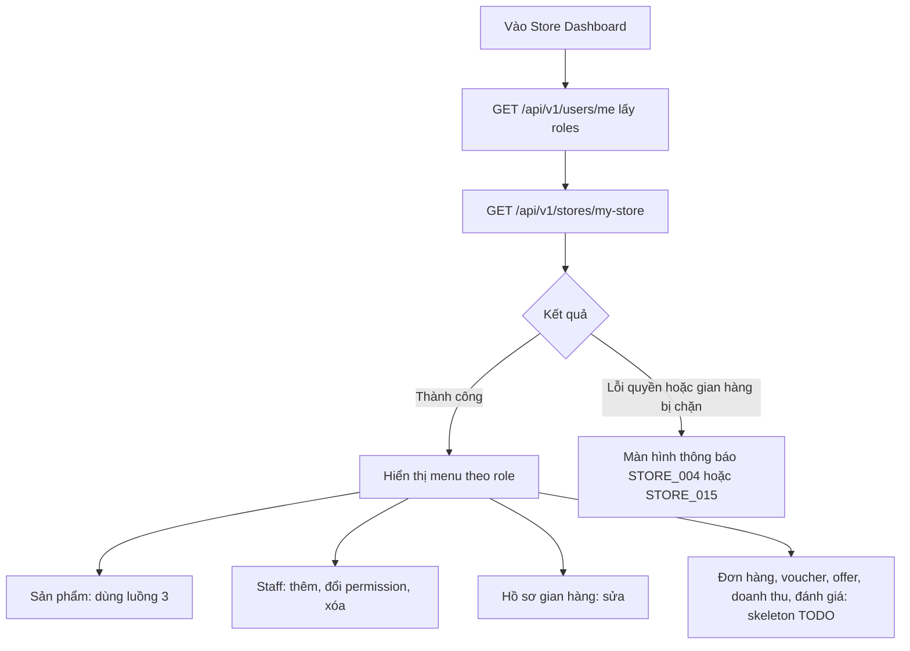

Thêm staff:

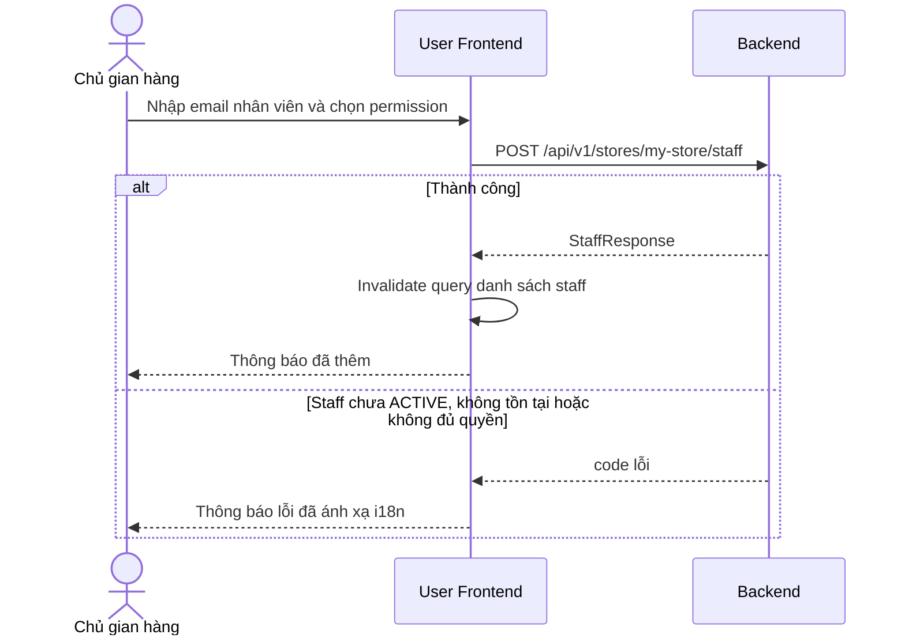

### 10.3 Điểm cần chú ý

1. **Q1:** Frontend không biết được permission code của user hiện tại. `GET /stores/my-store/staff/me` yêu cầu chính `STORE_STAFF_MANAGE`, nên một staff bình thường không dùng được. Giai đoạn đầu chỉ ẩn hiện menu theo **tên role**, và luôn coi `403` là quyết định cuối.
2. **Chưa có endpoint cho biết một staff thuộc gian hàng nào** (doc 14 mục 3.4). Dashboard của staff có thể chưa làm được cho đến khi Backend bổ sung.
3. **Mời staff** là `PLANNED`: hiện chỉ thêm trực tiếp bằng email. Không làm giao diện "gửi lời mời" và "chấp nhận lời mời".
4. Các mục `/store/orders` (Q15), `/store/vouchers`, `/store/offers`, `/store/revenue`, `/store/reviews` chỉ là skeleton. Chi tiết xem doc 04 và doc 05.

---

## 11. Notification

**Trạng thái:** Backend `IN_PROGRESS` (`feature/notification`, `feature/cart`, `integration/demo`). Frontend `NOT_STARTED`.

### 11.1 `[ĐÃ XÁC MINH BACKEND]` (tạm thời)

- `GET /api/v1/notifications?limit&token`, `GET /{id}`, `PATCH /{id}/read`, `DELETE /{id}` (xóa mềm), `PATCH /{id}/restore`.
- Phân trang bằng **cursor**: `NotificationPageResponse { items, nextToken, pageSize }`. `limit` mặc định 20, tối đa 50. `nextToken = null` là hết trang. Token là chuỗi Base64 không được giải mã ở Frontend.
- `type` và `referenceType` là chuỗi tự do, không có enum. ID là chuỗi.
- Các thao tác `PATCH` và `DELETE` trả body rỗng.
- **Không có kênh push** xuống trình duyệt.
- Q13: cờ đã đọc có thể được serialize thành `read` hoặc `isRead`; phải kiểm tra response thật.

### 11.2 Sơ đồ `[ĐỀ XUẤT]`

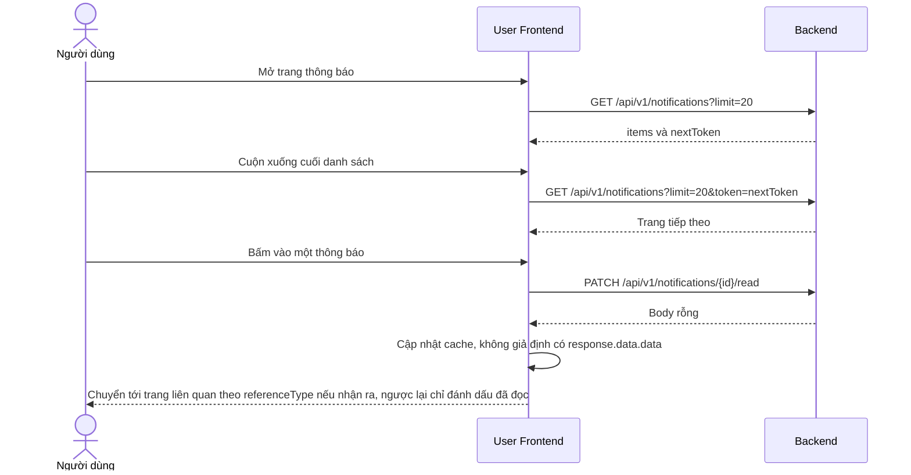

### 11.3 Điểm cần chú ý

- Dùng `useInfiniteQuery` với `getNextPageParam` lấy `nextToken` `[ĐỀ XUẤT]`.
- **Hiển thị dự phòng** cho `type` chưa biết: tiêu đề và nội dung vẫn hiện, bỏ qua icon hoặc điều hướng đặc biệt.
- Vì không có push, cập nhật số thông báo chưa đọc chỉ có thể bằng polling chu kỳ dài hoặc refetch khi cửa sổ lấy lại focus `[ĐỀ XUẤT]`. Chưa có endpoint đếm số chưa đọc trong doc 14, nên số này phải tính từ danh sách đã tải và không được coi là chính xác tuyệt đối.
- Điều hướng theo `referenceType` và `referenceId` chỉ làm khi giá trị đã biết; không đoán.

---

## 12. Chat

**Trạng thái:** Backend `IN_PROGRESS` (bản mới nhất ở `feature/chat`, `68b87cb`; cũng có ở `feature/order`). Frontend `NOT_STARTED`.

### 12.1 `[ĐÃ XÁC MINH BACKEND]` (tạm thời)

- REST: `POST /api/v1/conversations` với `{ targetUserId }` (tạo mới hoặc trả lại hội thoại cũ), `GET /api/v1/conversations` (không phân trang), `GET /api/v1/conversations/{id}/messages?page&size`, `PATCH /api/v1/conversations/{id}/read`.
- Lịch sử tin nhắn: `page` **bắt đầu từ 0**, `size` mặc định **4** (rất nhỏ, B6), trả Spring `Page<MessageResponse>`, tin mới nhất trước.
- WebSocket: STOMP qua SockJS tại `/chat` (trên origin Backend). Frame `CONNECT` phải có header `Authorization: Bearer <accessToken>`.
- Gửi tới `/app/conversations/{conversationId}/send` với `{ type: "TEXT" | "IMAGE" | "FILE", content?, attachmentUrl? }`.
- Nhận tại `/user/queue/messages` (server đẩy cho cả người gửi lẫn người nhận); lỗi tại `/user/queue/errors` với `ChatErrorResponse { errorType, errorMessage, timestamp }`. Payload WebSocket **không** bọc trong `ApiResponse`.
- Token chỉ được kiểm tra lúc CONNECT; chưa biết điều gì xảy ra khi access token (15 phút) hết hạn trên socket đang mở.
- Hội thoại chỉ giữa **hai user**, không gắn offer, order hay product (Q6).

### 12.2 Sơ đồ `[ĐỀ XUẤT]`

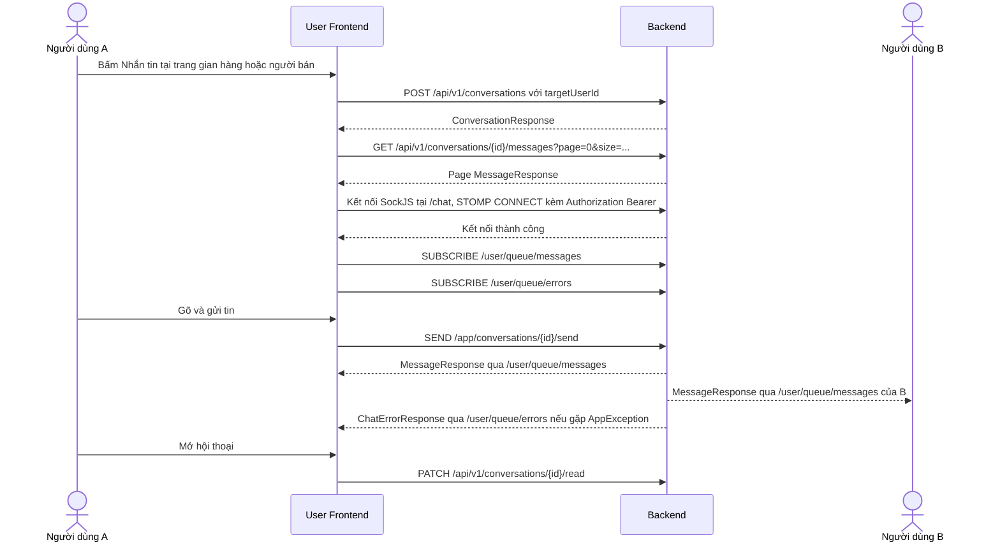

### 12.3 Điểm cần chú ý

1. **Điểm vào chat** (nút "Nhắn tin" nằm ở đâu, lấy `targetUserId` từ đâu) phụ thuộc Q6. Cần xác minh `ProductResponse` và `StoreResponse` có trả `sellerId` hoặc `ownerId` hay không trước khi thiết kế (doc 14 chưa liệt kê).
2. **Phải xử lý `page` bắt đầu từ 0** và `size` tự đặt lớn hơn mặc định, trong khi các danh sách khác bắt đầu từ 1.
3. **Kết nối socket** nên là một module độc lập, chỉ khởi tạo khi đã đăng nhập, và đóng khi đăng xuất `[ĐỀ XUẤT]`.
4. **Token hết hạn khi socket đang mở:** chưa xác minh được hành vi Backend, nên Frontend cần có cơ chế kết nối lại với access token mới khi socket đóng. Đây là việc thiết kế phía Frontend, cần kiểm thử thực tế.
5. **Dev proxy:** `vite.config.js` hiện chỉ proxy `/api`. SockJS dùng `/chat`, nên cần hoặc thêm proxy `/chat` (có `ws: true`), hoặc kết nối thẳng tới `http://localhost:8080/chat` (WebSocket của Backend cho phép mọi origin). Chưa cấu hình, xem doc 12.
6. **Chỉ gửi `type: "TEXT"` ở giai đoạn đầu.** `IMAGE` và `FILE` cần `attachmentUrl` và chưa có cơ chế upload (Q5).

---

## 13. Các luồng chưa có Backend, chỉ ghi nhận

| Tính năng | Trạng thái Backend | Phía Frontend |
|---|---|---|
| Wishlist | `NOT_FOUND` | Skeleton `TODO` |
| Follow gian hàng | `NOT_FOUND` | Skeleton `TODO` |
| Đánh giá người bán, gian hàng | `NOT_FOUND` | Skeleton `TODO` |
| Order phía người bán | `NOT_FOUND` (Q15) | Skeleton `TODO` |
| Thống kê doanh thu | `NOT_FOUND` | Skeleton `TODO` |
| Voucher của người bán | `PLANNED` (chỉ có API admin) | Skeleton `TODO` |
| Upload ảnh | `NOT_FOUND` (Q5) | Chỉ nhập URL https |

---

## Tài liệu liên quan

- [04-ROUTING-AND-PAGES.md](./04-ROUTING-AND-PAGES.md): route, layout, quyền truy cập từng trang.
- [05-PAGE-BY-PAGE-GUIDE.md](./05-PAGE-BY-PAGE-GUIDE.md): chi tiết từng màn hình.
- [07-API-INTEGRATION.md](./07-API-INTEGRATION.md): Axios, xử lý lỗi, phân trang.
- [08-AUTHENTICATION-AND-AUTHORIZATION.md](./08-AUTHENTICATION-AND-AUTHORIZATION.md): token, refresh, 401 và 403.
- [09-STATE-MANAGEMENT.md](./09-STATE-MANAGEMENT.md): TanStack Query, Zustand, query key.
- [13-DEVELOPMENT-ROADMAP.md](./13-DEVELOPMENT-ROADMAP.md): thứ tự triển khai các luồng.
- [14-BACKEND-INTEGRATION-MATRIX.md](./14-BACKEND-INTEGRATION-MATRIX.md): nguồn sự thật về Backend.
