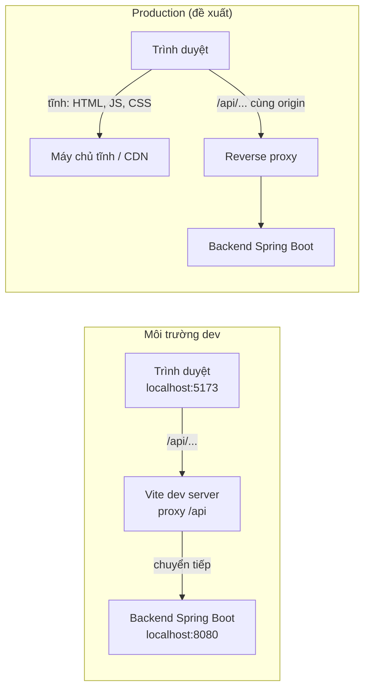

# 12 - Environment and Deployment (Môi trường và triển khai)

- Trạng thái: BẢN NHÁP v0.1
- Cập nhật: 2026-11-08
- Áp dụng cho: Moldy-Market-User-Frontend
- Mục đích: hướng dẫn dựng môi trường dev, giải thích biến môi trường và proxy, quy trình build, và những điều cần chuẩn bị cho production.

Nhãn: `[ĐÃ CẤU HÌNH]` là thứ đã có trong repo; `[ĐÃ XÁC MINH BACKEND]` lấy từ doc 14; `[ĐỀ XUẤT]` là dự kiến, chưa có.

---

## 1. Yêu cầu môi trường `[ĐÃ CẤU HÌNH]`

| Thành phần | Yêu cầu | Ghi chú |
|---|---|---|
| Node.js | `>=22.12.0` (`engines.node`), `.nvmrc` = `22` | Máy của người dùng đang chạy Node 22.20.0 |
| npm | đi kèm Node 22 (đang dùng 10.9.3) | Dùng `npm`, không trộn `yarn` hay `pnpm` để tránh nhiều lockfile |
| Git | bản mới | `.gitattributes` ép EOL là LF |
| Backend | Spring Boot chạy ở `http://localhost:8080` | Cần có để gọi API khi dev |
| IDE | Antigravity (fork VS Code) | `.vscode/settings.json` và `extensions.json` đã cấu hình |

Dùng `nvm` (hoặc công cụ tương đương) và chạy `nvm use` trong thư mục repo để đúng phiên bản Node.

---

## 2. Cài đặt và chạy dev `[ĐÃ CẤU HÌNH]`

```powershell
git clone https://github.com/Chu0701/Moldy-Market-User-Frontend.git
cd Moldy-Market-User-Frontend
npm install
Copy-Item .env.example .env.local
npm run dev
```

Mở địa chỉ Vite in ra (thường `http://localhost:5173`). Nếu sửa `vite.config.js` hoặc `.env.local`, nhớ **lưu file** rồi **khởi động lại** dev server (sự cố từng gặp: file chưa lưu khiến proxy tưởng như không chạy).

### Các lệnh npm

| Lệnh | Tác dụng |
|---|---|
| `npm run dev` | Chạy dev server có HMR và proxy `/api` |
| `npm run build` | Build production ra `dist/` |
| `npm run preview` | Chạy thử bản build (lưu ý: `preview` không dùng proxy dev trừ khi cấu hình riêng) |
| `npm run lint` | ESLint |
| `npm run format` | Prettier ghi đè |
| `npm run format:check` | Prettier chỉ kiểm tra |
| `npm run test` | **Chưa có.** Sẽ thêm khi cấu hình Vitest (mục 8) |

---

## 3. Biến môi trường `[ĐÃ CẤU HÌNH]`

Vite chỉ đưa vào bundle các biến có tiền tố `VITE_`. Biến không có tiền tố chỉ dùng trong `vite.config.js` (phía Node), **không lộ ra trình duyệt**.

| Biến | Dùng ở | Dev | Production |
|---|---|---|---|
| `VITE_API_BASE_URL` | code Frontend (Axios) | để **trống** (gọi cùng origin, đi qua proxy) | URL tuyệt đối của Backend, ví dụ `https://api.example.com`, hoặc để trống nếu cùng origin (xem mục 5) |
| `API_PROXY_TARGET` | `vite.config.js` | `http://localhost:8080` (mặc định nếu bỏ trống) | Không dùng (proxy chỉ có khi chạy dev server) |

Quy tắc:

- `.env.example` được **commit**, chứa tên biến và giá trị mẫu, không chứa bí mật.
- `.env.local` là bản riêng từng máy, **không commit** (`.gitignore` có `*.local`).
- **Không đặt bí mật** (khóa API riêng, mật khẩu) trong biến `VITE_*`, vì mọi thứ trong bundle đều đọc được.
- Thêm biến mới: cập nhật `.env.example` và doc này trong cùng Pull Request.

---

## 4. API base URL và proxy

### 4.1 Vì sao dùng proxy khi dev `[ĐÃ XÁC MINH BACKEND]`

Backend **không cấu hình CORS cho REST** (B1, doc 14 mục 2.4). Nếu trình duyệt ở `localhost:5173` gọi thẳng `localhost:8080`, request bị chặn. Giải pháp khi dev: Vite proxy chuyển tiếp `/api` tới Backend, nên trình duyệt chỉ thấy cùng một origin.

`[ĐÃ CẤU HÌNH]` `vite.config.js`: `server.proxy['/api']` trỏ tới `API_PROXY_TARGET` (mặc định `http://localhost:8080`) với `changeOrigin`. Đã kiểm chứng `GET /api/v1/categories` chạy được qua proxy.

### 4.2 Axios `baseURL`

`[ĐỀ XUẤT]` Axios đọc `import.meta.env.VITE_API_BASE_URL` làm `baseURL` (rỗng khi dev). **Không gắn cứng `/api/v1`** vì Backend có hai prefix `/api/v1/...` và `/api/...` (doc 14 mục 2.3); service dùng đường dẫn đầy đủ. Chi tiết ở doc 07.



---

## 5. Chuẩn bị cho production

### 5.1 Build

`npm run build` tạo `dist/` gồm tệp tĩnh (HTML, JS, CSS, font tự host). Không cần máy chủ Node khi chạy, chỉ cần máy chủ tệp tĩnh. Vì dùng React Router kiểu `createBrowserRouter`, máy chủ phải **trả `index.html` cho mọi đường dẫn không phải tệp** (SPA fallback), nếu không tải lại ở `/products/123` sẽ 404.

### 5.2 CORS và cùng origin (B1)

Proxy của Vite **không tồn tại ở production**. Có hai hướng, cần team quyết định (`[ĐỀ XUẤT]`, chưa chốt):

| Phương án | Mô tả | Đánh đổi |
|---|---|---|
| A. Cùng origin qua reverse proxy | Một tên miền, reverse proxy (Nginx, Caddy, cổng của nền tảng) chuyển `/api` tới Backend, còn lại trả `dist/` | Không cần sửa Backend; `VITE_API_BASE_URL` để trống; cấu hình thêm một lớp hạ tầng |
| B. Khác origin + Backend thêm CORS | Frontend ở tên miền riêng, Backend cấu hình CORS cho REST | Phải sửa Backend (B1); cần danh sách origin được phép; `VITE_API_BASE_URL` là URL tuyệt đối |

Khuyến nghị tạm: phương án A vì không cần thay đổi Backend. Nếu chọn B thì cần báo team Backend.

### 5.3 WebSocket (chat)

`[ĐÃ XÁC MINH BACKEND]` chỉ trên branch chat: STOMP qua SockJS ở `/chat`, WebSocket cho phép mọi origin. Khi làm chat, reverse proxy phải cho phép nâng cấp WebSocket. Đây là `IN_PROGRESS`, chưa làm.

### 5.4 Nền tảng triển khai

**Chưa chốt nền tảng.** Các lựa chọn phổ biến cho tệp tĩnh: dịch vụ hosting tĩnh (Vercel, Netlify, Cloudflare Pages), máy chủ tự quản (Nginx trên VPS), hoặc Docker (một image Nginx phục vụ `dist/`). Tiêu chí chọn: hỗ trợ SPA fallback, biến môi trường lúc build, HTTPS, khả năng reverse proxy `/api`. Đồ án chỉ cần chọn một phương án đơn giản và ghi vào doc này khi đã quyết.

### 5.5 Checklist trước khi triển khai

- [ ] `VITE_API_BASE_URL` đúng cho môi trường (biến được "đóng" vào bundle lúc build, đổi biến phải build lại).
- [ ] Đã quyết phương án CORS hoặc cùng origin (B1).
- [ ] SPA fallback đã bật.
- [ ] HTTPS bật (tránh mixed content khi API là https).
- [ ] Đã đọc lại phần bảo mật token (Q2 chưa chốt, doc 08).
- [ ] Lỗ hổng Backend liên quan (B2, B11) đã được xử lý hoặc chấp nhận có chủ đích.

---

## 6. Vấn đề đã biết (known issues)

| Vấn đề | Chi tiết | Hướng xử lý |
|---|---|---|
| `npm audit` báo mức moderate về `minimatch` | Nằm trong chuỗi ESLint (`devDependencies`), chưa có bản vá upstream | Chấp nhận tạm; không ảnh hưởng bundle production; theo dõi bản cập nhật ESLint |
| File chưa lưu làm proxy/config "không chạy" | Từng gặp với `vite.config.js` | Bật auto-save trong IDE, khởi động lại dev server khi đổi config |
| Tài khoản mới đăng ký không đăng nhập được (B10) | Backend đặt `PENDING_VERIFICATION`, chưa có luồng kích hoạt | Admin chuyển `ACTIVE` khi test (doc 14 mục 3.5) |
| Không có CORS REST (B1) | Chỉ chạy được qua proxy hoặc cùng origin | Xem mục 5.2 |
| Branch Backend lệch nhau (B3, Q12) | Contract của module `IN_PROGRESS` có thể đổi | Chỉ tích hợp khi đã merge vào `main` |

---

## 7. Chạy cùng Backend `[ĐỀ XUẤT]`

1. Chạy Backend (profile local) ở cổng 8080 với database sẵn sàng.
2. Có ít nhất một tài khoản `ACTIVE` (seed hoặc do admin kích hoạt, B10).
3. Chạy `npm run dev`, kiểm tra nhanh `http://localhost:5173/api/v1/categories` trả JSON.
4. Nếu trang chỉ tải lại mà không có phản hồi: kiểm tra Backend có đang chạy, `.env.local`, và đã lưu `vite.config.js` chưa.

---

## 8. CI và test: sắp cấu hình (chưa có)

| Hạng mục | Trạng thái | Kế hoạch |
|---|---|---|
| Vitest + React Testing Library | chưa cấu hình | jsdom, file setup, script `test`; chưa viết test tính năng |
| GitHub Actions CI | chưa cấu hình | các bước: cài đặt, `lint`, `format:check`, `test`, `build`, chạy trên mỗi Pull Request |
| Mẫu Pull Request | chưa có | thêm `.github/pull_request_template.md` |
| Bảo vệ branch `main` | chưa bật | bắt buộc CI xanh và ít nhất một review |
| Playwright E2E | chỉ ghi kế hoạch | cân nhắc sau khi có luồng chính |
| Husky, lint-staged | không dùng | có thể thêm sau |

---

## Tài liệu liên quan

- Doc 02: kiến trúc tổng thể và sơ đồ hệ thống.
- Doc 07: cấu hình Axios và lớp API.
- Doc 08: xác thực, lưu trữ token (Q2).
- Doc 13: roadmap.
- Doc 14: ma trận tích hợp Backend (B1, B2, B10, Q12).
- Doc 15: quy trình đóng góp.
