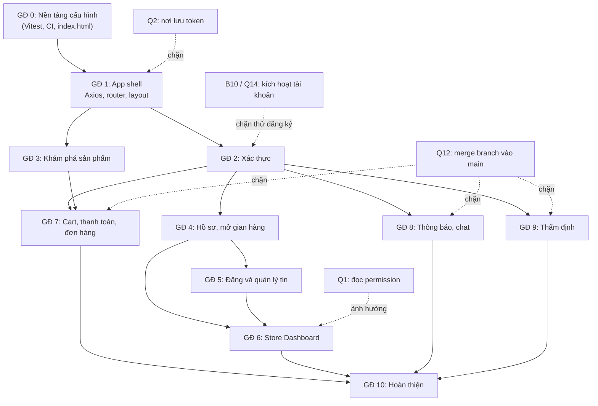

# 13 - Development Roadmap (Lộ trình phát triển)

- Trạng thái: BẢN NHÁP v0.1
- Cập nhật: 2026-11-08
- Áp dụng cho: Moldy-Market-User-Frontend
- Mục đích: sắp xếp thứ tự xây dựng tính năng, chỉ ra phụ thuộc giữa các tính năng và vào Backend, các điểm chặn đã biết, và cột mốc tích hợp.

Đây là **đề xuất** `[ĐỀ XUẤT]`. Hiện tại mọi tính năng Frontend là `NOT_STARTED`, phần công cụ là `FOUNDATION_ONLY`. Danh sách route và trạng thái từng trang nằm ở doc 04 và 05, doc này **không lặp lại** bảng đó, chỉ nhóm chúng thành các giai đoạn. Trạng thái Backend lấy từ doc 14.

---

## 1. Nguyên tắc sắp xếp

1. **Làm trước cái Backend đã có (`IMPLEMENTED` trên `main`)**; cái `IN_PROGRESS` chỉ bắt đầu khi branch đã merge và doc 14 đã cập nhật (Q12).
2. **Nền móng trước, tính năng sau:** Axios, router, providers, layout, auth phải xong trước khi làm trang nghiệp vụ.
3. **Luồng đọc trước luồng ghi:** trang công khai (xem, tìm kiếm) ít rủi ro hơn, kiểm chứng sớm lớp API và design system.
4. **Mỗi giai đoạn kết thúc bằng một cột mốc kiểm tra được** (chạy được với Backend thật, lint và build sạch, docs cập nhật).
5. Tính năng `NOT_FOUND` không có giai đoạn riêng: chỉ để skeleton `TODO` và chờ Backend.

---

## 2. Các giai đoạn

### Giai đoạn 0: Nền tảng cấu hình `FOUNDATION_ONLY`

Đã xong: Vite, Tailwind v4, shadcn (chỉ `button`), alias, proxy, Prettier, ESLint, i18n, design tokens, font, cấu hình Node/EOL/editor, cấu trúc thư mục (người dùng đang tạo thủ công). 

Còn lại (cấu hình, không viết tính năng): Vitest + React Testing Library, metadata `index.html` (lang `vi`, title, favicon), GitHub Actions CI, mẫu Pull Request, bảo vệ branch `main`, đối chiếu hai repo.

Cột mốc: `lint`, `format:check`, `build` sạch; docs 01 đến 15 có bản nháp.

### Giai đoạn 1: Khung ứng dụng (app shell)

Providers (QueryClientProvider...), Axios instance và interceptor, router skeleton, layout (`MainLayout`, `AuthLayout`, `StoreDashboardLayout`), `NotFoundPage`, Logo placeholder, lớp feedback (loading, empty, error), ErrorBoundary. Chọn nơi lưu token **trước khi** viết interceptor (Q2).

Phụ thuộc Backend: không (chỉ cần proxy).
Cột mốc: điều hướng giữa các route rỗng, đổi ngôn ngữ vi/en, một request thử `GET /api/v1/categories` đi qua lớp API chuẩn.

### Giai đoạn 2: Xác thực

Đăng ký, đăng nhập, đăng xuất, refresh token, route bảo vệ, `GET /api/v1/users/me`. Xem doc 08.

Phụ thuộc Backend: Auth `IMPLEMENTED`. **Điểm chặn B10/Q14:** tài khoản mới ở `PENDING_VERIFICATION` chưa đăng nhập được; trong lúc chờ, tài khoản test do admin chuyển `ACTIVE`. Trang đăng ký phải nói rõ với người dùng rằng tài khoản chưa dùng được ngay.
Quyết định cần có trước: Q2 (lưu token), Q1 (cách biết quyền).
Cột mốc: đăng nhập bằng tài khoản `ACTIVE`, tự refresh khi access token hết hạn (15 phút), xử lý đúng `AUTH_007` (thu hồi mọi phiên).

### Giai đoạn 3: Khám phá sản phẩm (công khai)

Trang chủ, danh sách và tìm kiếm (lọc, sắp xếp qua query string), danh mục, chi tiết sản phẩm, trang gian hàng công khai. Xem doc 04, 05.

Phụ thuộc Backend: Category, Product search/detail, Store public `IMPLEMENTED`. Chưa có: follow, đánh giá, wishlist (`NOT_FOUND`); biểu đồ giá, thẩm định (`IN_PROGRESS`, pricing).
Cột mốc: duyệt và tìm kiếm với dữ liệu thật; adapter phân trang đúng dạng `ProductSearchResponse`; URL chia sẻ được.

### Giai đoạn 4: Hồ sơ và mở gian hàng

Xem và sửa hồ sơ, đổi mật khẩu, mở gian hàng (mỗi user một gian hàng).

Phụ thuộc Backend: `IMPLEMENTED`. Doc 14 chưa liệt kê đầy đủ DTO của hồ sơ và gian hàng: cần đọc lại DTO Backend trước khi dựng form (doc 05 đã đánh dấu "chưa audit").
Cột mốc: sửa hồ sơ, mở gian hàng thành công, xử lý lỗi validation.

### Giai đoạn 5: Đăng và quản lý tin

Tạo, sửa, xóa, đổi trạng thái sản phẩm (tin cá nhân và của gian hàng); form nhiều trường với Zod; optimistic locking bằng `version` (`COMMON_010`).

Phụ thuộc Backend: Product CRUD `IMPLEMENTED`. **Điểm chặn Q5:** ảnh chỉ nhận URL https, chưa có cách upload; tạm dùng ô nhập URL. **Câu hỏi mở:** chưa có endpoint đã xác minh để liệt kê riêng "sản phẩm của tôi" (doc 05 đã nêu); với gian hàng có thể dùng search theo `storeId`.
Cột mốc: đăng, sửa, gỡ tin thành công; xử lý 409.

### Giai đoạn 6: Store Dashboard

Layout dashboard, hồ sơ gian hàng, sản phẩm gian hàng, quản lý nhân viên (thêm, danh sách, quyền, xóa).

Phụ thuộc Backend: `IMPLEMENTED`. Mời nhân viên là `PLANNED`. **Điểm chặn Q1:** Frontend không đọc được permission code, nên điều hướng theo quyền chỉ là tạm; `403` là quyết định cuối. Trang tổng quan, đơn hàng, doanh thu, voucher, offer, đánh giá của gian hàng chỉ có skeleton (`NOT_FOUND` hoặc `PLANNED`, Q15).
Cột mốc: chủ gian hàng quản lý sản phẩm và nhân viên qua dashboard.

### Giai đoạn 7: Giỏ hàng, thanh toán, đơn hàng (chờ Backend)

Cart, checkout (bỏ `quantity` theo quyết định team Q17), trang thanh toán QR với polling `paymentStatus`, danh sách và chi tiết đơn hàng, lịch sử thanh toán.

Phụ thuộc Backend: `IN_PROGRESS` (branch `feature/cart`, `feature/order`), **chưa merge** (Q12). Chỉ bắt đầu khi merge vào `main` và doc 14 được cập nhật.
Điểm chặn: B11 (order đọc được bởi bất kỳ user), B12 (order/checkout không đổi trạng thái sau thanh toán), B13 (404 khi chưa có order, Frontend phải xử lý như trạng thái rỗng), B14 (chưa giữ tồn kho), Q15 (luồng trạng thái order đang bàn lại), Q16 (cart và checkout độc lập), Q18 (COD và escrow).
Nguyên tắc cố định: chỉ tin `paymentStatus === "SUCCESSFUL"` từ Backend, không tin status order/checkout group, QR là URL ảnh Backend trả.
Cột mốc: tạo checkout group, hiển thị QR, polling tới khi thành công hoặc hết hạn 15 phút (ONLINE_BANKING).

### Giai đoạn 8: Thông báo và chat (chờ Backend)

Notification (cursor `token`, `useInfiniteQuery`), chat (STOMP qua SockJS, `/user/queue/messages`, `/user/queue/errors`).

Phụ thuộc Backend: `IN_PROGRESS`, chưa merge. Điểm chặn: Q13 (`isRead` serialize thế nào), Q6 (chat không gắn offer/order/product), B5, B6 (chat page bắt đầu từ 0, size mặc định 4).

### Giai đoạn 9: Thẩm định (chờ Backend)

Yêu cầu thẩm định, giao diện appraiser, biểu đồ giá. Phụ thuộc Backend: pricing `IN_PROGRESS`, B2 (thiếu `@PreAuthorize`).

### Giai đoạn 10: Hoàn thiện

Kiểm thử E2E (Playwright, chỉ kế hoạch), tối ưu hiệu năng, trợ năng (accessibility), rà soát bảo mật Frontend, chuẩn bị triển khai (doc 12), cập nhật toàn bộ docs, demo đồ án.

---

## 3. Sơ đồ phụ thuộc

Các giai đoạn 3, 4 có thể làm song song giữa các thành viên sau khi xong giai đoạn 1 và 2. Giai đoạn 7, 8, 9 có thể làm song song với nhau khi Backend đã merge.

---

## 4. Điểm chặn đã biết

| Mã | Nội dung (doc 14) | Ảnh hưởng | Cần ai |
|---|---|---|---|
| Q2 | Chưa chốt nơi lưu token | Interceptor, bảo mật phiên | Team quyết định, có thể cần Backend đổi sang cookie |
| Q1 | Không đọc được permission code | Phân quyền UI chỉ tạm | Backend/team |
| B10, Q14 | Không có luồng kích hoạt tài khoản | Đăng ký chưa dùng được | Team Backend |
| B1 | Không có CORS REST | Triển khai khác origin | Backend hoặc hạ tầng |
| B2 | Thiếu `@PreAuthorize` trên nhiều controller ở branch chưa merge | Rủi ro khi bật tính năng | Backend |
| B11 | Order đọc được bởi bất kỳ user | Lộ dữ liệu | Backend |
| B12 | Order, checkout không đổi trạng thái sau thanh toán | Hiển thị trạng thái đơn | Backend (dự kiến gắn listener) |
| Q5 | Chưa có cách upload ảnh | Form đăng tin | Team quyết định |
| Q12 | Chưa rõ thời điểm merge các branch | Mốc giai đoạn 7 đến 9 | Team |
| Q15, Q16, Q18 | Luồng order, cart, COD đang bàn lại | Giai đoạn 7 | Team |

---

## 5. Danh sách tính năng `PLANNED` hoặc chưa có API

Theo doc 14 mục 4.3: wishlist, follow, đánh giá, offer (thương lượng giá), refund, dispute, thống kê của gian hàng, upload ảnh, mời nhân viên. Các trang tương ứng chỉ là skeleton `TODO`. **Không viết service đoán endpoint.** Khi Backend có API, cập nhật doc 14 trước, rồi mới thêm vào roadmap.

## 6. Cách theo dõi tiến độ

- Mỗi giai đoạn tạo một milestone trên GitHub, mỗi tính năng là một issue gắn nhãn trạng thái Backend.
- Khi hoàn thành, cập nhật cột "Trạng thái Frontend" (`NOT_STARTED`, `FOUNDATION_ONLY`, `INTEGRATED`) trong doc 07 và doc 04.
- Rà soát roadmap mỗi khi doc 14 đổi (đặc biệt khi branch được merge).

---

## Tài liệu liên quan

- Doc 04 và 05: route và trang chi tiết.
- Doc 08: xác thực (Q1, Q2). Doc 10: luồng nghiệp vụ.
- Doc 12: môi trường, CI. Doc 14: ma trận Backend. Doc 15: quy trình làm một tính năng.
