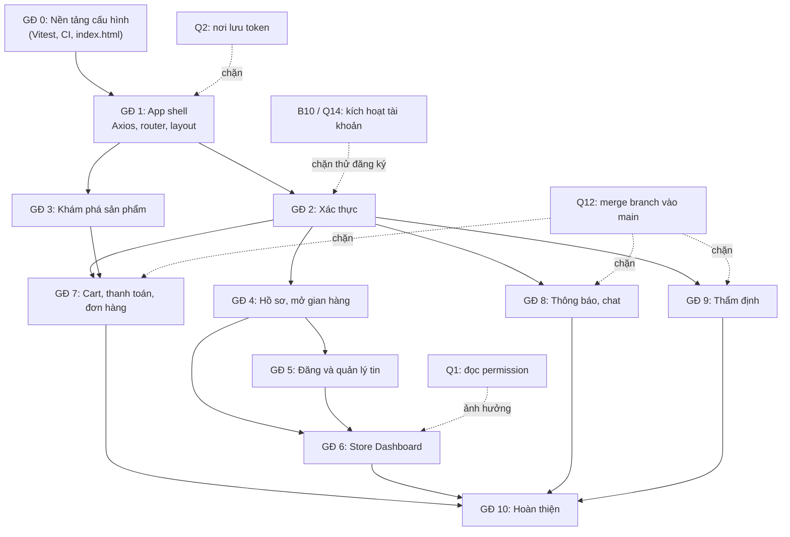

# 13 - Development Roadmap (Lộ trình phát triển)

- Trạng thái: v0.2 (cập nhật 2026-11-22)
- Cập nhật: 2026-11-22
- Áp dụng cho: Moldy-Market-User-Frontend
- Mục đích: sắp xếp thứ tự xây dựng tính năng, theo dõi tiến độ các giai đoạn và các điểm chặn hiện tại.

Danh sách route và trạng thái từng trang nằm ở doc 04 và 05; trạng thái Backend lấy từ doc 14.

---

## 1. Nguyên tắc sắp xếp

1. **Chỉ gọi API đã xác minh contract trong doc 14**; tính năng chưa audit/chưa có API chỉ làm skeleton `TODO`.
2. **Nền móng trước, tính năng sau:** Axios, router, providers, layout, auth trước khi làm nghiệp vụ.
3. **Mỗi giai đoạn kết thúc bằng cột mốc kiểm tra được** (`format:check`, `lint`, `test`, `build` và xác minh thủ công với Backend thật).

---

## 2. Tiến độ các giai đoạn (2026-11-22)

- **Giai đoạn 0 — Nền tảng cấu hình (`DONE`):** Vite, React 19, Tailwind 4, shadcn (`button`), alias, proxy (`/api`, `/chat`), ESLint, Prettier, i18n (`vi`/`en`, 514 keys), Vitest + RTL, `index.html` metadata, GitHub Actions CI, PR template.
- **Giai đoạn 1 — Khung ứng dụng (`DONE`):** `AppProviders`, `queryClient`, `routes.js`, `MainLayout`, `AuthLayout`, `NotFoundPage`, `RouteErrorPage`, `src/services/api/{client,unwrap,ApiError,pagination,authRefreshInterceptor}.js`, `src/lib/tokenStorage.js`, shared `common/` & `feedback/`.
- **Giai đoạn 2 — Xác thực & Email OTP (`DONE` local):** Login, Register, Verify Email OTP, Resend OTP, HttpOnly cookie refresh (`moldy_refresh` + `X-Moldy-Auth: 1`), Logout, `RequireAuth`, `GuestOnly` (`/login`), `useSession` (`['users', 'me']`).
- **Giai đoạn 3 — Khám phá sản phẩm công khai (`DONE` local):** `HomePage` (danh mục `INTEGRATED`), `ProductListPage`, `ProductDetailPage`, `CategoryPage`, `StorePublicPage`.
- **Giai đoạn 4 — Hồ sơ & Mở gian hàng (`DONE` local):** `ProfilePage`, `ProfileEditPage`, `AccountSettingsPage` (đổi mật khẩu), `OpenStorePage`.
- **Giai đoạn 5 — Đăng & Quản lý tin (`DONE` local):** `MyProductsPage`, `ProductCreatePage`, `ProductEditPage` (có `version` optimistic lock `409 COMMON_010`, ẩn/hiện, xóa).
- **Giai đoạn 6 — Quản lý gian hàng (`DONE` local):** `StoreOverviewPage`, `StoreProfilePage`, `StoreProductsPage`, `StoreStaffPage`, `StoreOrdersPage` (chủ shop xác nhận COD; staff phân quyền theo `/stores/my-store/staff/me`). *(Chưa tách `StoreDashboardLayout` riêng, đang dùng `MainLayout`).*
- **Giai đoạn 7 — Giỏ hàng, Checkout, Thanh toán & Đơn mua (`DONE` local):** `CartPage` (qty=1), `CheckoutPage`, `CheckoutPaymentPage` (SePay QR polling + COD + hủy đơn), `OrderListPage`, `OrderDetailPage`.
- **Giai đoạn 8 — Chat Realtime & Thông báo (`PARTIALLY_DONE`):**
  - Chat (`DONE` local): `ChatPage`, STOMP/SockJS tại `MainLayout`, gửi/nhận TEXT, chính sách chặn staff–owner cùng shop, bounded read cursors + `/user/queue/chat-reads`, badge chưa đọc.
  - Notifications (`NOT_STARTED`): `/api/v1/notifications` (DynamoDB cursor) đã có trên Backend `main`, chờ nối UI.
- **Giai đoạn 9 — Không gian Thẩm định (`NOT_STARTED`):** Triển khai theo `HANDOFF-APPRAISER-FRONTEND.md` sau khi HTTP/security audit bộ 6 controller `/api/v1/appraisal-*/**`.
- **Giai đoạn 10 — Hoàn thiện (`IN_PROGRESS`):** 49 test files / 449 tests pass, `lint` & `build` pass. Cần dọn 6 component đang gọi trực tiếp `@/services/` (tách qua feature hooks), xác minh UI thủ công các flow chat/store-orders, và hoàn thiện E2E/triển khai.

---

## 3. Sơ đồ phụ thuộc

Các giai đoạn 3, 4 có thể làm song song giữa các thành viên sau khi xong giai đoạn 1 và 2. Giai đoạn 7, 8, 9 có thể làm song song với nhau khi Backend đã merge.

---

## 4. Điểm chặn đã biết & trạng thái (2026-11-22)

| Mã | Nội dung (doc 14) | Trạng thái | Ghi chú |
|---|---|---|---|
| Q2 | Lưu access token `localStorage` (`tokenStorage.js`), refresh token HttpOnly cookie `moldy_refresh` + `X-Moldy-Auth: 1` | **ĐÃ CHỐT & TRIỂN KHAI** | Xem doc 08 & Handoff 2026-11-21 |
| Q1 | `/users/me` trả `roles`, `permissions`, `storeId`; quyền shop của staff lấy từ `/stores/my-store/staff/me` | **ĐÃ GIẢI QUYẾT** | Không suy quyền shop từ `/users/me` |
| B10, Q14 | Kích hoạt tài khoản qua Email OTP (`/verify-email`) | **ĐÃ GIẢI QUYẾT** | Admin không được bypass OTP |
| B11, B12, B14 | Bảo vệ quyền xem order, cập nhật order/checkout sau thanh toán, giữ chỗ reservation 15 phút | **ĐÃ SỬA LOCAL** | Nhánh `codex/selective-checkout-integration` |
| B1 | CORS cho REST | **ĐÃ CẤU HÌNH MỘT PHẦN** | `SecurityConfig` đã có CORS `/api/**`, nhưng cần bổ sung `allowCredentials(true)` và `X-Moldy-Auth` nếu deploy cross-origin |
| B2 | Thiếu `@PreAuthorize` | **CÒN MỞ TRÊN WALLET/ESCROW/WITHDRAWAL** | Đã sửa trên Voucher, Pricing, AdminAppraiser, Admin Order |
| B13 | `GET /api/v1/orders/me` trả 404 `ORDER_003` khi rỗng | **CÒN MỞ** | User FE đã bắt 404 và chuyển thành `[]` |
| Q5 | Upload ảnh sản phẩm | **CÒN MỞ CHO UI** | Backend đã có `FileController` (`/api/v1/files/**`, RAW JSON), UI sản phẩm vẫn nhập URL HTTPS |
| Appraisal | Quy trình thẩm định 6 bước mới + `AppraisalConversationService` placeholder | **CẦN AUDIT** | Xem `HANDOFF-APPRAISER-FRONTEND.md` |

---

## 5. Danh sách tính năng `PLANNED` hoặc chưa có API

Theo doc 14 mục 4.3: wishlist, follow, đánh giá, offer (thương lượng giá), refund, dispute, thống kê của gian hàng, upload ảnh, mời nhân viên. Các trang tương ứng chỉ là skeleton `TODO`. **Không viết service đoán endpoint.** Khi Backend có API, cập nhật doc 14 trước, rồi mới thêm vào roadmap.

## 6. Cách theo dõi tiến độ

- Mỗi giai đoạn tạo một milestone trên GitHub, mỗi tính năng là một issue gắn nhãn trạng thái Backend.
- Khi hoàn thành, cập nhật cột "Trạng thái Frontend" (`NOT_STARTED`, `FOUNDATION_ONLY`, `INTEGRATED`) trong doc 07 và doc 04.
- Rà soát roadmap mỗi khi doc 14 đổi (đặc biệt khi branch được merge).

---

## Tài liệu liên quan

- Doc 04 và 05: route và trang chi tiết.
- Doc 08: xác thực (Q1, Q2). Doc 10: luồng nghiệp vụ.
- Doc 12: môi trường, CI. Doc 14: ma trận Backend. Doc 15: quy trình làm một tính năng.
