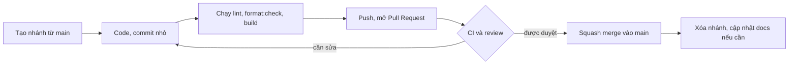
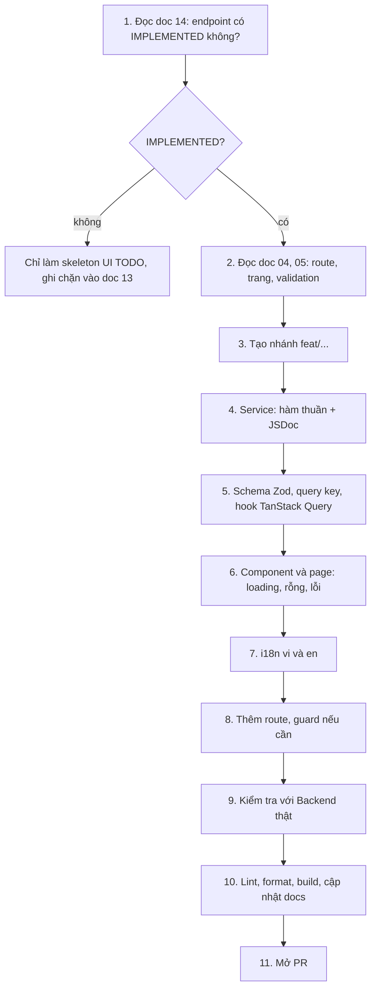

# 15 - Contributing (Hướng dẫn đóng góp)

- Trạng thái: BẢN NHÁP v0.1
- Cập nhật: 2026-11-08
- Áp dụng cho: Moldy-Market-User-Frontend
- Mục đích: quy trình làm việc chung của team: cài repo, đặt tên nhánh, commit, Pull Request, review, và cách làm một tính năng từ đầu đến cuối.

Nhãn: `[ĐÃ CẤU HÌNH]` có sẵn trong repo; `[ĐỀ XUẤT]` là quy trình team cần đồng ý (mẫu PR, CI, bảo vệ branch chưa cấu hình).

---

## 1. Cài đặt repo `[ĐÃ CẤU HÌNH]`

```powershell
git clone https://github.com/Chu0701/Moldy-Market-User-Frontend.git
cd Moldy-Market-User-Frontend
nvm use          # Node 22 theo .nvmrc
npm install
Copy-Item .env.example .env.local
npm run dev
```

Cài các extension IDE được gợi ý trong `.vscode/extensions.json` (Prettier, ESLint). Chi tiết biến môi trường, proxy và Backend: doc 12. Cần Backend chạy ở cổng 8080 và một tài khoản `ACTIVE` (B10).

---

## 2. Nhánh (branch) `[ĐỀ XUẤT]`

- Nhánh mặc định `main`. **Không commit trực tiếp lên `main`.**
- Tạo nhánh từ `main` mới nhất. Tên nhánh: `<loại>/<mô-tả-ngắn-kebab-case>`.

| Loại | Dùng cho | Ví dụ |
|---|---|---|
| `feat/` | tính năng mới | `feat/product-search-page` |
| `fix/` | sửa lỗi | `fix/login-redirect-loop` |
| `docs/` | chỉ sửa tài liệu | `docs/update-api-matrix` |
| `chore/` | cấu hình, phụ thuộc | `chore/add-vitest` |
| `refactor/` | tái cấu trúc không đổi hành vi | `refactor/split-product-card` |
| `test/` | thêm hoặc sửa test | `test/login-form` |

Nhánh sống ngắn (vài ngày). Việc lớn chia thành nhiều nhánh nhỏ.

---

## 3. Commit `[ĐỀ XUẤT]`

Dùng Conventional Commits: `<loại>: <mô tả ngắn, thể mệnh lệnh, tiếng Anh>`.

```text
feat: add product search page
fix: handle 409 conflict when updating product
docs: document checkout flow
chore: add base folder structure
refactor: extract pagination adapter
test: add login form tests
```

Quy tắc: một commit một thay đổi logic; thông điệp mô tả **vì sao** khi không hiển nhiên; không commit `.env.local`, `dist/`, code bị comment bỏ; chạy `lint` và `format:check` trước khi commit.

---

## 4. Pull Request `[ĐỀ XUẤT]`



Mô tả PR gồm: **làm gì và vì sao**, ảnh chụp màn hình nếu có đổi giao diện, endpoint nào được dùng (kèm trạng thái trong doc 14), cách kiểm tra, và cập nhật docs nào.

Checklist trong PR:

- [ ] `npm run lint`, `npm run format:check`, `npm run build` sạch.
- [ ] Endpoint dùng có trong doc 14 và `IMPLEMENTED`.
- [ ] Có loading, rỗng, lỗi; chuỗi qua i18n (`vi` và `en`).
- [ ] Không có `console.log`, code chết.
- [ ] Đã cập nhật docs liên quan trong **cùng PR** (mục 7).

Kích thước: PR nhỏ (dưới khoảng 400 dòng thay đổi có ý nghĩa) để review nhanh. Mẫu PR (`.github/pull_request_template.md`) và CI sẽ thêm ở bước cấu hình tiếp theo (doc 12).

---

## 5. Review

- Mỗi PR cần ít nhất một người khác duyệt (sẽ bật luật bảo vệ `main`).
- Người review kiểm tra: đúng ranh giới lớp (component, hook, service), không gọi Axios trong component, không lưu dữ liệu API vào Zustand, không bịa endpoint, xử lý lỗi, trợ năng cơ bản, tên gọi, docs.
- Nhận xét cụ thể, lịch sự, tách "bắt buộc sửa" và "gợi ý". Người viết trả lời hoặc sửa rồi báo lại; người review là người đóng thread.
- Không merge khi CI đỏ (khi đã có CI).

---

## 6. Xử lý conflict

1. Cập nhật nhánh `main` về máy: `git fetch origin`.
2. Nhánh của bạn: `git rebase origin/main` (hoặc `git merge origin/main` nếu team thống nhất dùng merge).
3. Gặp conflict: mở từng file, giữ cả hai ý khi cần, **đừng chọn bừa một phía**. Chạy lại `npm run lint`, `npm run build`, thử chạy ứng dụng.
4. Với `package-lock.json`: không sửa tay; lấy bản của `main`, chạy lại `npm install`, commit.
5. Sau khi rebase phải `git push --force-with-lease` (không dùng `--force` trần). Chỉ làm trên nhánh của mình.
6. Conflict khó hoặc liên quan docs 14: hỏi tác giả đoạn đó.

---

## 7. Cập nhật docs cùng PR `[ĐỀ XUẤT]`

Tài liệu là một phần của sản phẩm. Thay đổi nào dưới đây **bắt buộc** đi kèm cập nhật docs:

| Thay đổi | Doc cần cập nhật |
|---|---|
| Thêm hoặc đổi route, trang | 04, 05 |
| Thêm service, hook, đổi dạng gọi API | 07, 14 (nếu phát hiện lệch contract) |
| Đổi cấu trúc thư mục, component dùng chung | 02, 06 |
| Đổi token màu, font, component UI | 03 |
| Đổi cách xác thực, phân quyền | 08 |
| Đổi state, query key | 09 |
| Thêm biến môi trường, script, CI | 12 |
| Hoàn thành một tính năng | 04, 07 (trạng thái Frontend), 13 |

Khi Backend thay đổi (branch được merge, endpoint đổi): **cập nhật doc 14 trước**, rồi mới sửa code. Đổi nhãn trạng thái đúng bộ `IMPLEMENTED`, `PARTIALLY_IMPLEMENTED`, `IN_PROGRESS`, `PLANNED`, `NOT_FOUND`, `REQUIRES_BUSINESS_CLARIFICATION`.

---

## 8. Quy trình làm một tính năng từ đầu đến cuối `[ĐỀ XUẤT]`



Ghi chú từng bước:

1. **Kiểm tra Backend trước.** Nếu doc 14 không có hoặc không `IMPLEMENTED`, dừng ở skeleton. Nếu thiếu thông tin DTO (ví dụ hồ sơ, gian hàng), đọc DTO ở Backend và bổ sung doc 14, đừng đoán.
2. **Tuân thủ validation thật** của Backend (ví dụ mật khẩu 8 đến 100 ký tự, tiêu đề sản phẩm tối đa 150) khi viết schema Zod.
3. **Chỉ viết service cho endpoint `IMPLEMENTED`.** Không viết hàm "để sẵn" cho endpoint chưa có.
4. Tầng nào làm việc đó (doc 02, 06): service gọi API, hook dùng TanStack Query, component chỉ hiển thị.
5. Tính năng liên quan thanh toán: không bao giờ tự tuyên bố thành công, chỉ tin `paymentStatus` từ Backend (doc 10).
6. Test thủ công các nhánh: thành công, rỗng, lỗi mạng, 401, 403, 409 nếu liên quan.

---

## 9. Những điều không làm

- Không viết endpoint, DTO, enum, quyền hay quy tắc nghiệp vụ mà doc 14 không có.
- Không sửa tay `src/components/ui/*`.
- Không commit bí mật hoặc `.env.local`.
- Không tắt rule ESLint để "cho qua" mà không ghi lý do.
- Không trộn thay đổi cấu hình, refactor và tính năng trong một PR.

## 10. Hỏi và báo vấn đề

- Câu hỏi về Backend: ghi vào mục câu hỏi mở (doc 14 mục 7) và nhắn team Backend; đừng tự đoán.
- Lỗi hoặc thiếu sót Backend: ghi vào mục vấn đề (doc 14 mục 6) kèm cách tái hiện.
- Lỗi Frontend: tạo issue GitHub có bước tái hiện, kết quả mong đợi, kết quả thực tế.

---

## Tài liệu liên quan

- Doc 02, 06: kiến trúc và ranh giới lớp. Doc 07: API. Doc 11: quy ước code.
- Doc 12: môi trường, CI. Doc 13: roadmap. Doc 14: ma trận Backend.
